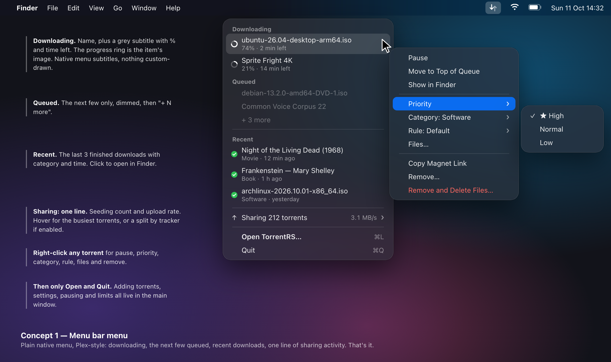
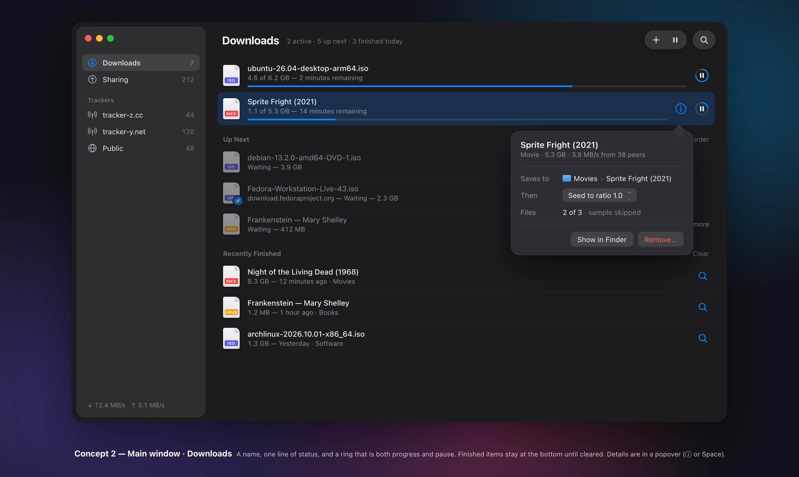
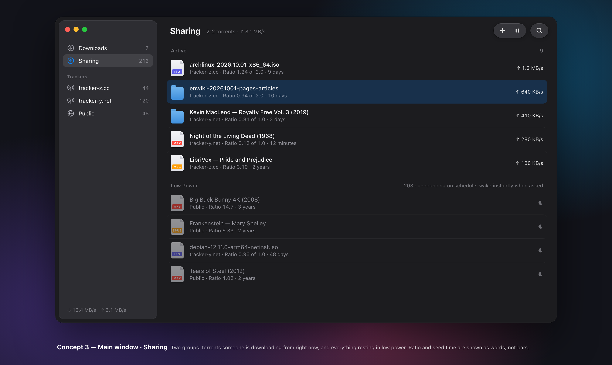
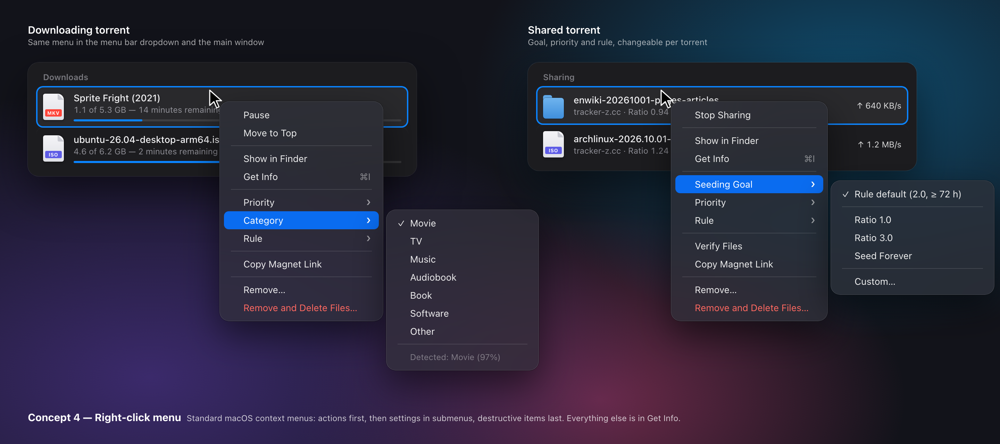
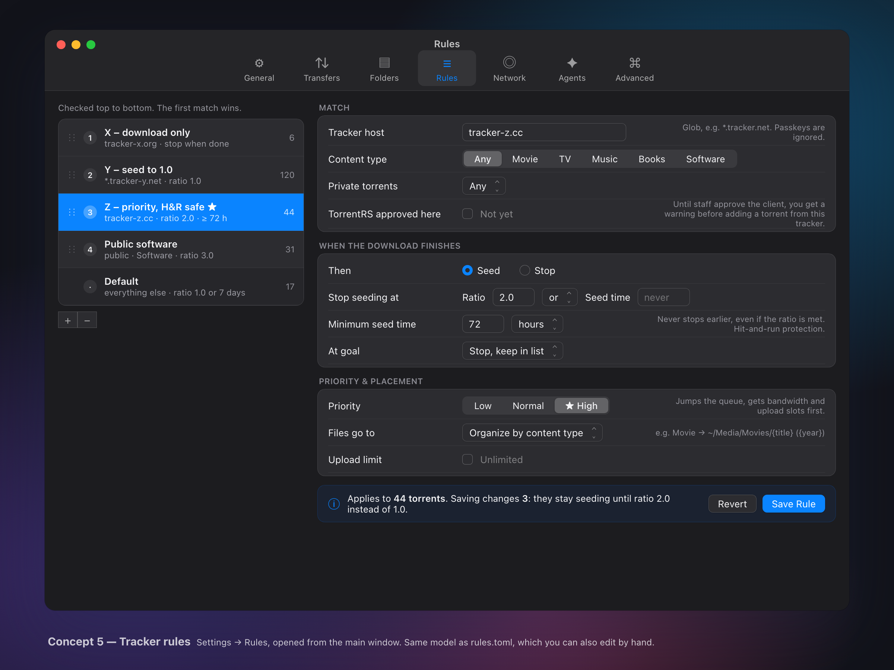
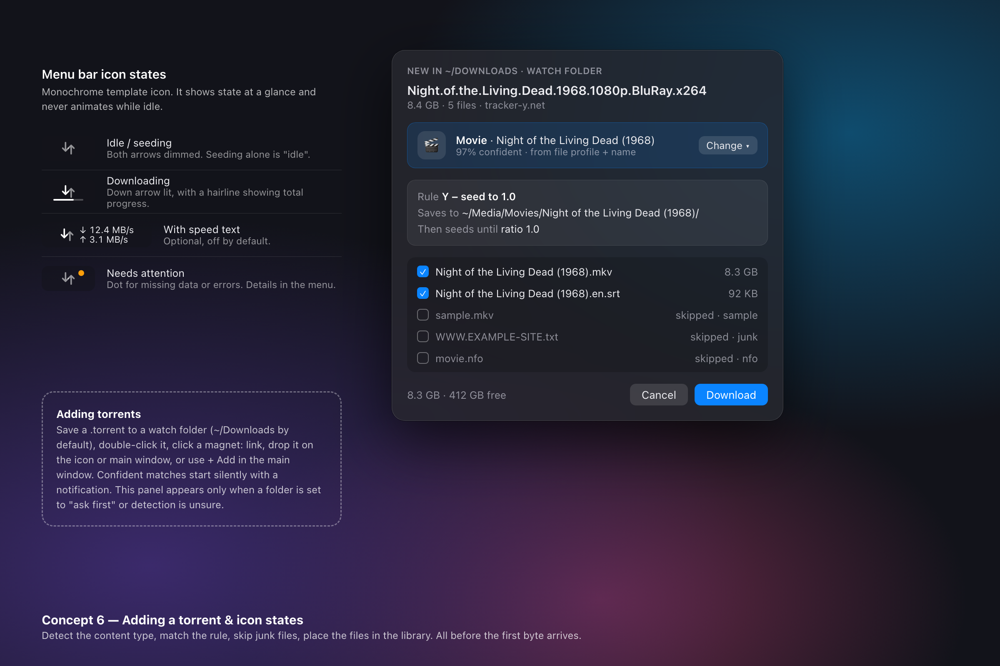
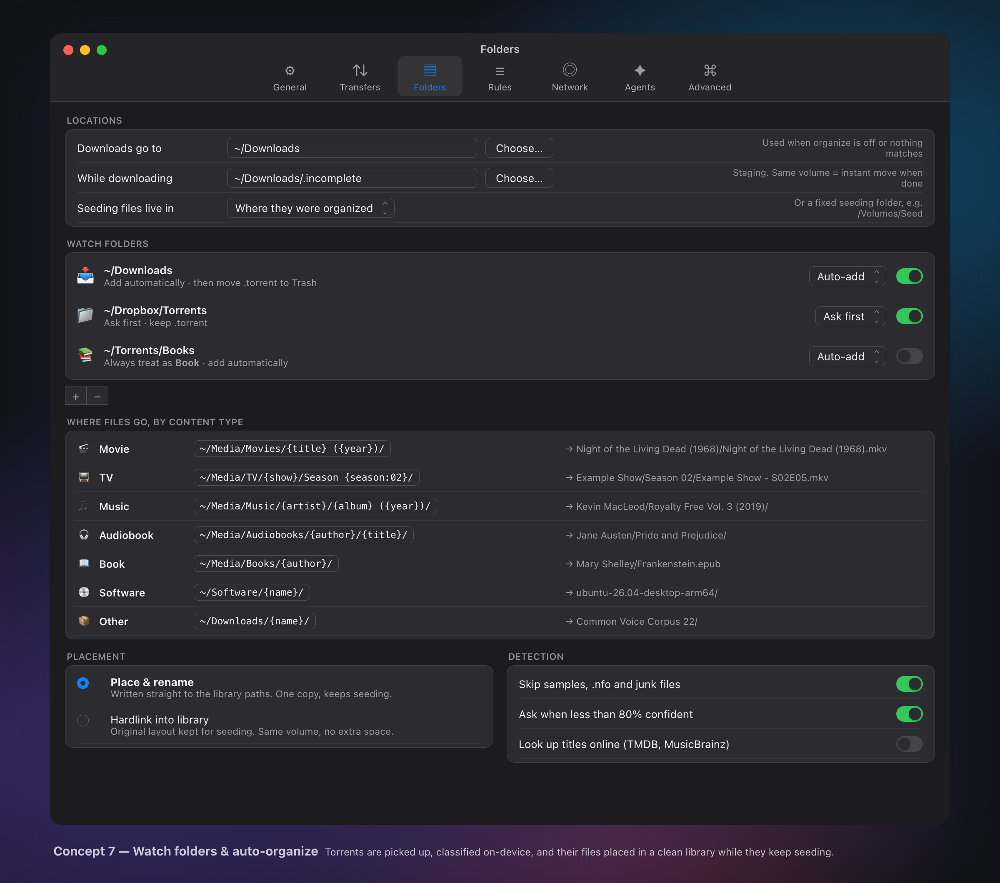
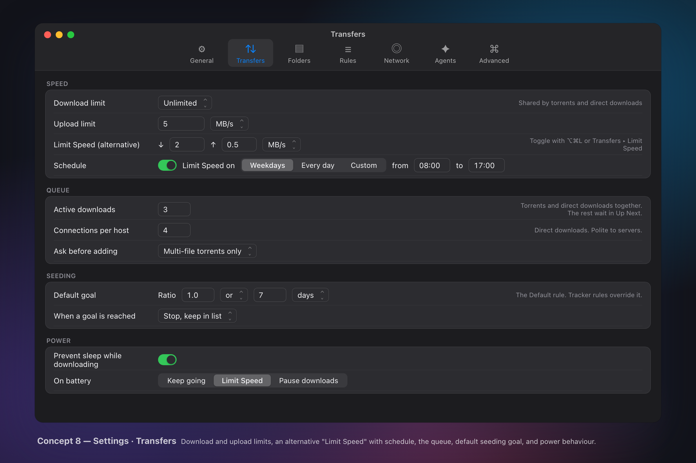
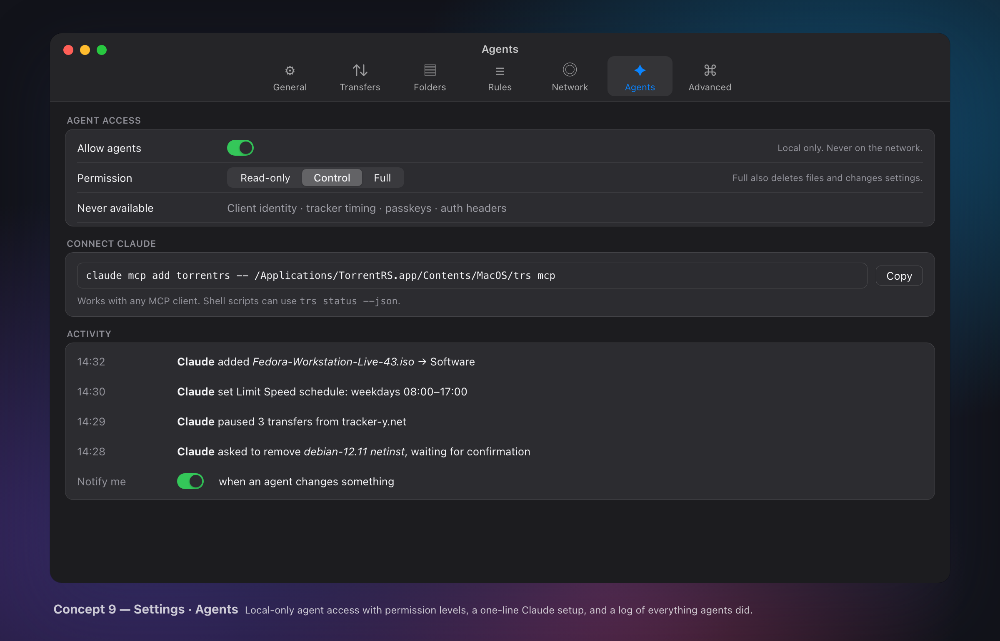
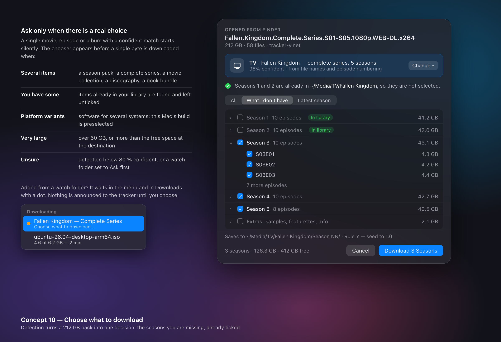

# Seedwell — Spec Sheet (draft v0.1)

> Status: **draft for discussion**. Items marked **[DECIDE]** are open questions.
> Working name: Seedwell.

## 0. Concept images

Target look and feel. **Dark mode is the primary design**; light mode follows the system. Mockups live in `docs/concepts/src/*.html`; re-render with `docs/concepts/render.sh`.

| | |
|---|---|
|  **1 · Menu bar menu** (§8.2) |  **2 · Main window: Downloads** (§8.3) |
|  **3 · Main window: Sharing** (§8.3) |  **4 · Right-click menus** (§8.5) |
|  **5 · Tracker rules** (§7) |  **6 · Add panel & icon states** (§7A, §8.1) |
|  **7 · Settings: Folders** (§7A, §8.4) |  **8 · Settings: Transfers** (§8.4) |
|  **9 · Settings: Agents** (§9A) |  **10 · Choose what to download** (§7A.6) |

## 1. Product statement

A macOS menu bar BitTorrent client that downloads fast, seeds hundreds of torrents
at near-zero cost, and decides what to do after a download finishes based on the
torrent's tracker. It does one thing: move torrent data well.

### Goals
1. **Mac native.** Menu bar app (no Dock icon), AppKit/SwiftUI UI, system notifications, launch at login, `.torrent` and `magnet:` handling.
2. **Fast to run.** Instant startup, ~0% CPU when idle, "Low" energy impact in Activity Monitor.
3. **Fast to download.** Saturate a gigabit line on Apple Silicon.
4. **Low memory.** 200 seeding torrents cost roughly the same as 2.
5. **Downloads clearly visible; seeding in its own area.**
6. **Tracker-based rules** decide seeding goals, priority and placement.
7. **Private-tracker compliant out of the box.** Honest identity, exact stats, gentle announces; one release channel, correctness enforced by tests (§7B).
8. **Agent-operable.** A local agent interface (the `seedwell` command line and an embedded Agent Skill) lets agents like Claude do anything the UI can, safely (§9A).
9. **Direct downloads.** Large HTTP/HTTPS files get the same pause/resume/throttle/queue treatment as torrents (§7D).
10. **Play while downloading.** A video can be watched in VLC, IINA or QuickTime before it finishes, with a working timeline; dragging it fetches that part first (§7F).
11. **Folder sync.** Folders kept the same on the user's devices and shared by invitation link, with roles (owner, admin, read & write, read only), peer to peer over the LAN and the Internet, with no account and no servers (§7G).

### Non-goals (deliberately excluded)
Spoofing another client's identity, stat/ratio manipulation, network-exposed remote control (agent access is local-only), RSS feeds, torrent search, a built-in media player (streaming to the user's own player is in scope, §7F), web UI, plugin system, built-in
browser, torrent creation, skins/themes, statistics dashboards. Adding any of these
needs a spec change.

## 2. Performance budgets

These are acceptance criteria. Every milestone is measured against them.

| Metric | Target | How measured |
|---|---|---|
| Cold start to menu icon, 200 torrents loaded | < 300 ms, **no rehash** | launch timing |
| Memory: 200 seeding, ~50 peers, window closed | **≤ 50 MB** total `phys_footprint` (engine ≤ 25 MB) | `footprint`, Activity Monitor |
| Memory: cost of one more idle seeding torrent | ≤ 4 KB resident | 2 vs 200 torrent diff |
| Memory: downloading at full speed | ≤ 150 MB incl. write cache (configurable) | `footprint` |
| Download throughput | ≥ 1 Gbit/s sustained on M-series, < 1 CPU core | local swarm benchmark |
| Idle CPU (seeding, no requests) | ~0%, ≤ 1 wakeup/s average | `powermetrics`, Activity Monitor |
| Main window, 1,000 torrents | 60 fps scroll, opens < 150 ms | Instruments |
| Main window closed | its memory is released | `footprint` before/after |
| 30-day soak, 200+ torrents | memory flat (±5%), zero crashes, zero lost counters | soak rig (§5A) |
| Cold → serving first block | < 50 ms | local swarm benchmark |

## 3. Architecture

```
┌─────────────────────────── Seedwell.app ───────────────────────────┐
│  Swift shell (AppKit + SwiftUI)                                     │
│   • NSStatusItem + menu   • Main window   • Settings window         │
│   • Notifications, login item, URL/file handlers                    │
│                 ▲ snapshots / events      │ commands                │
│                 │        (UniFFI bridge)  ▼                         │
│  Rust core (static lib)                                             │
│   session ─ torrents ─ peers ─ piece picker ─ choker                │
│   storage (disk I/O pool, write cache, fd cache)                    │
│   trackers (HTTP/UDP) ─ DHT ─ PEX ─ LSD ─ uTP ─ NAT-PMP/UPnP        │
│   rules engine ─ queue manager ─ persistence                        │
└─────────────────────────────────────────────────────────────────────┘
```

### 3.1 Rust core + thin Swift shell (recommended)
- **Core:** Rust, `tokio` runtime (kqueue). All torrent logic, state and persistence live here. The core has no UI knowledge.
- **Shell:** Swift. AppKit `NSStatusItem`/`NSMenu` for the menu bar; SwiftUI (with AppKit `NSTableView` where SwiftUI's `Table` is too slow) for the windows.
- **Bridge:** UniFFI, generating Swift bindings. The UI **pulls** compact snapshots only while something is visible (menu open, window open). When nothing is visible the UI costs nothing and the core sends only events (completed, error).
- **One process.** No separate daemon in v1: lower memory and simpler. The core API is kept clean enough to split into a `launchd` agent later if remote/CLI control is ever wanted.
- **One control API.** The menu, main window, `trs` CLI and agent interface (§9A) all use the same typed, versioned command API in the core. Anything one can do, the others can too. Nothing can change client identity or compliance behaviour (§7B).
- **`trs` CLI** ships inside the app bundle. It also runs the core headless for benchmarks and tests.

*Rejected alternatives:* Tauri/Electron (webview costs 50–150 MB and doesn't look native). Pure-Rust AppKit via `objc2` would work for the menu but makes the table window much harder for little gain.

### 3.2 Engine source **[DECIDE]**
- **A. Own engine from scratch** (recommended). We control the memory model ("parked" torrents, §5), the disk path and the scheduler. This is the most work. Small, well-defined crates (bencode, SHA, maybe DHT) are reused where they fit.
- **B. Build on `librqbit`.** Faster to a first download, but we inherit its architecture, and the parked-torrent memory model may need deep changes.
- Proposed: spend about a week in M1 reading librqbit's crates, then commit to A while borrowing pieces where they fit.

### 3.3 Workspace layout
```
crates/
  bencode/     zero-copy bencode
  proto/       metainfo (v1/v2/hybrid), peer wire, extensions, tracker codecs
  dht/         Kademlia DHT (BEP 5)
  utp/         uTP / LEDBAT (BEP 29)
  engine/      session, torrent, peer, picker, choker, storage, queue
  rules/       rule matching + evaluation (pure, unit-testable)
  ffi/         UniFFI surface
  cli/         dev/benchmark harness
app/           Xcode project (Swift shell)
bench/         local swarm + memory benchmarks
```

## 4. Protocol scope

**v1 (required):** BEP 3 (core), 5 (DHT), 6 (Fast), 7 (IPv6), 9 (magnet metadata),
10 (extension protocol), 11 (PEX), 12 (multitracker), 14 (LSD), 15 (UDP tracker),
23 (compact peers), 27 (private: DHT/PEX/LSD off), 29 (uTP), MSE/PE encryption
(prefer/require/off), UPnP-IGD + NAT-PMP/PCP port mapping.

**Folder sync (§7G):** Seedwell Sync v1, our own protocol with Syncthing's sync rules (index exchange by sequence, version vectors, content-defined chunks), over TLS 1.3 on TCP and uTP; discovery on the LAN, the Mainline DHT (rotating topics) and peer exchange. Not wire-compatible with Syncthing or Resilio.

**v1.x:** BEP 52 (v2 + hybrid torrents), BEP 47 (padding files), BEP 19 (web seeds).

**Never:** super-seeding, tracker scraping of unrelated torrents, torrent creation.

## 5. Low power mode for idle torrents

The key idea: a seeding torrent nobody is downloading from goes into **low power mode**. There it is a few hundred bytes of state plus an announce timer. Memory, CPU, sockets and upload slots go to the torrents peers are actually asking for.

### 5.1 Power tiers (demand-driven, automatic)
| Tier | What's resident | Enters when | Leaves when |
|---|---|---|---|
| **Cold** (low power) | info-hash, name, save path, size, counters, tracker URLs + next announce, rule id | no peer interest for N min (default 10) | a peer connects and sends `interested` |
| **Warm** | + file table (piece → file mapping), fds via shared LRU, a few peer connections | a peer is interested | interest stops → back to Cold after N min |
| **Hot** | + piece bitfield, piece hashes, picker, full peer set | downloading, verifying, or high demand | done / demand falls |

- A cold torrent still **announces at the tracker's required interval**. Skipping announces would drop it from the swarm, and private trackers would stop crediting seed time. Each announce is one small request, so this is cheap.
- For public torrents, a cold torrent announces to the DHT on a slower cycle.
- **Promotion is fast.** Cold → Warm happens in milliseconds, because it only loads the file table from the stored `.torrent`. A peer never notices that a torrent was asleep.
- **Upload slots and bandwidth follow demand.** The choker spends upload capacity across the torrents with the most interested peers and real throughput, weighted by rule priority (§7.3). A popular torrent gets served first; 190 cold ones cost nothing.
- Seeding torrents don't need piece hashes or a bitfield (they're complete), so neither is held outside the Hot tier.

### 5.2 Memory mechanics
- **Peer connections** are capped globally (default 200) and per torrent (default 50). Each peer has small fixed buffers; 16 KiB blocks come from a shared slab pool.
- **Reads while seeding** go through `pread` and the OS unified buffer cache, which doesn't count against our footprint. There is no app-level read cache.
- **Writes while downloading** go to a bounded write cache (default 32 MB) and are flushed per completed piece after hash verification.
- **Worker threads exist only while there is work.** The disk I/O, hashing and maintenance pools start a thread when a job finds more queued work than idle workers (up to 4, one per performance core, and 3) and a thread that waits 30 s for a job exits; the three document watchers (config, rules, trackers) share one polling thread. A seeding engine nobody is reading from has none of them (each is about 30 KiB of resident stack). The write-cache default is 32 MB: with the 64 MB it had in the settings file, a full-speed local download peaked at about 88 MB; with 32 MB at about 55 MB and 16 MB at about 37 MB, at the same throughput. Existing settings files keep their value.
- **The status item and the menu pop-up window are pinned to sRGB** like every other window: on a wide-gamut display macOS otherwise builds a set of ColorSync tone-curve tables (272 KB each, 15 at launch, 33 with the menu open) for them. Measured: 3 and 9. A bare AppKit status item app is itself about 10 MB; the engine adds almost nothing at idle (5.3 MB headless with 1 or 300 resumed torrents), and an opened-then-closed main window leaves about 12 MB of SwiftUI/AppKit framework state behind that no allocator call returns.
- **File descriptors:** shared LRU cache (default 512). `RLIMIT_NOFILE` is raised at startup, because the macOS default of 256 is too low.
- **Announces** are spread out, with jitter, so 200 torrents don't wake up at once. Timers use one hierarchical wheel and macOS timer coalescing.

## 5A. Long-term stability: seed for years

It must be safe to leave a torrent seeding for years, across app updates, reboots, sleeps, network changes and tracker outages.

**No unbounded growth**
- Every in-memory collection is size-capped: peer lists, the DHT table, the fd cache, logs and per-torrent history.
- There are no caches without an eviction policy. A 30-day soak test must show a flat memory curve (§2).
- Counters are 64-bit and persisted, so a ratio is never lost or overflows.

**Crash safety and self-healing**
- State lives in a transactional store (§10). A crash or power loss loses only seconds of counters, never torrents or seed time.
- Each torrent runs in isolation: one malformed peer, bad tracker reply or I/O error stops that torrent's task, not the session. Errors are captured, the torrent goes to `Errors` with a readable reason, and it is retried with backoff.
- If the app crashes, it relaunches itself (helper login item / `launchd` KeepAlive) and resumes without a rehash.

**Outside conditions**
- **Tracker down for days or months:** exponential backoff capped at e.g. 1 h. The torrent keeps seeding to known peers and via DHT/PEX where allowed. It never gives up permanently or removes itself.
- **Files moved, deleted or the external drive unplugged:** the torrent goes to `Missing data`. Nothing is re-downloaded or overwritten. The app tells the engine whenever a volume is mounted or unmounted (`NSWorkspace` notifications → `volumes_changed`); the engine then looks at each distinct folder torrents save to, once, and in one pass marks every torrent on a missing one "Drive not connected" (finished Cold torrents included: no actor is started to find out, and their trackers get `stopped`) or, for a folder that came back, resumes them: finished ones simply return to Cold, unfinished ones come up through the start queue, and only what must be verified is, two torrents at a time (§10, verification gate). Without a notification (the headless daemon) a torrent with missing data is retried at 1, 5, 15, then every 60 minutes; a finished one only after its folder is there again. The user can also "Locate…" the files.
- **Disk full, read-only volume, permission denied:** a write that fails like that does not fail the torrent for good. The torrent stops asking for blocks, keeps serving the pieces it has verified (libtorrent's "upload mode"), keeps announcing, and the row says why: "Disk full — retrying in 10 min" ("Disk is read-only", "Not allowed to write"). It tries again by itself at 10, 20, 40, then every 60 minutes: for a full disk only once the volume has room for a few pieces (a `statvfs`), otherwise the check just waits for the next step; a restart that fails again moves to the next step, one that holds for five minutes forgets the trouble. While it waits the torrent does not use up a download slot (§7.3). "Not enough space" found at start-up waits the same way (state Error with the reason and the same schedule). Other storage errors stay errors until the user acts.
- **Files modified on disk:** detected by size/mtime check when a cold torrent wakes. That torrent is rechecked before it serves any data, so we never upload corrupt pieces.
- **Bit rot:** an optional background **scrub** re-verifies cold torrents slowly (e.g. one torrent per day, I/O-throttled, only on AC power).
- **Sleep/wake, network changes and outages:** the engine knows when the network is gone (the OS path monitor, wake notifications, or failures it sees on several trackers at once) and then sends almost nothing: no failure counts toward any backoff, and one useful announce per few minutes tests the network (§7C.4c). When the network is back, only the announces that came due are sent, spread over about a minute through the same host gate. Sockets and port mappings are refreshed once. A seed never stays silent for hours because the network was down.

**Upgrades**
- The state schema is versioned with forward migrations. Updating the app never loses torrents, counters or seed time.
- Before each migration the previous state is backed up automatically.

**Verification**
- Fuzzing (`cargo fuzz`) for bencode, metainfo, peer wire, tracker and DHT parsers, since these handle untrusted input.
- Fault-injection tests: kill -9 during writes, full disk, unplugged volume, tracker returning garbage.
- A soak rig seeds 200+ torrents against a synthetic swarm for 30 days per release candidate.

## 6. Download speed

- Rarest-first picker with sequential-within-piece requests, endgame mode, and fast resume of partial pieces.
- Request pipelining sized to each peer's bandwidth-delay product (adaptive queue depth).
- Choker: tit-for-tat plus optimistic unchoke; upload slots auto-sized to the upload limit.
- Redundant connections (libtorrent's `close_redundant_connections`): a torrent that wants nothing more (complete, or a partial seed holding every wanted piece) closes any peer that can never want anything from it (it has every piece, or every piece we have; also when a HAVE completes it, and right after we finish), as a plain local close with no strike, and does not dial those addresses again while upload-only. They are candidates again the moment more files are ticked or a recheck finds pieces missing. Downloading torrents and tracker announces are never affected.
- Idle seeds (upload-only torrents): leechers find us, not the other way round. An incoming connection is never refused for want of a slot while the torrent is upload-only: at the per-torrent cap a redundant peer, else the longest-idle peer that is not interested in us (10 s or more) and has sent no HAVE for 5 minutes (a peer still downloading stays until it is done), is closed to admit it (a Cold torrent wakes for the handshake as before). Outgoing, an upload-only torrent dials nothing when the last tracker response reported zero leechers (`incomplete` = 0), and otherwise never dials an address remembered as a seed; with nothing to dial and no peers the actor sleeps. `numwant`, announce intervals, `left` and events are untouched (no scrapes, no extra announces). The global connection cap is not evicted against (redundant peers are dropped at once, so it rarely fills with them).
- TCP and uTP in parallel; uTP yields to other traffic via LEDBAT.
- Hardware SHA-1/SHA-256 (ARMv8 crypto extensions). Hashing runs on a worker pool, off the network threads.
- Disk: sparse files by default (APFS), optional full preallocation. Writes are coalesced and `pwrite` runs on a dedicated I/O pool.
- Fast reconnects: peer list persisted per torrent; DHT routing table persisted.
- Watches network changes (`NWPathMonitor`) and sleep/wake: a new interface refreshes the port mapping and pulls failed announces in; a lost network holds all announces, dials and DHT traffic; a restored one releases what came due, spread (§7C.4c). Nothing is re-announced that is not due.

## 7. Tracker rules

Rules are the core of seeding control. The first matching rule wins and a default rule always applies. Rules are edited in Settings → Rules and stored in `rules.toml` (also hand-editable, hot-reloaded).

### 7.1 Matching
- `tracker`: hostname glob (`tracker-x.org`, `*.tracker-y.net`) matched against any of the torrent's announce URLs. Passkeys in the path are ignored.
- `private`: true/false (BEP 27 flag).
- `category`: detected content type (§7A.2): `movie`, `tv`, `music`, `audiobook`, `book`, `software`, `game`, `other`. Can be combined with `tracker`, e.g. "tracker Z **and** TV".
- Rules are evaluated on add and re-evaluated live when edited. The editor previews the effect ("affects 48 torrents").

### 7.2 Actions
| Field | Values | Meaning |
|---|---|---|
| `on_complete` | `seed` (default) / `stop` | `stop` = never seed (tracker X) |
| `stop_when` | `ratio`, `seed_time`, `mode = any\|all` | seeding goal (tracker Y: ratio 1.0) |
| `stop_when_idle` | `{ below = "1 GB", hours = 150 }` / `false` | stop seeding a torrent that uploaded less than `below` in the last `hours` of seeding (§7.5). Absent = the global setting, `false` = off for this rule |
| `min_seed_time` | duration | hard floor that overrides `stop_when` (hit-and-run protection). Unset = the global private floor below for private torrents |
| `at_goal` | `stop` (default) / `remove` | `remove` removes the torrent but keeps the files |
| `priority` | `high` / `normal` / `low` | see 7.3 (tracker Z) |
| `finished_dir` | folder | overrides the finished location (§7A.4) for this rule; a plain folder, the torrent's own layout goes below it (§7A.3) |
| `up_limit` / `down_limit` | rate | per-torrent caps. Only `up_limit` is enforced today (a torrent's upload); a download cap is set for a whole favorite tracker instead (§7E.4) |

**Ratio** = uploaded ÷ the larger of downloaded and the verified bytes held (qBittorrent's rule, and how trackers count it). *Uploaded* is the piece payload written to peers; *downloaded* is the size of the pieces that passed their hash check (§7B.2), so data that failed its hash never lowers a ratio. A partial selection is measured against its part (1.8 GB of 14 GB held, 3.7 GB up = 2.06), and a torrent added already complete (cross-seeding, downloaded = 0) against what it holds. Seeding goals use the same ratio.

**Resuming a torrent stopped at its goal** keeps it sharing: its goal becomes the user's own "Seed forever" (the rule's floor stays), shown in Get Info; *Rule default* hands it back to the rule. Without this the next goal check would stop it again within a minute.

**Global private floor.** `config.toml` `transfers.private_min_seed_secs` (seconds; default **10 days**, `0` = off; Settings ▸ Transfers ▸ Seeding ▸ "Private torrents") is a hit-and-run floor for every torrent with `info.private = 1`: its seeding goal cannot count as reached before it has seeded this long. It is resolved with the rule, in one place (`RuleSet::resolve_with_floor`), so the app and the CLI (`settings`) agree:
- a rule's own `min_seed_time` wins (set = use it, even a shorter one); unset = the global floor, or the Default rule's `min_seed_time` if that is longer;
- public torrents are unaffected (they keep the Default rule's floor, if any);
- it holds back goal-based stopping and removal only: pause, stop and remove by hand work at any time;
- it applies to private torrents that are already seeding as soon as the setting loads or changes (rules are re-evaluated); torrents already stopped at their goal stay as they are;
- goal text names it: "Ratio 1.0 or 7 days, at least 10 days (private)", "Then seeds until ratio 1.0 or 7 days, at least 10 days (private)", in Get Info too.
Config version 4 added the key; a version 3 file loads with the default and is rewritten once, with the usual backup, keeping all other settings and unknown keys.

### 7.3 What "priority" means **[DECIDE: confirm]**
`high` torrents:
1. jump the download queue;
2. get a larger bandwidth share when global limits are saturated (weights 4 : 2 : 1);
3. get upload slots first while seeding;
4. are never paused by "max active" queue limits.

**Stalled downloads do not hold a slot** (qBittorrent's "slow torrents do not count"). A running download that moves under 2 KiB/s for 60 s is *stalled*: it stops counting toward "max active downloads", so the next queued download starts, and the row says "Stalled — not counted in the queue" (a tracker problem, if there is one, is shown instead). It counts again after moving at least 2 KiB/s for 60 s; a rate that flickers around the threshold never flips (hysteresis both ways). A torrent that is verifying is never judged, and one whose disk refuses writes counts as stalled until it recovers. To bound memory, at most twice "max active downloads" downloads run at once (stalled ones included; `high` priority and torrents someone is streaming are never held back and may exceed it). Active downloads always get their slots first; stalled ones use what is left of the cap, earliest in the queue first. The thresholds are constants of the engine (`stall_rate` 2048 B/s, `stall_after` 60 s), not settings.

### 7.3a Speed limits: which cap applies
Four caps can apply to the same bytes, each a token bucket charged with what a peer connection moved ("debt model": the connection pauses for as long as the debt takes to pay back), and the **strictest wins**, because a connection waits for the longest of the waits:
1. the **global** download and upload limit (Settings ▸ Transfers, or *Limit Speed (alt.)* while that is on), shared by torrents and direct downloads, split 4 : 2 : 1 between priorities (§7.3);
2. the favorite tracker's **shared** download / upload cap (§7E.4): one bucket for all of that tracker's torrents together;
3. the torrent's **own** upload cap from its rule (`up_limit`, above).
A cap that is not set costs nothing: a torrent with no limit anywhere makes no limiter call and takes no lock. Limits are bytes per second in the files (`0` or absent = unlimited); the app shows them as a number with a unit menu, **MB/s by default and KB/s optionally** (decimal, 1 MB/s = 1,000,000 B/s; an empty field is *Unlimited*; "2,5" and "2.5" both mean two and a half).

### 7.4 Example
```toml
[[rule]]
name = "X – download only"
match = { tracker = "tracker-x.org" }
on_complete = "stop"

[[rule]]
name = "Y – seed to 1.0"
match = { tracker = "*.tracker-y.net" }
stop_when = { ratio = 1.0 }

[[rule]]
name = "Z – priority, H&R safe"
match = { tracker = "tracker-z.cc" }
priority = "high"
stop_when = { ratio = 2.0 }
min_seed_time = "72h"

[[rule]]
name = "Public software – seed longer"
match = { private = false, category = "software" }
stop_when = { ratio = 3.0 }
finished_dir = "~/Software"

[default]
stop_when = { ratio = 1.0, seed_time = "7d", mode = "any" }
```

### 7.5 Inactive seeds (`stop_when_idle`)
A second, independent stop condition next to `stop_when`: **stop seeding a finished torrent that uploaded less than `below` during the last `hours` hours of seeding** (typical: 1 GB in 150 h). It makes cleaning up dead seeds automatic while busy ones keep going. Either condition may stop a torrent; off by default.
- **Settings.** Global default: `config.toml` `transfers.idle_min_upload_bytes` (decimal bytes, `0` = off) and `transfers.idle_window_hours` (default 150, 1..=8760); Settings ▸ Transfers ▸ Seeding ▸ "Inactive seeds": "Stop seeding when less than [ 1 ] [GB] uploaded in [ 150 ] hours" (empty = off; MB/GB/TB menu, like the speed limits). A rule overrides it in `rules.toml`: `stop_when_idle = { below = "500 MB", hours = 72 }` (`below` is `"1 GB"`, `"500 MB"`, `"2 TiB"` or a number of bytes; `hours` defaults to 150) or `stop_when_idle = false` to switch it off for that rule's torrents (Rules editor: Same as Settings / Off / Custom). CLI: `seedwell settings set transfers.idle_min_upload_bytes=1000000000`.
- **Hours of seeding, a running window.** Only time the torrent actually seeds counts (app running, torrent active and finished). A paused torrent, a closed app or a Mac that was off neither adds time nor ages old uploads out, so launching after a week away stops nothing. The window slides: at any moment it covers the last 150 hours of seeding.
- **Never too early.** It cannot fire before the torrent has seeded one full window since it finished, since the condition was switched on (or its numbers changed), or since the user last resumed it by hand (a resume restarts the window, so it is not undone an hour later). The private floor and a rule's `min_seed_time` win: nothing stops before them.
- **Stopping** is the same state as a reached goal (`Want::GoalReached`, Stopped group, `Stopped/` status folder, the rule's `at_goal` action). Words come from the engine: row "Ratio 0.4 · Stopped — 0.3 GB uploaded in the last 150 h"; goal text "Ratio 1.0 or 7 days, or less than 1 GB in 150 h" (or "Seed until less than 1 GB in 150 h"); Get Info "Inactive: Uploaded in the last 150 h: 0.3 GB (stops below 1 GB)"; CLI `info` prints the same.
- **Memory.** A finished torrent that has the condition keeps a ring of 25 `u32` KiB counters (24 slots of window/24 seeding time plus the one being filled, so the sum always covers at least a full window) and a few counters: 127 bytes serialised, about 150 bytes in memory including the box; torrents without the condition keep an 8-byte `None`. It is updated on the existing goal check (no timer per torrent), saved at most every 5 minutes (and when it is created, stopped or reset) to `state/idle/<info-hash>.bin`; losing that file only restarts the window. After a restart, uploads made since the last save count but the unobserved seeding time does not age the ring.

## 7A. Watch folders, content detection and locations

Pipeline for every new torrent, whether it came from a watch folder, a drop, a double-click or a magnet link:

```
 .torrent / magnet ─▶ parse ─▶ detect category ─▶ match rule ─▶ choose location ─▶ download ─▶ seed per rule
                                  (§7A.2)          (§7.1)        (§7A.3, §7A.4)
```

### 7A.1 Watch folders
- Default: `~/Downloads`. Users can add more folders.
- Folders are watched with **FSEvents**, with no polling and no idle wakeups.
- A file counts as ready when its size has been stable for 1 s. This avoids partial browser downloads (`.crdownload`/`.download`) and Safari's `.download` bundles.
- Duplicates (same info-hash) are ignored, with a notification. **Exception, public torrents only:** the announce URLs of the new `.torrent` or magnet (`tr=`) that the existing torrent does not have are merged into it (exact URL, its http/https twin and a second URL of a tracker profile it already has are skipped; each becomes a tier of its own; at most 8 added over the torrent's life, the ones it came with not counted) and the user is told "Added 2 trackers to <name>" instead of getting an error. The new trackers announce `started` through the normal per-host gate (§7B.3, §7C.2). Never when the existing torrent is private, or is a magnet whose metadata has not arrived yet (privacy unknown): that add keeps the plain "Already added" answer. The merged list is stored with the torrent.
- Per-folder settings:
  - **Mode:** add automatically, or ask first (shows the add panel).
  - **After adding:** move the `.torrent` to Trash (default), move it to an archive folder, or leave it. The original is always kept internally in `torrents/<infohash>.torrent`.
  - **Optional forced category or rule:** e.g. `~/Torrents/Books` means "always book".
- Automatic adds post a notification, e.g. "Added *Night of the Living Dead (1968)* · Movie · tracker-y.net → ~/Media/Movies". Clicking it opens the torrent in the main window.

### 7A.2 Content detection
This runs **on-device, deterministic and fast** (< 1 ms per torrent), using only the metainfo:
1. **File profile:** extensions and size distribution.
   - Mostly `.mkv/.mp4/.avi` with one large file → movie candidate.
   - Many video files → TV.
   - `.flac/.mp3/.m4a` → music. `.m4b` → audiobook. `.epub/.pdf/.mobi/.azw3/.cbz` → book.
   - `.dmg/.pkg/.iso/.zip` with installers → software. In the UI `software` is called **App**; the engine id stays `software`.
   - **Games** (`game`, symbol `gamecontroller`) are decided *after* the rest and only out of a torrent that is Software or Other, so video, music and books are never turned into a game (a film called "The Game" stays a film). Evidence, one is enough: a bracketed repack tag (`[… Repack]`), or a `-GROUP` release suffix together with a game word (update, patch, DLC, GOTY, deluxe, campaign, early access) and no program words (macOS, x64, keygen, …), a console tag (`PS5`, `PS4`, `NSW`, `XBOX360`, `Wii U`, or `Switch` next to `NSP`/`XCI`), console files (`.nsp`, `.xci`, `eboot.bin`), `steam_api.dll`, a `setup.exe` with two or more `.bin` data discs, three or more engine archives (`.pak`, `.vpk`, `.bsa`, `.unity3d`, `.pck`), or a tracker category that says games. Words of ordinary programs (Adobe, Autodesk, Office, Ubuntu, VST, …) veto the weaker name evidence. Games have their own place in Settings ▸ Folders like every category (`[folders.categories.game]`).
2. **Name parsing:**
   - `S01E02` / `1x02` / `Season 1` → TV (show, season, episode).
   - A year in brackets with resolution or codec tags → movie (title, year).
   - Artist – Album (Year) with format tags → music.
   - Version strings or `x64`/`arm64` → software.
3. **Tracker hints:** a `source` field in the info dict that names a category (a bare tracker abbreviation is ignored), and any category mapping configured per tracker.

The result is a **category plus confidence**, and the parsed fields (title, year, show, season, episode, artist, album, name). They name things in the interface (titles, smart add, icons) and match rules; they never name a folder or a file on disk (§7A.3).
- Below the confidence threshold (default 80%), the torrent becomes `other` and the add panel asks, even in auto mode (setting).
- A plain video, with nothing that marks a film or a show (no year, no episode, no release tags in the torrent name or the main file's name, and no tracker category), is `other` and decided: it is not asked about (2026-10-13; e.g. Big Buck Bunny from webtorrent.io, a talk, a home video).
- Users can always change the category; this re-applies the rule and, where the category has a finished folder of its own, the location.
- Junk files are skipped by default: `sample`, `.nfo`, `.txt` ads, `.exe` in a video torrent. They show as unchecked in the file list.
- **Optional, off by default:** online metadata lookup (TMDB / MusicBrainz / Open Library) for canonical titles. This is network access beyond BitTorrent, so it's strictly opt-in. **[DECIDE]**

### 7A.3 Placement: flat, with optional status folders
*(User decision, 2026-10-14: "where a file goes based on its content is too complex; we don't want folders based on authors and titles. Keep a flat structure." This replaces the destination templates, "Place & rename" and "Hardlink" placement of earlier versions.)*

**Flat.** A torrent keeps its own layout, unchanged, directly inside its finished location (§7A.4): a multi-file torrent in its top folder, a single-file torrent as the file, with the names the torrent gives. Nothing is renamed, nothing is filed under authors, titles, shows or seasons, and the content category never decides a folder name. `<finished>/<torrent name>` is where it is, whether detection ran or not. There is one placement and no setting for it.

- **Write to a staging folder first:** files are downloaded to the incomplete location (`…/.incomplete/`, §7A.4) on the same volume and moved into place (an atomic `rename`) when complete, so nothing half-downloaded is ever visible in the finished location.
- Name collisions are never overwritten: a move that finds the name taken gives the file a suffix (`name (2)`, §7A.5); a download whose own name is already taken by another file stops with "destination already exists" and leaves that file alone.
- **Torrents placed by earlier versions** (destination templates, file-by-file placement) stay exactly where they are: their recorded paths are kept, nothing is moved automatically because of this change, and settings changes do not propose moving them.

**Organize by seed status (optional, off by default).** *Settings ▸ Folders ▸ Organize by seed status* (`folders.by_status`). When on, finished torrents live in a subfolder of their finished location named after their sharing state (§8.3):

| Folder | Torrents |
|---|---|
| `Active/` | Popular and Active |
| `Dormant/` | Dormant (no upload and no interested peer for 24 hours) |
| `Stopped/` | paused by the user, or stopped at the seeding goal |
| `Dead/` | the error has lasted over 24 hours, or the tracker says the torrent is unregistered |

- **Error** (a problem less than 24 hours old) is transient: a torrent in Error stays where it is.
- **No churn.** The folders are re-evaluated at most once an hour. A torrent moves to another folder only when two evaluations in a row agree (Stopped and Dead do not wait for the second), and never while it is uploading at that moment (it is tried again at the next evaluation).
- **Downloads in progress are never moved by this**: they are in the incomplete location, and a download that finishes lands in `Active/`. Torrents the user placed ("Move to…", a save path of their own) and torrents placed by earlier versions are left alone.
- **Moves are the ordinary relocation of §7A.5**: sibling folders on one volume, so `renamex_np` renames, journaled and crash-safe, never an overwrite (collision suffix), seeding pauses for milliseconds (measured: 40 files, 20 MB, 31 ms; state stays Seeding, peers stay connected). The folders a move (or a removal with its files) empties are removed up to the save location; Finder's own litter (`.DS_Store`, `._*`) does not count as content and goes with its folder, anything else keeps the folder untouched.
- **A move that cannot be done does not nag.** Before the first rename a preflight checks every source file for the lock flags (`uchg`/`schg`/append-only, Finder "Locked") and that the folders involved can be written. A failure is reported in words naming the file or folder: "“f22.bin” is locked (Finder › Get Info › Locked), so the torrent stays where it is", "No permission to change “Downloads”". The torrent keeps seeding where it is and gets no error state; the reason is remembered per torrent (`move_note` on its row, `seedwell debug health`). The automatic check re-runs only that preflight at each later evaluation, reports again only when the reason changes, and moves the torrent once the preflight passes. A move the user asked for ("Move to…", Move…) reports every failure.
- **Turning the switch on** asks "Move the N existing torrents to the new location?" (§7A.5) and files the finished torrents into the folders; **turning it off** asks the same and moves them back up. Declining leaves them where they are, and the hourly evaluation does not file them behind the user's back.
- The status folders sit inside the category, rule or app-default finished location, so a changed location moves a torrent with its status folder.

### 7A.4 Locations: incomplete and finished, per category
Every download has two locations:

- **Incomplete location**: where data is written while downloading (staging).
- **Finished location**: where the files live once complete. They are seeded from there; there is only ever one copy.

**App-level defaults** are set in Settings ▸ Folders. **Each category may override either one, or both** (plain folders; the category decides *which folder*, never a name inside it). A rule may override the finished location for its torrents. A **favorite tracker** (§7E.6) may set its own Incomplete and Finished folders, and some per content type. **Precedence, finished location:** an explicit save path chosen at add > the matched rule's *own* `finished_dir` > the tracker's folder for the category > the tracker's folder > the Default rule's `finished_dir` > the app's category folder > the app default. **Incomplete location:** the tracker's folder for the category > the tracker's folder > the app's category folder > the app default. (The Default rule's folder is an app-wide fallback, so a tracker's choice beats it; a rule the user wrote for a case stays stronger than the tracker.) With *Organize by seed status* (§7A.3) the status folder is added below whichever of the three applies.

**Different-disk warning.** When an incomplete location and the finished location it feeds are on different volumes (compared by device id of the nearest existing folder), Settings shows a warning next to the pair: "On different disks: finishing a download copies the files instead of an instant move." The pair is allowed; the warning only explains the cost. The same check runs when a disk is mounted or unmounted.

### 7A.5 Moving files after a location changes
When a finished location changes (app default, category override, a favorite tracker's folders, a torrent's category, "Move to…" on a torrent, or the *Organize by seed status* switch), Settings asks "Move the N existing torrents (X GB) to the new location?" and the files are relocated in the background:

| Case | Method | Cost | Interruption |
|---|---|---|---|
| Same volume | `renamex_np(RENAME_EXCL)` per file, directories created first | Microseconds per file, no data copied | Seeding pauses for milliseconds while that torrent's file handles close and reopen |
| Different volume | Stream copy with large unbuffered (`F_NOCACHE`) reads and writes, **hashing every piece as it passes** against the torrent's piece hashes; `fsync`; then switch the torrent to the new paths and delete the source | One sequential read and one write; the integrity check costs no extra I/O | **None for seeding**: seeding only reads, so it keeps serving from the source until the copy is verified, then switches over in milliseconds |
| Torrent still downloading | Only the finalize target changes; data in the incomplete location is moved when the download finishes | Zero | None |
| Incomplete location changes during a download | Same methods as above for the partial files; that torrent's writes pause while its files move (instant on the same volume) | As above | Download of that torrent pauses during a cross-volume copy |

- **Crash safety:** every move is journaled (the finalize journal of trs-storage). After a crash it is resumed or rolled back; the source is deleted only after the destination is verified and the torrent's record points at it.
- **Scheduling:** at most one cross-volume copy per destination volume at a time; the copy is unbuffered (`F_NOCACHE`), so seeding and the Mac stay responsive without a speed limit (`advanced.move_limit_mib`, default 0 = unlimited; settings before version 6 that still hold the old default 100 become 0). Measured, 1 GiB verified copy within one SSD: about 1.4 GB/s. Re-pointing a category with hundreds of torrents queues them; same-volume moves finish almost at once.
- **Safety:** never overwrite (collisions get a suffix, §7A.3); refuse when the destination lacks free space for the largest pending torrent plus 1 GB; a failed or cancelled move leaves the torrent seeding from its original location.
- **UI:** the row shows "Moving… 42%" in its grey status line; the menu bar icon shows the green move bar (§8.1).

### 7A.6 Smart add: choose what to download (concept 10)
Detection exists to remove decisions, so the app asks only when there is a real choice. A single movie, episode, album or book with a confident match starts silently with a notification. The chooser appears **before anything is downloaded or announced** when any of these holds:

| Trigger | Detected from | Preselection |
|---|---|---|
| **Several items** | season pack, several seasons, complete series; movie collection (≥ 2 movies); discography (≥ 2 albums); book or audiobook bundle (≥ 3 titles) | everything the library does not already have |
| **You have some** | an item's files already exist at their place in the torrent's own folder (§7A.3) with the same size (for example a torrent added again after "remove, keep files"), or the same episode/title identity is there at another quality | those items unticked, labelled "In library" |
| **Platform variants** | software with several OS / CPU builds (`arm64`, `x86_64`, `win`, `linux`, `.dmg`, `.exe`, `.AppImage`…) | the build for this Mac only |
| **Very large** | total over 50 GB (Settings ▸ Transfers), or more than the free space at the destination | everything |
| **Unsure** | confidence below 80 % (§7A.2), or a watch folder set to Ask first | everything; the category picker is highlighted |

- **Structure, not a file list.** Files are grouped into items: TV by season then episode, movie collections by title (year, quality), music by album, books by title, software by variant. Junk (samples, `.nfo`, screenshots, ads) is collected under **Extras**, unticked. Tri-state checkboxes per group; the raw file list is one disclosure away.
- **Quick picks** for TV: All · What I don't have (default when something is in the library) · Latest season. For collections: All · What I don't have.
- **Footer:** selected count and size, free space at the destination, and the primary button names the choice ("Download 3 Seasons").
- **Engine:** a torrent that needs a choice is held in state **Awaiting choice**: a `.torrent` is not announced, not connected to peers and allocates nothing until confirmed; a magnet fetches metadata (that needs peers), then holds. Confirming sets file priorities (unticked = skip) and starts. Cancel removes it and leaves no files. There is no timeout: it waits for the user.
- **In the notifier.** The choice does not need the main window: the notifier popover (§8.6) slides out for every torrent that awaits a choice, and the choice is made right in it, **compact first**: the block shows the title, "Category · size · folder" and two buttons on the bottom line, right-aligned, **Cancel** then **Start** (Start takes **every file** unless the list was changed, and starts the torrent through the normal path; see "One pair of actions" below) and **Cancel** (removes the held torrent and moves the `.torrent` file it came from to the Trash, see "Cancel and the .torrent file" below; nothing was downloaded, so there is no prompt). The **chevron** in front of the title (there is no Select Files… button; a 24 x 28 pt hit area) expands that block in place: the popover grows by a checklist of at most 220 pt that scrolls inside (same tree, tri-state boxes and sizes as the chooser, "Select all / none", the selected size; everything but the Extras starts ticked), then **Cancel** and **Start**. The popover never opens the chooser window; the title and its line are one link that opens the main window on the torrent (§8.6). The popover and the main-window chooser ("Choose…" on the row, the menu, Get Info ▸ Files) show the same selection: one model per torrent, a tick in one is a tick in the other, and Start or Cancel in either resolves both. In either checklist a group's chevron only folds or unfolds it (a real 28 pt hit area; a click beside the glyph never ticks); a row's title and its checkbox tick it.
- **Watch folders and agents:** an auto-added torrent that needs a choice appears in the notifier, in Downloads and in the menu with an orange dot and "Choose what to download…". The notifier replaces the notification; only when it cannot be shown (no menu bar item) is there a notification that opens the chooser. Agents get `needs_choice` with the same structure and confirm through `choose_files` (Control level).
- **One pair of actions, everywhere.** Whatever holds a torrent that is new or waiting (the notifier block, compact or expanded, an auto-start countdown block, the main window's row in selection mode, the chooser window, the context menu and the menu bar submenu of a held row) offers the same two actions: **Cancel** and **Start**, on the bottom line, right-aligned, Cancel first and Start (the prominent default) last; in a menu the items are *Start* and *Cancel*. **Start** applies the current ticks and starts the torrent; a torrent that waits for a choice begins with **every file ticked except the Extras group** (samples, featurettes, `.nfo`), so Start without opening the list downloads everything but extras and the list always shows what Start will do; nothing else is excluded by default (no "already in library" rule; the chooser's quick picks "What I don't have" and "Latest season" are one click away); the chooser's quick picks ("What I don't have", "Latest season") are one click away. Start is disabled while nothing is ticked. On an auto-start countdown Start means start now. The word is Start for every held torrent, never Download or OK; only the chooser of a torrent that already runs (Get Info ▸ Files) says **Download** for the files it adds. The count of the choice is a line of text ("1 season · 2.0 MB · 69 GB free"), not in the button. **Cancel** removes the torrent and, see below, moves its `.torrent` file to the Trash. Keys, where the block owns them (an expanded checklist, or the only block): **Return = Start, Escape = Cancel, ⇧Escape = Cancel keeping the file.** Pause and Start Now are gone from the notifier, the row and the menus: a countdown offers only Cancel and Start (the engine's pause-countdown API stays, unused by the UI).
- **Selection mode in the main window.** A torrent that waits for a choice has a disclosure triangle in Downloads and, open, its file list under the row: the same tree, checkboxes, sizes and ticks as the popover, on the **same model** (one per torrent): a tick in the window shows in the popover and the chooser window and back. The row's actions are **Cancel** and **Start**. Nothing downloads, announces or connects until Start; the torrent stays held and silent. The row's old "Choose…" button is gone (the context menu has *Choose Files…*).
- **Cancel and the .torrent file**. Cancel on a torrent that waits for a decision (a choice, or the countdown of §7A.7 turned into one by the chevron) removes the torrent **and moves its source `.torrent` file to the Trash** (the core's Trash seam, `move_to_trash`; never a permanent delete). **⇧-Cancel** removes the torrent and keeps the file where it is. The button always reads **Cancel**, a normal bordered button. While Shift is held a small caption, **Keep .torrent file** (11 pt, secondary), slides out just below it (0.18 s) and slides back when Shift is released; it hangs in the popover's own padding (a few points are reserved under the buttons of a block that has a file), so the popover never changes height. The hover text says both: "Remove this torrent and move its .torrent file to the Trash. Hold ⇧ to keep the file." With no file to trash there is no caption and no Shift variant: magnet links and web addresses (also a magnet link whose file list is being fetched), a file that is gone, or a file Seedwell does not own. Escape is Cancel and ⇧Escape is ⇧-Cancel wherever Escape cancels (the expanded block, the chooser window); the chooser window's Cancel for a held torrent asks "Remove …?" first and names what happens to the file.
  - *Where the file is.* The engine remembers the path **in memory, only for torrents that are still held** (`EngineHandle::held_source`): set when a torrent is added from a `.torrent` path (Finder open, drag and drop, File ▸ Open, the add panel, a watch folder, the "ask first" answer) and forgotten when the torrent is released (OK, Download, Start Now, the countdown ends) or removed. It is the file that is **left** after the folder's "after adding" action: the original path for "leave", the archive copy for "archive", nothing for "trash" or "delete". Nothing stores paths for every torrent, and a restart forgets it (a torrent held across a restart has a plain Cancel). Adds that carry the bytes only (the control socket and CLI) have no file.
  - *Safety.* Only a regular file (never a symlink or folder) whose name ends in `.torrent` and whose own info-hash is the cancelled torrent's is moved, and that is checked again, by reading the file, right before the move. Anything else is left alone and the torrent is still removed. If the Trash refuses, the torrent is still removed and a quiet notification says "Couldn't move <name>.torrent to the Trash".
  - *QA.* `SEEDWELL_QA_TRASH_DIR` (a folder under a temp root) makes the app move the file (and a synced folder removed with its files) there instead of to the real Trash; `starting cancel [name] keep` is ⇧-Cancel; `starting shift on|off` forces the Shift state of the button; `open-file <path>` opens a `.torrent` as Finder would.
- **One engine text.** Titles ("Sintel (2010)"), the line "Rule … · Saves to … · Then seeds until ratio …" and seeding goals in words come from the engine (`trs_classify::torrent_title`, `SeedGoal::describe`, `ChoicePreview::summary`), so the app and the CLI show the same text. The title is stored with the torrent and recomputed only when the category changes. A row whose remaining bytes do not fit at its destination fails at resume or re-add with "Not enough space: …" instead of failing in the middle of a write.
- **Later changes:** Get Info ▸ Files reopens the same chooser for a running torrent, so more seasons can be added at any time; newly ticked items download into the same locations.
- **A finished torrent that gets more files is a download again**. The state is derived from the wanted pieces: a torrent whose wanted pieces are not all verified is downloading, whatever happened before. When files are ticked after it finished (Get Info ▸ Files, the file tree, the chooser, a skipped file streamed), or a recheck finds wanted pieces missing, the engine takes it out of Recent and Sharing (`finished_at` cleared and persisted, `seed_group` none), it takes a download slot like any download (queue rules apply) and shows progress over the wanted bytes, speed and time left. It keeps seeding the pieces it has. When the wanted pieces are complete again it is finished again with a new `finished_at` (Recently Finished for 15 h) and the "finished" notification is shown again. Seeding goals and the private floor never act on it while it downloads; the seed time it had earned stays counted.

  **Progress and time left of a download again**. A download measures *wanted* bytes only: the engine keeps the verified bytes of the wanted pieces (`wanted_done`, one `u64` in the shared counters; Cold torrents get it from the resume data) and the row's time left is `(wanted − wanted_done) / rate`, so a skipped file never lengthens it. The tracker's `left` is unchanged (whole torrent). When a finished torrent becomes a download again, the engine records `session_base = wanted_done` (persisted in `torrent-session.bin`, cleared when it finishes); the row's progress, the "2.2 of 9.8 MB" text and the menu's `NN%` count `(wanted_done − base) / (wanted − base)` (`session_done` / `session_size` on the row), so the new file starts at 0 % and ends at 100 %. Ticking more files while it is still downloading keeps the base; a fresh download has base 0. Sharing's "X of Y downloaded" still counts the whole torrent.

### 7A.7 A grace period before an auto-added torrent starts
A torrent that Seedwell would start without asking (the classifier is confident, ask mode is "never", or the watch folder is set to auto-add) does not start at once. It is added **held** for N seconds (Settings ▸ Transfers ▸ "Wait before starting", default 10, `0` = start at once, max 600) so that a wrong catch can be stopped before a single packet leaves the Mac.

- **Held, silent.** The same silent state as "awaiting a choice" (§7A.6) plus a countdown: no tracker announce, no DHT lookup or announce, no peer connection (incoming ones are turned away), no PEX, no metadata fetch for a magnet link, nothing allocated. The state is `pending`; the engine owns the deadline (a session job), so it holds with no window open, and the row, the FFI and the control layer report it with the deadline.
- **Applies to** `.torrent` files and magnet links from every source: watch folders, opening files, drag and drop, the CLI and agents. **Does not apply** when the chooser is shown already (unsure classification, Ask mode: the user is deciding), to paused adds, or when the caller chose the files. A magnet link has no file list yet, so it is held first and, once started, fetches its metadata and may still end in the chooser; ask mode "always" skips the wait for it.
- **Skip it.** `seedwell add --now` starts at once. The control layer's `add` answer carries `pending` (`starts_at_ms`, `starts_in_secs`, `paused`) and `list pending` finds the waiting torrents.
- **The user can:** **Start** (now) or **Cancel** (§7A.6, the same two actions as everywhere), with nothing else (no Pause, no Start Now: the engine's pause-countdown API stays but the UI does not offer it), or the **chevron** or the **title** (the countdown ends and the torrent stays held for the choice exactly as in §7A.6; the chevron expands the block inside the notifier (§8.6) with its checklist, the title opens the main window in selection mode (§8.3); **Start** starts the torrent with that selection at once, **Cancel** removes it and moves its `.torrent` file to the Trash, ⇧-Cancel keeps the file (§7A.6); for a magnet link the metadata is fetched first, the block reads "Fetching file list…" and the checklist follows).
- **Pause.** The user's pause of a torrent in its countdown (the menu's check, `seedwell pause`, an agent, Pause All) stops the countdown instead of pausing the torrent behind it; Resume (or Resume All) runs it on, with at least 3 s left.
- **Restart.** Quitting during the wait leaves the torrent held. On the next launch it is held again with a fresh countdown and the notifier comes back; a countdown the user stopped comes back stopped (with the fresh time left), until the user resumes it (§10). Nothing ever starts without the countdown having run.
- **At the deadline** the torrent starts as the add would have, the notifier closes itself when nothing waits any more.
- **Notifications.** The notifier (§8.6) replaces the "Added …" notification of an auto-add that waits.

## 7B. Private tracker compliance (out of the box)

Private trackers ban clients that "report malformed stats" or "hammer our hardware". They also ban beta clients and forks or modified versions of mainstream clients. Seedwell has to be a model citizen with **no configuration**. Nothing below can be turned off in the UI.

### 7B.1 Honest identity
- A **unique peer-ID prefix** in Azureus style (`-XX1000-`), with a two-letter code nobody else uses (to be checked against the known client lists). The prefix carries the real version.
- `User-Agent: Seedwell/1.0.0`, with the real version.
- **Never spoof another client.** There is no option to change the peer ID or user agent. Pretending to be qBittorrent/Transmission is the "altered client" case trackers ban, and it would be deceptive. This is a hard non-goal.
- A **stable `key`** per torrent and session, and a peer ID that stays the same for the whole session.

### 7B.2 Correct stats: the #1 ban reason
- `uploaded` / `downloaded` are payload bytes only. Protocol overhead and re-sent data don't count. `downloaded` counts the size of each piece that passed its hash check and came from peers; data that fails its hash check, duplicate blocks and pieces still in progress are never in `downloaded`. Bytes of pieces that failed their hash check are reported separately as `corrupt=` on HTTP announces (sent only when non-zero, placed before `event`, as Transmission does; UDP has no such field), counted per tracker session like `uploaded`/`downloaded`. `uploaded` counts piece payload written to peers' sockets. All three restart at zero with each `started`; nothing from an earlier session, or lost in a crash, is ever replayed.
  - *How each is kept (Transmission's rule, checked against its source):* `downloaded` is credited when the piece passes its hash check (the same figure is the lifetime total behind the ratio and the statistics; the on-disk lifetime totals keep their format, but figures stored by earlier builds include hash-failed bytes and stay as they were). `corrupt` is credited with the piece size when the check fails and lives in memory for the session. `uploaded` is credited as the connection takes the bytes of a `piece` message (partial writes count their payload part; a block still queued when the connection ends is never counted). Download and upload speeds are a separate, block-based measure and do not read these counters.
  - *Crash loss:* a crash (no `stopped`) loses, as far as the tracker is concerned, the upload since the last announce: at most one announce interval of that session (the tracker's `interval`, 30 minutes on most private trackers, never less than its `min interval`; at 1 MB/s that is up to 1.8 GB, at 10 MB/s up to 18 GB per torrent at worst, usually far less because uploads are bursty). A restart starts a new session with `started` and zeros, so nothing is replayed or double counted. Seedwell's own lifetime totals are written every minute, so a crash costs them at most about a minute of transfer.
- `left` is exact. A torrent added already complete (cross-seeding) announces `left=0` and **never** sends `event=completed`.
- `left` counts every byte not yet verified, skipped files included (libtorrent's `bytes_left`), so a partial selection announces `left > 0` from the start and honestly follows the download.
- A torrent that was finished and then downloads again (files ticked, a recheck) keeps its tracker session: no extra `started`, regular announces just carry the new `left`, and `completed` is never sent a second time (the flag is persisted). A partial selection that finished does not send `completed` (not every piece is there); it is sent once when the torrent is really complete.
- Events follow the spec exactly:
  - `started` once per session;
  - `completed` exactly once, only when the download really finishes;
  - `stopped` on pause, remove and quit. Quitting waits briefly (≤ 3 s) to send these.
- Counters persist across restarts. The per-session reporting matches what trackers expect after a new `started`.
- **Reference behaviour:** the announce sequence and counter semantics must match the mainstream clients (qBittorrent, Transmission) (qBittorrent/libtorrent, Transmission, Deluge) **byte for byte where it matters**. This is checked by packet-capture comparison tests, not assumed. (Transmission 4.0.6 got banned over an announce bug, which shows how strict this is.)

### 7B.3 Don't hammer the tracker
- Announce intervals:
  - Always honour `interval` and `min interval`.
  - Never announce early, except `started`/`stopped`/`completed`.
  - "Force re-announce" in the UI is rate-limited to `min interval`.
- **Startup and wake:**
  - Announces are staggered with jitter.
  - At most N concurrent requests per tracker host (default 2).
  - Requests to the same host share one HTTP keep-alive connection.
  - So 200 torrents on one tracker can never cause a burst.
- **Quit** is the one exception, for `stopped` only: the process is leaving and a `stopped` has no use for pacing, so at quit all `stopped` announces go out together, up to 50 in flight over all trackers (the per-host cap and the token bucket do not apply to them), each given 3 s to connect and 2 s to answer once the request is written, and the whole quit (everything sent or given up) is bounded by 10 s. Same as libtorrent/qBittorrent (`max_concurrent_http_announces`, `stop_tracker_timeout`). A `stopped` caused by pause or remove while the app runs keeps the regular pacing. Never sent for a torrent that did not send `started`, or whose tracker halted it.
- Failures:
  - Exponential backoff.
  - `failure reason` is shown to the user. One that looks permanent (unregistered torrent, banned client, bad passkey) stops re-announcing until the user acts; any other is retried slowly (30 min → 1 h → … → daily, §7C.4).
  - `warning message` is shown.
- `numwant` is moderate (default 50). Scrape only when the UI needs it, no more often than the announce interval.

### 7B.4 Private torrent rules (BEP 27)
- Private torrents use **only** the trackers in the `.torrent`.
- DHT and LSD are off for them, and their info-hash never leaks to the DHT. **PEX is off by default** (BEP 27) and the user can allow it **per tracker**: a private tracker's page (§7E.1) has a *Peer exchange (PEX)* switch, off by default, with the warning "Only turn this on if the tracker's rules allow peer exchange. Most private trackers forbid it." It exists for private trackers only (favorites, automatically identified ones and Other private alike) and affects only that tracker's private torrents; public torrents never read it. Stored in `trackers.toml` (`allow_pex = true` on a favorite; `pex_trackers = ["example.org", "@other-private"]` for the others, by registrable domain), where an absent value is off and old files load as off. Saving an automatic tracker as a favorite takes the setting along; removing the favorite leaves PEX off.
- **One rule, one place** (`policy::pex_allowed`): `pex = global && (!private || tracker.allow_pex)`. The **master switch** is Settings ▸ Network ▸ *Peer exchange (PEX)* (`network.pex`, default on; footnote "Public torrents. Private trackers: off unless allowed on the tracker's page."): off means no PEX for any torrent, public or private, whatever the trackers allow (their switches show disabled with "Peer exchange is off in Settings › Network"). The setting is live: turning it **off** stops sending PEX and ignores received PEX on every connection at once (a peer that is merely late to notice is not punished); turning it **on** adds `ut_pex` to the extended handshake of new connections and re-sends the extended handshake on the open ones (BEP 10), no reconnect. A `ut_pex` message from a peer we never offered it to still counts as misbehaviour. PEX-learned addresses join the known peers (§8.3). CLI: `seedwell trackers` shows `[peer exchange off|allowed]` for private trackers and `seedwell tracker <name> pex [on|off]` shows or sets it (permission `full`; control method `set_tracker_pex`); the control `trackers` result carries `private`, `allow_pex` per tracker plus `other_private_allow_pex` and `pex_enabled`.
- Trackers are never added or removed, and the announce URL is never rewritten (a duplicate add of a private torrent merges nothing, §7A.1).
- Passkeys (which identify your account) are kept secret: never logged, and hidden in the UI and in copied magnet links.

### 7B.4a Hit-and-run protection (on by default)
Most private trackers ban accounts that stop a torrent before a minimum seeding time (often 48-72 hours, sometimes 10 days). Seedwell's global private floor (§7, `transfers.private_min_seed_secs`, default 10 days, Settings ▸ Transfers ▸ "Private torrents: seed at least") keeps every private torrent seeding at least that long before a ratio or time goal may stop or remove it, unless the rule that applies sets its own `min_seed_time`. It never blocks you: stopping, pausing or removing by hand is always possible.

### 7B.5 No stat manipulation, ever
No "report extra upload", no fake seeding, no ratio tricks, no super-seeding on private torrents.

### 7B.6 Release discipline
- Version numbers follow semver, and there is one release channel. There is no build-based gating: no build refuses a tracker, and there is no developer switch that changes what a build may announce to.
- Correct behaviour is enforced by tests (§7B.8), not by refusing trackers. Every build treats a private torrent like any other and announces with the same honest identity (§7B.1); Seedwell is exercised against private-tracker rules on local mock trackers only.

### 7B.8 Verification
- **Mock tracker test suite.** It checks event order, counter semantics, intervals, concurrency caps and the private flag, and fails CI on any deviation.
- **Byte-for-byte accuracy** (`crates/engine/tests/it/accuracy.rs`). Scripted wire peers count the payload crossing their own sockets and a loopback tracker records every announce; announced `uploaded`, `downloaded`, `left` and `corrupt` must equal the wire exactly for a normal download, a peer that sends a corrupt piece, a tracker outage, pause and resume, and a torrent added complete. `pex_policy.rs` covers the PEX matrix (§7B.4).
- **Capture comparison.** The same torrent goes through qBittorrent and Seedwell, and the announce sequences are diffed.
- **Soak.** Announce counts per host per hour are logged and asserted under the 30-day soak (§5A).

## 7C. Tracker communication: correct by construction

Tracker traffic is the most safety-critical code in the product. One bug here can get every user's account banned. Goal: **hammering is impossible by construction, and protocol errors are caught by several independent test layers before release.** "Zero risk" can't honestly be promised; this design gets as close as engineering allows.

### 7C.1 Standards we implement exactly
| Spec | What it governs |
|---|---|
| BEP 3 | HTTP announce: parameters, events, `interval`, `failure reason`, `tracker id` echo |
| BEP 23 | Compact peer lists (`compact=1`) |
| BEP 7 | IPv6 peers (`peers6`) and the `ipv6=` parameter |
| BEP 12 | Multitracker tiers: shuffle within a tier, promote the working tracker, fail over inside a tier. Every tier announces on its own schedule (§7C.4b) |
| BEP 15 | UDP tracker: connection-ID reuse (60 s), transaction IDs, retransmit timeout `15·2ⁿ s` |
| BEP 41 | UDP tracker URL path/options |
| BEP 48 | Scrape (only when needed) |
| BEP 24 | Tracker-reported external IP |
| BEP 31 | `retry in` on failure |
| BEP 27 | Private torrents |
| RFC 3986 | Exact percent-encoding of binary `info_hash` / `peer_id`. This is a classic source of bugs. |
| RFC 9110/9112 | HTTP semantics: redirects (max 3, same scheme or upgrade only), `Retry-After`, gzip, keep-alive, timeouts |
| TLS | rustls with full certificate verification and no insecure fallback |

The response parser is **strict but defensive**:
- Bencode is parsed to spec.
- Unknown keys are ignored.
- Missing or invalid `interval` falls back to 30 min.
- Absurd values are clamped:
  - `interval` below 5 min is raised to 5 min, unless the tracker also sets `min interval`, in which case we respect it with a 60 s floor;
  - `interval` above 24 h is capped at 24 h.
- Peer lists larger than the cap are ignored.

### 7C.2 Architecture: a pure state machine behind a single gate
```
 torrent events ─┐
 timers ─────────┼─▶  AnnounceStateMachine  ──(Request intent)──▶  HostGate  ──▶  HTTP/UDP I/O
 responses ──────┘    (pure, no I/O, no clock)                     (per host)
```
- **Sans-I/O state machine**, one per (torrent, tracker). Every policy lives here as a pure function `(state, input, now) → (state, intents)`: event order, intervals, backoff, counters. With no sockets and no real clock, it is deterministic and exhaustively testable.
- **HostGate:** the *only* code that can send a tracker request. The request type has a private constructor, so nothing else can even build one.
  - At most **1 in-flight request per (torrent, tracker)**.
  - At most **2 concurrent requests per host**.
  - A **token bucket per host** (default ≤ 1 request/s sustained, burst 3) as a **hard ceiling**. Even a logic bug elsewhere cannot exceed it.
  - **Only at quit** (`begin_quit`), `stopped` announces are released outside those two limits, bounded by one global cap of 50 in flight; an open host breaker still holds a host back and quit-time `stopped` failures never feed the breaker. Everything else, and every `stopped` while the app runs, keeps the limits above.
  - A **host circuit breaker:** if a host fails for many torrents at once, the *host* is paused with backoff. 200 torrents never retry independently.
  - HTTP keep-alive: one connection per host.
- **Persisted timing:** the last announce, the next allowed time and the `completed`-sent flag are stored transactionally per (torrent, tracker). Restarts and crashes cannot cause an early announce or a second `completed`.
- **Crash-loop breaker:** after 3 launches within 10 minutes that each followed a crash (a launch after a clean quit does not count), all announces are delayed, apart from `stopped`.
- **Fail closed:** if an invariant check fails at runtime, that host's announces stop and an error appears in the UI. Silence is safer than spam.

### 7C.3 Invariants (checked in tests and at runtime)
1. A non-event announce never happens before `max(interval, min interval)`. A manual re-announce never happens before `min interval` either, unless the user explicitly forces it ("Announce anyway", `--force`: at most once per tracker per 5 minutes, §7C.4, and never within 10 s of the previous announce). The independent audit (`audit.rs`, the machine's own self-check and the model checker) licenses exactly that forced announce, as its own send kind, and nothing else early: a forced ask can never halt a tracker, and a second one inside 5 minutes is not sent. Seedwell's own failure backoff is not a tracker rule and never holds a user's ask back.
2. Each tracker gets `started` before any other event in a session. `stopped` comes only after `started`, and nothing follows `stopped` except a new `started`.
3. `completed` is sent at most once per torrent, ever, and never for torrents added already complete.
4. Within a session, `uploaded`/`downloaded` never decrease, and `left` is never negative or larger than the torrent size.
5. Per-host requests never exceed the token bucket (apart from quit-time `stopped`, capped at 50 in flight globally), and there is never more than one in-flight request per (torrent, tracker).
6. The `key`, `peer_id` and `tracker id` echo stay the same for a session.
7. Private torrents: no request goes to any host other than their own announce URLs.

### 7C.4 Backoff and failure handling
Retry pace depends on what the torrent is doing. A download needs peers soon; a seed does not, and hundreds of seeds retrying quickly would waste wake-ups and tracker goodwill.

| Role | Transient failure schedule (+0–20 % jitter) | Cap |
|---|---|---|
| **Downloading** (incl. fetching metadata) | 1 min → 2 → 4 → 8 → 16 → 32 min | 1 h |
| **Seeding** (Popular / Active) | 15 min → 30 min → 1 h → 2 h → 4 h | 6 h |
| **Seeding, dormant** (§8.3) | 30 min → 1 h → 2 h → 4 h → 8 h | 12 h |

- Transient failures are timeouts, DNS errors, 5xx and connection resets. The role is taken when each retry is scheduled, so a download that finishes moves to the seeding schedule and a dormant seed that becomes popular moves to the faster one (never earlier than the retry already scheduled).
- `Retry-After` (429/503) and BEP 31 `retry in` are a floor: a downloading torrent waits exactly that long; a seeding torrent waits for whichever is later, the hint or its own schedule.
- `failure reason` that looks permanent (unregistered or not-found torrent, banned client, invalid passkey) stops announcing to that tracker until the user acts. **Ask Tracker Again** (row button and context menu, Get Info ▸ Trackers, `seedwell reannounce` / `seedwell debug announce`) is the user's act: it announces once more, never sooner than ten seconds after the last attempt; the answer says whether it went out or when it may. Nothing does this automatically. Any other `failure reason` (maintenance, "announce too frequently") is retried slowly: 30 min → 1 h → 2 h → 4 h → 8 h, then every 24 h. Seeding never silently ends for years because of one maintenance message.
- **A host that recovers helps its siblings.** When an announce to a host succeeds, every other (torrent, tracker) waiting in backoff on the same host whose last failure was the host's (5xx, timeout, connection refused or reset, DNS) has its retry pulled forward to 5–60 s from now (jittered, never within 30 s of its own last attempt or before a `Retry-After` hint, still through the per-host gate and never before the regular interval or `min interval`). Failures that are about the torrent (a tracker `failure reason`, a 4xx, a halt) are left alone. It happens at most once per recovery: a retry that fails again continues the normal backoff, and the next pull waits for a success of its own, so there is no retry storm. Not while an outage is declared (§7C.4c).
- **Ask Tracker Again always beats Seedwell's own wait.** A manual re-announce (row context menu, Get Info, `seedwell reannounce`) goes out now, through the per-host gate, whatever the backoff says (a halt, a slow `failure reason` schedule or a 15-minute seed backoff); the only floor is 10 s since the last attempt on that tracker (a double click). If it fails, the backoff restarts from that failure as usual. The **tracker's own `min interval`** is kept by default (private trackers can penalise early announces): the answer then says "the tracker asked for a minimum time between announces" with the time it allows the next one, which is a different message from "Seedwell is backing off after N failed tries". It can be overridden explicitly: `seedwell reannounce --force` or Get Info's "Announce anyway" (shown as "Tracker allows the next announce at 07:13 · Announce anyway"). Forced announces are limited to one per tracker per 5 minutes, so a loop cannot hammer. `--wait` waits up to 30 s for the answer and prints it ("ok: 12 seeders, 3 leechers" or the plain-language failure). The CLI prints the tracker's host only, never the announce URL or passkey.
- `warning message` is shown, and announcing continues normally.
- Sleep/wake and network changes only reschedule failed announces, spread across the same jittered scheduler. They never trigger a regular announce early, so no torrent ever announces twice in a burst.
- **An outage is not the trackers' fault.** Failures that come from the network being gone do not escalate any backoff (§7C.4c): without that, a seed that was cut off for three hours would sit at the 6 h step for hours after the network returned.

### 7C.4b Multiple tiers: every tier runs alone
**Decision (2026-10, after a soak finding).** Each tier of `announce-list` is an independent announcer, as in Transmission. Inside a tier, BEP 12 applies: the first tracker that is not failing is the active one, a failing one is retried on its own backoff, a tracker that works is promoted to the front. Nothing that happens in one tier ever starts, stops, retires or reschedules a tracker of another tier.

The first model followed libtorrent's default (`announce_to_all_tiers = false`: announce to the first working tier only and hand over between tiers). That hand-over is what the soak caught. On the Ubuntu torrent, tier 1 (`torrent.ubuntu.com`) answered 503 and tier 2 (`ipv6.torrent.ubuntu.com`) worked with `interval = 1800`. When tier 1 recovered, tier 2 was suspended with a `stopped` 675 s into its interval, and the next tier 1 failure started it again with a second `started`. Both are announces the tracker had not asked for. libtorrent avoids this because it has no per-tracker sessions; ours do.

Rules (all covered by `crates/tracker/tests/multi_tier_independence.rs`):
1. A tracker that is mid-interval after a success receives nothing because another tier failed, recovered, was retried, or changed health. Its next request is its own regular announce, `interval` after its own last success.
2. A retry of tracker A never causes any request to tracker B in another tier. Inside a tier, a failing tracker that the set moves past (a later tracker took over and was promoted) is retired **without any request** if it never acknowledged `started`. A retired tracker that did acknowledge `started` gets one `stopped` and cannot be started again before its regular announce time (`Input::Retire`).
3. Each tracker keeps the event rules: one `started` per session, `completed` at most once, one `stopped` at pause/remove/quit. At quit every tracker with an open session gets one `stopped` attempt, no retry.
4. `http`/`https` spellings of one tracker (same host, path and query) in different tiers are one tracker: the later one becomes a failover in the earlier one's tier. Otherwise a private torrent that lists both would be announced to twice per interval.
5. Different hostnames with no shared tracker profile (`torrent.ubuntu.com` and `ipv6.torrent.ubuntu.com`, which exist to collect v4 and v6 peers separately) are two trackers in separate tiers; each announces once per interval. The per-host gate still applies to each.
   **Tracker profiles (§ trackers.toml):** tiers whose URLs the engine's profile matcher (`policy::match_profile`, the one that attributes a torrent to a profile) maps to the same profile are folded into ONE tier when the torrent is registered, so BEP 12 failover applies inside it and a tracker that is known under several domains is never announced to in parallel. A tier belongs to the profile of its first matching URL. The fold happens at registration; editing profiles later takes effect for torrents registered afterwards.
6. `set_port`, `set_crypto`, network change and wake move no healthy tracker's schedule in any tier (a network change only pulls failed announces in, spread by the wake jitter).
7. Dual-stack is handled inside one request by the transport (§7C.4a rule 1); it is never a reason to announce to another tracker.

### 7C.4c Outages: detect, hold, probe, release
**Decision (2026-10-15, after the qBittorrent comparison, `docs/qbittorrent-parity.md` area 3).** The tracker hub keeps one small piece of state beside its torrents: `Online`, or `Offline { since, reason, probe_at }`. Online it costs nothing but the handling of events. Offline it has exactly one timer, the next probe. Nothing is polled and no task exists per torrent.

*Entering Offline* (any of):
1. **The OS says so** (`NWPathMonitor`, debounced 3 s): reason `path`. No probe is made until the OS reports a usable path again.
2. **Inference** (the headless daemon has no path monitor, and the OS can be wrong): announces failed to *reach* at least 2 distinct tracker hosts (DNS failure, connection refused or unreachable, connect timeout; not HTTP errors, not `failure reason`, not a slow tracker) within 2 minutes, with no sign of life elsewhere in that time (an answered announce, a peer handshake, a DHT datagram, an accepted inbound connection). With a single tracker host in use, 3 distinct torrents failing is the evidence. One tracker being down never makes Offline: that stays per-tracker backoff and the host breaker. Reason `inference`.
3. **A wake from sleep** (workspace notification, or a wall-clock jump the monotonic clock did not see): a short check, not shown as an outage. The hub waits for the OS to report a path (or 5 s), then probes once.

*While Offline:*
- No announce, dial or DHT query is sent; the hub-wide `held` flag is one shared value, so a machine costs no extra memory. An announce that comes due is only marked due; a request still queued at the gate is withdrawn.
- **Backoff is frozen.** A network failure while Offline is not counted and schedules no retry. The failures that revealed the outage (2 minutes back) are rolled back, and the host breakers they opened are closed. `stopped` is never held.
- **The probe is a useful request, not a ping:** the next due announce of one torrent, preferring a tracker that answered recently, at +30 s, 1 min, 2 min, 5 min, then every 5 min (each ±20 %). Any answer of any kind (even `failure reason` or an HTTP error) proves the network. An OS "path satisfied" (after a loss), a wake, an accepted inbound connection or a DHT datagram triggers a probe right away, at most once per 10 s. If nothing is due, a probe has nothing to test with: when the OS or a sign of life vouches for the network the hub goes Online at once, otherwise it waits for the next step.
- Dials wait (their addresses keep their place, without strikes), the DHT sends nothing and runs no timer. The UI shows a quiet "Offline" where it shows the transfer rates; nothing modal.

*On recovery* (first answer): go Online; the announces that came due are released over 60 s with jitter (at least 3 s after the release) through the unchanged host gate (2 in flight and the token bucket per host, so 100 due announces on one host take about 100 s). A torrent whose announce did not come due keeps its schedule and sends nothing. Then, once: the DHT's bootstrap backoff starts over (it can sit at an hour) with one bootstrap, torrents with nobody connected forget their dial backoff, and the port mapping and listen sockets are refreshed. qBittorrent's "reannounce everything" is deliberately not copied: it breaks the per-host pacing and `min interval`.

*Invariants and tests:* nothing in this section moves a regular announce earlier than §7C.3 #1 allows. `crates/tracker/tests/outage.rs` runs 300 torrents on 3 hosts through 5-minute and 3-hour outages, one dead tracker, an unsatisfied path, a 10 h sleep and a captive portal on a virtual clock; the oracle of the property tests knows the rule. `crates/engine/tests/outage.rs` covers the running engine.

### 7C.4a Lessons from real client bans: regression suite
Every known tracker-ban bug in a mainstream client becomes a permanent test. The first one:

**Transmission 4.0.6, an HTTP announce spam bug (2024).** Many trackers banned this version.
- Transmission sent each announce **twice, over IPv4 and IPv6**, to the same tracker.
- On hosts without working IPv6, the IPv4 request succeeded and the IPv6 request failed. When both responses were processed in the same batch, the **failure overwrote the success**. The client then rescheduled "announcing in 20 seconds" instead of the tracker's interval of about 30 minutes.
- The IPv4 success also reset the failure counter, so the retry never backed off. Reports show 1–2.5 announces/min against a ~35 min interval.
- Transmission fixed it in 4.1.0 ("Fixed 4.0.6 bug where Transmission might spam HTTP tracker announces").

Design rules this produces for Seedwell:
1. **One announce per (torrent, tracker) per interval**, not one per address family. Dual-stack is handled by connection fallback (happy eyeballs), not by parallel announces.
2. If per-family announcing is ever added, each family is a **separate state machine with its own failure counter**. A failure in one family can never shorten the other's schedule, and success in one never resets the other's backoff.
3. **A success always wins over a concurrent failure** for the same logical announce, whatever the processing order.
4. The re-announce time comes only from the latest *successful* response's `interval`/`min interval`, or from backoff after failure. It is never earlier than `min interval` after a success.

Tests:
- **Property test:** every interleaving and ordering of {success, failure, timeout} responses for concurrent requests, delivered one at a time or batched, across many torrents announcing at once after idle. Assert invariants 1 and 5 of §7C.3 and rules 2–4 above.
- **Simulation:** a dual-stack host with IPv6 blackholed, 500 torrents, 24 simulated hours. Each (torrent, tracker) gets at most `ceil(24 h / interval)` + event announces.
- **Positive control for the detector:** run the real **Transmission 4.0.6** binary against the local mock tracker only, with IPv6 refused. The probe's `analyze` must flag it as **announce spam** (more than one non-event announce per `min interval`), while Transmission 4.1.x and Seedwell must pass. This proves the detector catches real bans before our client ever meets a real tracker. The banned build never talks to a real tracker.

Sources: transmission/transmission issue #7078 and PR #7086; 4.1.0 release notes; openwrt/packages issue #29085.

### 7C.5 Verification: layered, each layer independent
1. **Property tests** (`proptest`): random sequences of torrent events, responses, crashes and clock jumps. All 7C.3 invariants are asserted after every step.
2. **Model checking** (e.g. `stateright`): exhaustive exploration of the state machine for small bounds, covering every interleaving of pause, resume, complete, crash, failure and wake.
3. **Fuzzing** (`cargo fuzz`): bencode and response parsers, the UDP packet decoder and URL handling.
4. **Deterministic simulation:** 1,000 torrents × 50 hosts over 90 simulated days with injected faults (timeouts, garbage, 5xx, DNS loss, sleep/wake, crash loops), on a virtual clock. Per-host request counts are asserted against budget. This runs in minutes in CI.
5. **Real-tracker conformance in CI:** run against open-source tracker servers in containers, at least `opentracker`, `Ocelot` (the tracker behind many private sites), `XBT`, `Chihaya` and `Torrust`, over HTTP, HTTPS and UDP.
6. **Reference capture diff (real swarms, real clients):**
   - Install mainstream clients (qBittorrent, Transmission) side by side: Transmission, qBittorrent, Deluge, and optionally BitTorrent/µTorrent (note: adware).
   - Take official Linux ISO torrents (Ubuntu, Debian, Fedora, Arch). Rewrite only the tracker URL to point at our local **tracker probe**, a logging proxy that forwards each request to the real tracker and returns its real response. The announce URL is outside the info dict, so the info-hash and swarm are unchanged.
   - Every request and response is recorded over a scripted lifecycle: add → download → pause → resume → complete → seed → quit → relaunch → remove.
   - Our client must produce a semantically equivalent sequence. Any difference is a documented, deliberate decision.
   - Private-tracker passkeys are never used in these captures.
7. **Release gate:** no release ships unless layers 1–6 are green. The tracker module has mandatory review and no unreviewed changes.
8. **Runtime self-audit:** each host has local counters for requests per hour, errors and backoff state, visible in Advanced. If a host is ever over budget, the client self-throttles and records a diagnostic.

## 7D. Direct downloads (HTTP/HTTPS)

Large files from plain links get the same care as torrents: pause, resume, throttle and queue, and they go to their category's finished folder. **They never appear in Sharing**, because there is nothing to seed.

- **Adding:** paste a link (main window **+**), drop a link on the icon or window, or use the agent interface/CLI. If a URL serves a `.torrent` (by `Content-Type` or extension), it is added as a torrent instead.
- **Segmented download:** up to 4 parallel ranges per file (configurable), only when the server supports `Range` (`206`). Slow segments are split adaptively, with a single-connection fallback.
- **Reliable resume:**
  - The segment map is persisted.
  - On resume, the client validates with `ETag`/`Last-Modified` via `If-Range`.
  - If the file changed on the server, it restarts with a notice. It never stitches together corrupt data.
- **Throttle and queue:**
  - Downloads share the global download limit and the same queue as torrents ("max active downloads" counts both).
  - Per-download limits are available.
- **Integrity:** an optional expected checksum (SHA-256/SHA-1/MD5) can be pasted or passed by an agent. The client also auto-detects a matching `SHA256SUMS` next to the file. It is verified on completion and the result shown.
- **Polite to servers:**
  - At most 4 connections per host.
  - Honours `429`/`503` + `Retry-After`, with exponential backoff.
  - At most 10 redirects.
  - Full TLS verification.
- **Authenticated sources:**
  - A download can carry headers (e.g. `Authorization`, `Cookie`) for links that need a login.
  - They are stored in the Keychain and never logged.
  - They are scoped to that download's host and **never** apply to tracker traffic. Tracker identity stays fixed (§7B.1).
- **Same pipeline:** category detection (from filename and `Content-Type`), the category's finished folder (§7A.4), `.incomplete` staging, notifications and Recently Finished.
- **UI:** a link glyph on the file icon, and the host shown in the subtitle, e.g. "releases.ubuntu.com — 2.1 of 5.9 GB — 3 minutes remaining".
- **Out of scope:** browser extensions, video-site grabbing, FTP, and download "acceleration" tricks beyond honest range requests.

## 7F. Streaming: play while downloading

**Goal.** Press Play on a downloading video and watch it in the user's own player (VLC, IINA, QuickTime). Dragging the
player's timeline jumps there: Seedwell fetches that part first and playback resumes on its own. No built-in player.

### 7F.1 How it works (no player control channel needed)
- **Local HTTP with ranges.** Seedwell serves the file at `http://127.0.0.1:<port>/<token>/<file name>`: loopback only,
  a random 128-bit token per stream, `Accept-Ranges: bytes`, the full `Content-Length` and a content type from the
  extension. The token dies when the stream is closed, the torrent removed, or the app quits.
- **The request is the playhead.** A player seeking issues a new `Range: bytes=N-`; Seedwell moves the urgent window
  to the pieces covering N. While playing, the player's reads advance, and the read offset (playhead + player
  buffer) keeps the window moving. Several open ranges (players probe the index while playing) each get a window.
- **Never send unverified or missing data.** A read waits for its piece to arrive and pass its hash, then streams
  immediately; it never returns zeros or errors for "not yet". A read that waits longer than 60 s with no peer
  progress ends the response cleanly (the player shows its own error/retry).
- **The index first.** On Play, the first and last pieces of the file (at least 2 MB each, plus the MP4 `moov` or
  MKV `Cues` location when the header points to it) are fetched before anything else, so the duration and the
  timeline are right from the start.

### 7F.2 Piece order while streaming
- **Urgent window**: the next ~30 s of playback (estimated from the file's bitrate, at least 8 MB) after each live
  read offset, with deadlines nearest-first. Urgent pieces are requested from several fast peers at once (endgame
  style for just those blocks; duplicates cancelled on arrival) and from web seeds when present.
- **Read-ahead**: the following ~2 min at high priority.
- **Everything else follows the normal order** (rarest-first, after the first four pieces of a fresh download, which are picked at random so there is something to share quickly; libtorrent's `initial_picker_threshold`, same in streaming and plain mode), so the swarm keeps piece diversity. Pure sequential download is never
  used (bad for swarms and frowned upon by private trackers); stats and announces are unaffected.
- A seek far away drops the old urgent window at once (its outstanding requests become normal priority, not cancelled
  unless they are duplicates).
- Unselected files cannot be streamed; selecting a file for streaming selects it for download.

### 7F.3 Where Play appears
- On a downloading or finished video row (Movie and TV, and Other files with a video extension) once the start of
  the file is present; in a season pack each episode has Play (Get Info › Files and the row's context menu); the
  the menu bar's Recent rows have no Play (they reveal in Finder). Finished files open the file itself (no server needed).
- **Players: any installed one.** Seedwell lists the video players on this Mac (LaunchServices: apps that open the
  file's type, ranked by a known list) and launches each the way it accepts a URL:

  | Player | Launch | Notes |
  |---|---|---|
  | IINA | `iina://weblink?url=<url>` (or open -a) | everything mpv plays |
  | VLC | open -a VLC `<url>` | everything |
  | QuickTime Player | open -a, `<url>` | MP4/M4V/MOV only; AVFoundation sends many small ranged requests |
  | Infuse | `infuse://x-callback-url/play?url=<url>` | everything |
  | mpv, Movist Pro, Elmedia | open -a / CLI | when installed |

  "Play" uses the default player (Settings › General › "Play videos with": Automatic = IINA, VLC, Infuse, then
  QuickTime; or a chosen app). "Play With ▸" in the row and Get Info menus lists every installed player that can play
  this file's container; players that cannot (QuickTime for MKV) are left out, and with none left Play explains which
  player to install. Apps whose executable cannot run on this Mac (no arm64 slice and no Rosetta, e.g. an Intel-only
  VLC) are left out, and Play says to update that player. A player not in the table is offered when LaunchServices says it opens the type and is launched
  with open -a and the URL.
- **Several players at once.** Each Play makes its own stream (own token, own read cursors), so two episodes in two
  players, or the same file in two players, work together. Urgent windows of all live streams share the urgent
  bandwidth fairly; read-ahead is per stream.
- Players on other devices (Apple TV, phones) would need the server outside loopback, which the local-only rule
  forbids; not in scope.
- **Agents**: `stream_url(id, file)` returns the local URL (permission `control`; `file` defaults to the largest video or audio file); `stop_stream(token)`. CLI: `seedwell stream <id> [--file N]` prints the URL, `seedwell stop-stream <token>`.

### 7F.4 Budgets and tests
- Start to first frame on a healthy swarm: ≤ 5 s. Seek to an unfetched point: playing again in ≤ 4 s (healthy swarm,
  ≥ 5 MB/s, pieces ≤ 8 MiB). A seek must wait for one whole piece to be verified, so with larger pieces the budget is
  4 s plus the time to fetch one piece at the swarm rate (never serve unverified data to go faster).
- A stalled read means no growth in the awaited piece's received bytes for 60 s; a slow piece is never cut off.
- Measured 2026-10-11 (fake swarm 6 MB/s, 4 MiB pieces, 296 MiB 1080p): VLC 3.0.21 first frame 4.1 s, seek 2.0 s;
  AVFoundation (QuickTime) 1.0 s / 1.8 s; IINA 1.3.5 plays (first data past the index 1.4 s); libavformat (mpv/IINA
  engine) seek 0.7 s. No extra memory beyond the existing piece cache; the server holds no file data of its own.
- Measured 2026-10-12 with the real engine (`crates/engine/tests/streaming_players.rs`, release build): a throttled
  seeder (6 MB/s), a Seedwell leecher streaming a 296 MiB 1080p H.264 file (600 s, 4 MiB pieces) over loopback HTTP.
  First frame / seek to 70 % (about 7-15 % downloaded at the seek): AVFoundation (QuickTime) MP4 1.0 s / 2.1 s;
  libavformat (mpv, IINA engine) MP4 1.5 s / 1.0 s, MKV 0.8 s / 1.0 s (a second seek to 35 %: 1.0-1.7 s); VLC 3.0.21
  (universal build, headless, includes its own 1.8 s start-up on a local file) MP4 3.6 s / 2.3 s, MKV 3.6 s / 2.3 s
  (the very first VLC launch after a reboot took 5.2 s while it built its plugin cache). All within the budgets; every
  byte compared equal to the source. Web seeds (BEP 19) are not used for urgent pieces yet (the engine has no web seed client).
- Tests: Range edge cases (open-ended, suffix, past end, multiple), seek storms (50 random seeks), slow swarm,
  > 4 GB files, a stalled piece, the token refused from another host or with a wrong token, removal during play, and
  real players: headless VLC (`--start-time`, recorded Range requests, time from seek to playing), IINA and
  AVFoundation (QuickTime's engine: an AVPlayer test that loads the duration and seeks), plus two streams at once.

## 7E. Tracker profiles and statistics

### 7E.1 Trackers: automatic, and favorites
**Trackers are identified automatically; nothing is set up**. Public or private, every torrent is grouped by its tracker at run time:
- The group key is the **registrable domain of the torrent's primary announce host**: the first URL of the first tier (`announce` when there is no list). `tracker.example.org` → `example.org`, `bttracker.debian.org` → `debian.org`, `a.example.co.uk` → `example.co.uk`; an IP address or `localhost` is its own domain. Only the primary host counts: a public magnet that lists ten trackers stays in its first tracker's group and never merges groups together.
- The name is the domain without its TLD, first letter capitalised ("Debian", "Example"; an IP or `localhost` names itself).
- A torrent with no tracker at all (magnet or DHT only) is **Public**. A private torrent whose trackers cannot be parsed is **Other private**, shown only while it has something in it.
- Nothing of this is stored: no entry in `trackers.toml`, no history of its own, never a passkey (announce URLs are masked everywhere they are shown).

A **favorite** is a stored profile (`trackers.toml`) the user made with right-click → **Save as Favorite** on an automatic tracker. Only favorites have tracker-specific settings, except one: peer exchange (§7B.4) can be allowed for any private tracker, stored by its domain (`pex_trackers`) when it is not a favorite:
- **Name**, custom (starts as the automatic name).
- **Announce URLs:** a list of host or URL patterns, any number. "Save as Favorite" stores the bare primary hosts of the group's torrents; passkeys in the path or query are never stored (the same stripping for every pattern; a pasted full announce URL keeps only its address and the editor says "Passkey removed — only the tracker address is kept").
- Optional **rule** link (§7: "tracker favorite → rule" is the normal way to set seeding behaviour), optional colour/icon.
- Matching: each announce URL of a torrent is checked against the favorites' patterns; the best match wins (exact URL, then host and path, then host; earlier URL, earlier favorite). A favorite takes precedence over the automatic grouping, so a torrent moves into a favorite the moment one of its addresses matches and out again when the address is removed (live, no restart). Rules (§7) can still be written against a favorite's id or `public`.
- Profiles that already exist in `trackers.toml` are favorites.
- **Right-click, then edit in place**: the sidebar menu of a favorite has *Info*, *Rename* (the label becomes a field, Finder-style: Return commits, Escape cancels, losing focus commits) and *Remove from Favorites* (an inline strip under the top of the tracker's tab: "Remove “Name” from Favorites? 2 rules use it."; the torrents stay and regroup automatically). An automatic tracker has *Info* and *Save as Favorite*.
- **Info** opens the tracker's **Info page** in the main window (not a popup): the tab's content switches from the torrent list to the page, the sidebar item stays selected, the title is the tracker's name with "Info" under it, and a small "‹ Torrents" link at the top returns. The page has the tracker's numbers (live download and upload speed, uploaded, downloaded and ratio for the last 7 days, torrents completed and the 30-day upload sparkline for every tracker), how many torrents are sharing and downloading now, the busiest now, the tracker's state (Working, or the first failure text), the last successful announce and the mean announce interval (from the announce lines of up to four of its torrents; nothing new is tracked), and **Tracker URLs**: one row per address. A favorite's rows have a pen (the row becomes a field; Return saves, Escape cancels) and an x (removes at once; the only address asks first, since it removes the favorite), and a + under the list adds a focused empty row. Every button has hover text. A line is checked as typed: an invalid address keeps the field open with a short red hint, a duplicate says "Already in the list", and a pasted announce URL keeps only its address with the quiet note "Passkey removed — only the tracker address is kept". An automatic tracker's list is read-only with the hint "Save as Favorite to edit". A **private** tracker's page (favorite, automatic or Other private) also has a **Peer exchange** section under the numbers: the switch "Peer exchange (PEX)", off by default, the warning of §7B.4 under it, and, while the master switch in Settings ▸ Network is off, the switch disabled with "Peer exchange is off in Settings › Network". Public trackers have no such section.
- Not shown, because no cheap data exists: the busiest torrent *this week* (no per-torrent history), announce success rate, per-tracker seeder/leecher totals.
- Settings → Rules → Trackers still lists the favorites for their rule link.

### 7E.4 Speed limits per tracker (favorites only)
A favorite can have its own **download limit** and **upload limit** (`down_limit` / `up_limit` in its `[[tracker]]` table of `trackers.toml`, bytes per second; absent or `0` = unlimited). Like every tracker-specific setting it needs a favorite (an automatic tracker's Info page says "Save as Favorite to set limits").
- **One shared cap, not one per torrent.** All torrents of the tracker together never move more than the cap, in each direction: a rate-limit *group* in the engine. A favorite with a limit owns one token bucket per limited direction (`GroupLimits`, keyed by profile id); a favorite with no limit owns none, and a torrent that belongs to no limited favorite carries no group at all. Each peer connection of a torrent in a limited favorite charges what it moved to its torrent's group bucket as well as to the global limiter (§7.3a: the stricter of the two paces it). Measured with three 10 MB torrents of one tracker over local peers: a 1.0 MB/s cap held at 0.999 MB/s, 0.5 MB/s at 0.501 MB/s, a 0.8 MB/s download cap at 0.800 MB/s, and under a 0.6 MB/s global limit a 2 MB/s tracker cap left 0.60 MB/s (a 0.3 MB/s tracker cap under it gave 0.30 MB/s).
- **Live.** Editing a cap, clearing it, or changing the favorite's addresses takes effect at once, no restart: the bucket keeps its identity and takes the new rate, a removed cap switches its bucket off and drops it, and a torrent that moves into or out of a favorite (an address added or removed, §7E.1) joins or leaves the group as it is re-matched. Changing a cap, a name, a colour or the rule link does not re-match the library (only ids and addresses do).
- **Edited** on the favorite's Info page, in a small **Speed limits** section under the numbers: *Download* and *Upload*, each the same control as Settings (a number, an MB/s / KB/s menu, empty = Unlimited), applied while typing after a short pause and at once on Return or when the field loses focus, with the tracker's current rate beside it against the cap ("1.0 / 5 MB/s"), and one grey line: "One cap for all torrents on <name> together. The global limits still apply; the lower one wins." CLI: `seedwell tracker <favorite> limits [--down R] [--up R]`; `seedwell trackers` shows each favorite's caps.

### 7E.6 Download location per tracker (favorites only)
A favorite may set `[tracker.location]` (`incomplete_dir`, `finished_dir`) and `[tracker.categories.<name>]` (the same categories and keys as `[folders.categories.<name>]`) in its `[[tracker]]` table of `trackers.toml`; plain folders, validated like the Folders settings. Empty = "Same as Settings". Precedence is in §7A.4. It applies to new torrents and to re-placement (§7A.5); saving different folders announces the change like a Folders change, so the app asks "Move the N existing torrents…?". The folders are checked by the real-home guard and the different-disk warning (§7A.4). Edited in a **Download location** section on the favorite's Info page (changes apply with *Save*, *Revert* undoes them) and in Settings → Rules → Trackers (saved with the tracker): Incomplete, Finished and a *By content type* disclosure.

### 7E.7 Hidden mode (favorites only)
`hidden = true` on a favorite (and optionally `hide_only_seeding = true`) leaves its torrents out of the general views. Display only: the engine, seeding, limits and statistics do not change.
- **Hidden:** the tracker's torrents are not listed in Downloads or Sharing, the menu bar menu (Downloading, Up Next, Recently Finished, the Sharing line and submenu) or their counts (sidebar badges, the window's toolbar line, the error count), and the tracker is not in the sidebar. Its own tab shows everything as usual, and a new download of a hidden tracker does not take the window. **No notification names its torrents**: finished, started, needs-a-choice, error and goal banners and the "starting" popover are held back (sleep prevention is unchanged).
- **Hide only what is sharing:** only finished torrents are hidden (Sharing, the menu's sharing items, Recently Finished); downloading and queued torrents show normally, with their notifications; notifications about seeding (goal reached, an error while sharing) are held back.
- Opened from **Settings → Rules → Trackers** (*Hide this tracker*, *Hide only what is sharing*, *Show Torrents*, which opens the tracker's tab). While its tab is open it stays in the sidebar. Speeds stay global.

### 7E.2 Historical statistics
Recorded **per automatic tracker, keyed by its domain** (§7E.1), for every torrent whether or not a favorite exists, and for "All", "Public" (no tracker) and "Other private". The same small counters as always, only the key differs; there is no per-torrent history. A favorite's history is the sum of the domains of its addresses (several addresses on one domain count once) plus whatever was recorded under its own id before statistics were keyed by domain, so saving a tracker as a favorite never resets its numbers, and removing the favorite keeps them under the domain. History recorded earlier under Public or Other private stays there (it cannot be split). Recorded:
- **Bytes downloaded and uploaded:** payload only, exactly what is reported to trackers.
- **Torrents added, completed and removed.** **Files downloaded:** count and bytes of wanted files completed.
- **Seed time:** total, plus the number of torrents currently seeding and in low power.
- **Ratio:** lifetime upload ÷ download.

Storage:
- **Daily buckets** in `state.redb`, plus lifetime totals. A bucket is about 64 bytes, so 10 years × 20 trackers is about 15 MB on disk and nothing in memory.
- The current day is held in memory and flushed with the regular debounced state writes.
- Counters are monotonic and survive restarts and crashes (§5A). Removing a torrent does not erase its history.

Display:
- In the main window, selecting a tracker in the sidebar shows a header above its torrents:
  - lifetime **↓ / ↑ / ratio**, **torrents downloaded**, **files**;
  - a quiet **30-day bar chart** of daily up/down;
  - "this week", "this month" and "all time" summaries.
- The sharing line in the menu bar menu stays one line. The stats live in the window.
- Agents get the same data via `tracker_stats(tracker, range)` (§9A).
- Export: CSV per tracker from the tracker's right-click menu.

## 7G. Folder sync

Keep folders the same on several devices, peer to peer, with no account and no cloud in between: what BitTorrent
Sync (now Resilio Sync) did, with Syncthing's proven sync rules. Holding a folder's key is the permission. The
design notes, with the research behind them, are in `dev-docs/` (local).

**The wire protocol** is specified in `crates/sync-proto/PROTOCOL.md`: framing, every message, statement,
invitation and proof, the stored formats, and how they may change. 0.1.6, the first release with sync, is the
baseline every later version must still sync with:
- devices agree on a protocol version and feature bits in their Hellos, and two that share none refuse each
  other and say which needs an update;
- fields are only appended, records carry their length, and types, kinds and values a device does not know are
  skipped or kept and passed on;
- a breaking change raises the version and keeps the previous one (N-1) for at least a release;
- the 0.1.6 bytes are frozen in golden tests, and `tools/sync-compat.sh` runs this build against another
  Seedwell's (from 0.1.7, CI runs it against the latest release).

**Separate from torrents by construction.**
- Sync lives in its own crates: `trs-sync-proto`, `trs-sync`, `trs-sync-net` and `trs-fswatch`.
- It has its own port, its own state file (`sync.redb`) and its own speed limits and counters. Sync bytes never
  appear in torrent stats or ratios (§7B.2).
- The engine lends it two things only: DHT lookups on public topics, and a port mapping.
- A sync failure never stops a torrent; a panic in sync restarts the sync service alone.

### 7G.1 Keys, devices and trust

- **Device:** each install has an Ed25519 key pair. The **device ID** is SHA-256 of the public key, shown in base32
  with check characters (`MFZWI3D-BONSGYC-…`, as Syncthing writes them).
- **Folder authority:** a folder has a 32-byte secret `S`, from which its Ed25519 signing key is derived (HKDF-SHA256
  with a fixed label). The folder ID is SHA-256 of the signing key's public half `pk`.
  - Only **owner** devices hold `S`. It is never in a link, and it is only sent to a new co-owner, inside the
    encrypted session.
  - Discovery (DHT topics, LAN tags) is derived from `pk`, so members find each other without `S`.
- **Roles:** every device in a folder has one role, set by a signed **grant**.

  | Role | Syncs | May share (invite) | May change roles, remove devices |
  |---|---|---|---|
  | Owner | read & write | any role | yes |
  | Admin | read & write | Read & write or Read only | no |
  | Read & write | read & write | no | no |
  | Read only | receives and passes on changes, never sends its own | no | no |

  - A grant says "device D has role X in folder F" and carries a serial number.
    - A grant for Owner or Admin, a role change and a removal must be signed with the folder key, so only an owner
      can make them.
    - An admin signs grants only for devices it admits through an invitation (below), at the invitation's role.
    - A later owner-signed grant for the same device replaces earlier ones (higher serial; equal serials: the
      greater signature bytes).
  - Grants and removals form the folder's **membership**. Every device keeps it, checks every statement itself, and
    passes it on to the others when they connect, as with writers today.
  - **Removing a device:** an owner-signed statement.
    - Devices refuse sessions with a removed device and ignore every version it signs from then on.
    - Versions they already accepted stay valid.
    - It keeps the files it has; that cannot be prevented.
  - **Sharing end:** how long the folder is shared is an owner-signed statement: an end time, or none. Admins
    cannot set it; an owner's latest statement (by serial) counts.
    - Until the end nothing changes. Once it has passed, every device that is not an owner counts as removed:
      sessions with it are refused or closed, versions it signs later are ignored, and it keeps its files. No
      invitation admits anyone ("this folder is no longer shared").
    - An owner's later statement (a later end, or none) makes them count again. The statement travels with every
      device's grant when it connects, so a device that was cut off learns of it.
    - Each device judges the end by its own clock, so devices whose clocks differ cut off a little apart.
  - **Co-owners:** an owner can grant Owner to another device. That device receives `S` over the encrypted session
    the next time the two connect. That is the backup: a folder whose only owner device is lost keeps syncing, but
    nobody can change roles any more.
- **Links are invitations:** `seedwell://sync/<invite>?name=<name>`. The name is only a hint for the joining device.
  - The invite is base32 and holds:
    - the folder's `pk`, the role it admits (Read & write or Read only; Admin only from an owner);
    - an expiry, and a maximum number of uses (1 to 1000, or unlimited);
    - an invite ID and the issuer's device key, all signed by the issuer;
    - a one-off secret.
  - **Admission:**
    - The joining device finds the folder's devices from `pk` and connects. It presents the invite, and proves it
      has the secret, bound to its TLS session.
    - Only an **owner or admin** device admits. It checks the issuer is still an owner or admin, the invite has not
      expired or been revoked, and uses are left. Then it signs the new device's grant and passes it on.
    - Until an owner or admin device is online, the joining device waits ("Waiting for the folder's owner or an
      admin").
  - **Counting uses:** every grant names the invite it came from.
    - When devices learn of more grants from one invite than its limit (two admins admitting at the same moment),
      they all keep the same ones: the earliest by issuer time, then by signature bytes. The rest are treated as
      removed.
  - Revoking an invitation is an owner- or admin-signed statement for the invite ID; it stops new admissions.
  - Links have no access period of their own: how long the folder is shared is the folder's setting (below).
  - The Share dialog defaults to **one use, valid 7 days**.
  - A folder's link can also invite to a channel (§7G.7): one link, two invitations with the same role, uses and
    expiry. Joining checks both first (an expired one refuses the whole join), and revoking the link revokes both.
  - Raw keys (`SWW-`/`SWR-`) are gone: nothing in the UI, the CLI or the agent interface shows or accepts them.
- **Names:** every device has one name (Settings › Folder Sync › device name; the computer's name until set), and
  its user may give their own (*Your name*, empty until set). The device signs both into each folder's and channel's
  membership as a profile statement, when it joins, at each start and when either changes; the latest counts.
  Every member shows them, also for a device it never met: member lists, chat authors and private conversations as
  "Kari (Studio iMac)", or the device's name alone; conflict copies use the device's name. A name from a session's
  Hello only stands in until the profile arrives. Messages carry only the author's key, so a rename shows on the
  earlier messages too. An agent's message keeps its own agent name, with the computer's. A profile lives in its
  folder's or channel's membership, so leaving or deleting that removes it with every other record.
- **Devices** (0.1.9): what this Mac keeps of another device (its name from its last Hello, where it was reached)
  lives in the entry of each folder, channel and private conversation (§7G.7) it was met in, nowhere else. Removing
  a folder, leaving a channel or deleting a conversation forgets the device there; once it shares none with this
  Mac, its addresses go from memory too. Peer exchange tells a
  device only of the other members of the folders and channels it shares with this one. The single device list of
  0.1.8 and earlier is moved into the folders and channels when read; a device met in none of them is forgotten.
- **Proof:** after TLS 1.3 (mutual, with device keys as raw public keys), each side shows its grant for the folder,
  or, when joining, its invite and the secret's proof. Both are bound to the session through the TLS exporter
  value. A peer without a valid grant (or a valid invite, toward an owner or admin) is dropped.
- **Signed versions:** every file version is signed by the writer device that made it. Every device checks every
  entry, and every chunk against the hashes in signed entries. A dishonest member can pass data on but cannot change
  it.
- **Secrets:** the folder secret `S` (owners only), unused invite secrets and the device key are kept in one of
  two places.
  - **The Keychain:** a build with a keychain entitlement uses the data protection keychain. The app probes this
    with a write, because without the entitlement a read only answers "not found".
  - **A 0600 file in the state folder:** used by ad-hoc builds (the curl-installed releases), isolated runs and
    the Linux daemon. The login keychain is not used: it ties an item to the exact build, so macOS would ask for
    the password after every update.
  - Either way, the keys are never written into the synced folder, never logged, and returned through the agent
    interface only with Full permission (logged).

### 7G.2 The sync model

- **Index:** every device keeps an index per folder.
  - An entry holds the path (NFC on the wire), kind, size, mtime, the exec bit, the chunk list, a deleted flag, a
    **version vector** and a sequence number.
  - Devices exchange only the changes since the last sequence they saw from each other. A reset database announces
    a new index ID and sends everything.
- **Chunks:** content-defined (FastCDC), SHA-256 per chunk.
  - Sizes scale with the file: average = 64 KiB to 4 MiB; a file keeps its size tier until it has halved or
    doubled.
  - A chunk that exists in any local file is copied, not downloaded, so renames, moves and copies send no data.
  - A file being synced is passed on from its partial copy (download progress), so a big file spreads between
    devices as it arrives.
- **Conflicts:** edits on two devices that did not see each other's version are concurrent.
  - The winner, in this order, so every device picks the same one without talking: **a change beats a delete**
    (the file comes back); a directory beats a file or link; the newer mtime; the higher device ID.
  - The other version is kept as `Name (conflict, <device>, YYYY-MM-DD HH.MMz).ext`, which syncs like any file and
    is listed under Conflicts until resolved. The time is the losing version's mtime in UTC (the `z`), so devices in
    different time zones name it alike; the app shows it in local time. Copies named before 0.1.9 carry local time
    without the `z`. Every device that keeps the same losing version makes the same copy
    (the loser's version vector and mtime, a file ID derived from the loser's), so two devices resolving at once
    give one copy, not two.
  - A delete that lost is absorbed: a writer holding the winning change records a new version of it that has seen
    the delete, so a version the delete had replaced cannot come back through a device that has not caught up.
  - A directory that a file replaced elsewhere, but that gained files here meanwhile, stays; the file comes in as
    a conflict copy beside it.
  - Equal content is never a conflict.
  - A name that differs only in case from an existing one is refused with an issue, never overwritten.
  - **Resolving** (folder page, agent interface): keep the current version, keep the copy (it replaces the
    file), or keep both (the copy gets a plain name). The version not kept goes to the archive on this device.
- **Deletes** are versioned tombstones, kept one year. A device back after longer offers its unknown files as new;
  nothing deleted comes back silently.
- **Archive:** a file replaced or deleted by another device is first moved to `.seedwell/Archive/` (a hard link or
  rename, so it costs no space until the file is gone; not below `Seedwell Pass-Through/`, §7G.10). Kept 30 days, staggered (hourly for a day, daily after), and
  at most 10 % of the folder's size (but never less than 100 MB, so a small folder keeps its versions), oldest first.
  Local edits are not archived.
- **Writing safely:**
  - A file is built in `.seedwell.<name>.tmp` in its own directory, as a clone of the old version where possible,
    with every chunk verified, then put behind a write barrier (macOS `F_BARRIERFSYNC`, `fsync` elsewhere): its
    data reaches the drive before the rename does.
  - Just before the rename the target is checked again: if it changed since the last scan, that is a conflict, not
    an overwrite.
  - Index records of finished files are committed in batches (every 64 files and at the end of a round), each
    after the directories they changed are fsynced, so the index is never ahead of the disk. That directory fsync
    is the batch's one full flush (macOS `F_FULLFSYNC`, which empties the drive's cache, so every file behind a
    barrier is on the medium too). A full flush costs 5 to 20 ms on a Mac's SSD however little it writes: one per
    file made 2000 files of 1 KB take 9.5 s over loopback, one per batch takes 1.4 s.
  - Interrupted temp files are kept 24 h to resume.
  - A pull holds the folder's core while it waits for peers. So nothing a peer needs from this device may wait
    for that core, or two devices pulling from each other each wait for the other:
    - chunk requests are answered through a second, read-only handle on the index;
    - received index batches queue (8 deep) for a per-session applier, while the session keeps reading answers.
- **Folder marker:** `<root>/.seedwell/` must exist. Without it (an unmounted disk, a deleted folder) the folder
  stops with *Folder missing* and nothing is deleted anywhere.
- **Not synced:**
  - `.DS_Store`, `._*`, `Icon\r`, `.Spotlight-V100`, `.Trashes`, `.fseventsd`, `.TemporaryItems`,
    `.DocumentRevisions-V100`, Office lock files and the quarantine attribute.
  - Patterns in a synced `.seedwellignore` (`**`, `!`, `(?i)`, `//` comments), plus local-only patterns per folder.
    Ignored files are left alone on disk.
  - Symlinks are synced as links, never followed.
  - Roots inside iCloud Drive or `~/Library/CloudStorage` are refused, and dataless (not downloaded) files are never
    read.
- **Watching:** FSEvents (inotify for the Linux daemon), started alongside a stat-only full scan at each start, 2 s of
  quiet before a path is scanned, a jittered hourly stat-only scan as a safety net. Starting FSEvents takes a second,
  and many seconds when many streams start at once (many folders at login), so a folder never waits for it: it scans
  and syncs at once, looks for changes itself every 3 s until the watcher runs, and scans once more when it does.
  Moving or renaming a folder waits (a minute at most) until its index is closed; a folder still busy is not moved
  (its files stay, it starts again where it is, and the user is told to try again). An unchanged file (size, mtime, inode,
  ctime) is never hashed again.

### 7G.3 Finding and reaching devices

- **LAN:** a multicast and broadcast announcement on the sync port every 30–60 s and on every network change.
  Folders appear in it only as tags that change every hour. It needs the macOS Local Network permission
  (`NSLocalNetworkUsageDescription`).
- **Internet:** Mainline DHT announce and lookup on a topic that changes every day, `SHA-1(label ‖ pk ‖ UTC day)`.
  Only members can work it out, and one day's swarm cannot be linked to the next without the key. Plus peer
  exchange between members, and addresses typed in by hand.
- **Transports:** TCP, plus uTP on the Internet (LEDBAT gives way to other traffic). Up to two connections per peer
  on the LAN (index and data).
- **NAT:**
  1. NAT-PMP/UPnP map the sync port.
  2. Devices that both reach a third member punch a hole through it.
  3. **Relay:** a member with an open port relays between the user's own devices (on by default, capped), or
     between all members of a shared folder or channel (opt-in). `seedwell relay` runs a self-hosted relay. Both
     carry channel sessions as they carry folder sessions.

  Relays carry only end-to-end-encrypted bytes. Seedwell runs no servers.
- **Retries:** an address that did not connect is tried again after 1, 2, 5, 10, 30, 60 and 120 s, then every 5
  minutes; the dialer wakes when the next one is due (a device that is just starting is not left waiting for a fixed
  30 s round).
- **Limits:** LAN unlimited by default; the Internet has its own up and down limits, separate from torrent limits.

### 7G.4 Budgets

| Metric | Target |
|---|---|
| LAN, 1 GbE between Apple Silicon Macs | wire speed (≥ 110 MB/s) |
| Idle, everything up to date | 0 % CPU, ≤ 1 wakeup/s for all of sync |
| Small change seen on a LAN peer | < 3 s |
| Initial hashing | ≥ 1.5 GB/s from an SSD |
| Rescan of 100k unchanged files | < 2 s |
| Memory | ≤ 10 MB plus bounded caches; the index lives on disk |
| Rename or move of any size | metadata only |

### 7G.5 Where it shows

- **Menu (§8.2):** a *Folder Sync* line under Sharing, only while there are synced folders, with a submenu:
  - the folders, each with status and a subtitle;
  - an edit and a delete button on hover;
  - a delete confirmation that slides out under the row;
  - an *Add Folder…* row at the bottom.
- **Add Folder…** opens a modal, then **Cancel** and **Start**:
  - *From this Mac*: choose a folder. This Mac becomes its owner, and the Share dialog opens after Start.
  - *Shared with me*: paste a link, and choose where it goes. A bare key is refused, with "Folders are shared with
    links now".
    - The place offered first is `~/Seedwell/<name>`, with a number when that is taken (`Team 2`). When it is taken
      by a folder that is not synced (left from an earlier join, say), Location offers that folder too, and a note
      says so. Syncing into it keeps its files and shares them; where they differ from the others', both versions
      are kept, and where they are the same they merge. (A joining Mac scans them before it may write; once it may,
      the files only it has become its own versions and are sent. Joining with write access, it may change files
      before the owner's admission reaches it: those changes wait, and once it is admitted they are its own versions
      too, a conflict decided as for any writer.)
  - Opening a `seedwell://sync/…` link opens the same modal, filled in.
- **Share…** opens the Share dialog, for owners and admins only. It is in the folder list's right-click menu, the
  folder page, the edit modal, and Finder's right-click menu on synced items.
- **The system Share menu** (Finder's Share ▸, next to AirDrop) has *Seedwell* for one file or folder. A Share
  extension hands the path to the app (`seedwell://share?path=…`); it reads nothing itself.
  - Inside a synced folder, it opens that folder's Share dialog, or says that only the owner and admins can share.
  - Anywhere else, it opens the Share dialog for the folder (or the file's folder) as a new one: add and share in one.
    A note says it is not synced yet; Copy Link starts syncing it from this Mac, as its owner, and makes the link.
    The sharing period appears once it is synced.
  - macOS opens the share sheet in *Collaborate* mode for folders, which only iCloud can host; Seedwell is under
    *Send copy*. The "Seedwell in Finder" guide says so, and Finder's right-click *Share…* on a synced folder is the
    direct way.
  - **Switching it on:** the "Seedwell in Finder" window, offered once like the badges, has a row for each
    extension. Each row shows **On**, or **Open Settings**, which opens that extension's list in System Settings.
    The window checks once a second and notices a switch by itself. Settings › Folder Sync has both rows too.
    - The badges are read with `FIFinderSyncController.isExtensionEnabled`.
    - The Share menu is read by asking which services the system offers for a folder. A switched-off extension is
      left out; it is the only way an app can read this.
  - Settings:
    - the role, as a segmented control: Read & write, Read only, and Admin for an owner;
    - *Single use* (on by default; off offers 5 or 10 times, or unlimited);
    - *Link expires* (on by default, 7 days; or 1 or 30 days): how long the link can be used to join.
    - optionally a channel (§7G.7): the same link then also invites to it, so the joining Mac gets the folder and
      its chat at once.
  - A line under the settings says what the link does: "One Mac can join with this link within 7 days, as Read &
    write."
  - **Done** and **Copy Link** at the bottom right. Copy Link makes a new link with the settings and copies it
    ("Link copied"); a link is never shown or copied again.
  - **Folder sharing:** an owner's *Stop sharing after* switch (off by default; 1, 7 or 30 days), which applies
    at once. It is the folder's setting, not a link's.
    - When the time is up, every Mac but the owners' leaves the folder. Each keeps the files it has, and links
      stop working.
    - Every device compares with its own clock.
    - While it runs, the dialog shows a countdown instead of the switch ("Sharing ends in 6 days, 23 hours";
      hours and minutes in the last day), ticking while the dialog is open. Beside it, the owner's **Extend** menu
      adds 1, 7 or 30 days to the current end, or **No End Date** lifts the end; the members count again.
    - Members' rows show "until 1 Nov", and the folder page shows "shared until 1 Nov".
    - An admin sees the countdown, without the menu.
  - **Active links:** the links that still admit someone, with uses and dates, each with **Revoke**. Used, expired
    and revoked links are not listed.
- **Edit** opens a modal, then **Cancel** and **Save**:
  - the name (renames the folder on this Mac only), and the location (*Move…*);
  - a *Share* line saying what this Mac may do, with *Share…* for owners and admins;
  - options: pause, only sync on the local network, rescan now.
- **Main window:** *Folder Sync* in the sidebar under Sharing. A folder page shows:
  - **Members:** every device in the folder, with this Mac first, then by role. Each row shows how the device is
    reached (LAN / Internet / relay, client, bytes each way) or *Offline*, and its role. The owner has a role menu
    on every other device (Owner, Admin, Read & write, Read only, *Remove from Folder…*, which asks first).
  - **Conflicts:** *Show in Finder*, and *Keep* ▸ *Current Version* / *<device>'s Version* / *Both*.
  - **Issues:** each with its reason.
- **Settings › Folder Sync:** device name, *Your name* (for chats), sync port (picked at the first start and kept; editable: a new port
  applies at once, sync starts again on it in a few seconds, and a port another app has is refused with "Port N is
  in use by another app." while the old one keeps running; under it *From the Internet*, the router's answer for
  the sync port: *Opened on the router*, *Checking*, *Closed* or *Not known*, §8.4 "Reachability"), finding devices on the LAN and over the Internet, relaying,
  Internet speed limits, default location for joined folders, and *Sync status in Finder* (*Turn On…*, or *On* with
  *Manage…*).
- **Finder:** a Finder Sync extension inside the app badges each synced folder and its items.
  - **The folder's badge:**
    - green tick: up to date, with a device online;
    - blue: downloading, uploading, or both / scanning;
    - grey: paused, or no device online;
    - orange: a conflict to resolve;
    - red: the folder is missing or failed.
    - When Seedwell is not running, every folder shows grey.
  - **Badges inside a folder:**
    - pending paths show downloading, and so do the folders above them (grey while the folder waits or is paused);
    - conflict copies show orange, and paths that cannot be synced show red;
    - everything else gets a tick, except the default ignores;
    - nothing gets a tick when the folder has ignore patterns of its own, or more than 1,000 pending paths (it
      could be wrong); paused or failed folders badge their items no further.
  - **Right-click** offers *Show in Seedwell* (`seedwell://folder/<id>`).
  - **How it gets its data:** the extension is sandboxed and reads only `Finder/status.json` in the app's state
    folder. The app rewrites that file when something changes (checked every 2 s), and marks it "not running" on
    quit; the extension also checks that the app runs. The core keeps the first 1,000 pending paths per folder
    where it holds the folder's lock anyway, so asking never waits for a pull.
  - **Turning it on:** macOS lets only the user switch the extension on. With a synced folder and the extension
    off, the app shows *Show Sync Status in Finder* once ever:
    - what the badges mean;
    - three steps, then **Cancel** and **Open System Settings**, which opens the extension list;
    - it notices the switch by itself and says *Finder Shows Sync Status*, then **Done**.
    - Later, Settings has the way in.
- **Agents (§9A):** the `sync.*` methods and `seedwell sync …` commands.
  - Making or listing invitation links (`sync.share`, `sync.invites`), changing roles and removing devices
    (`sync.set_role`, `sync.remove_device`) and how long a folder is shared (`sync.set_share_until`) need Full
    permission; `sync.members` is read-only; revoking a link is
    Control.
  - Links never reach the activity log.
  - *Remove and delete files* takes two steps.

### 7G.6 Later (v1.x)

- Encrypted members: names encrypted with AES-SIV, chunks with XChaCha20-Poly1305 (Syncthing's untrusted-device
  scheme).
- On-demand folders, only as File Provider placeholders (iCloud Drive style). Finder lists every file, opening one
  fetches it, and *Remove Download* frees it. The user chose this over a file browser in Seedwell's window. It needs
  a Developer ID-signed build: an app group shared by the app and its extension, and the folder under
  `~/Library/CloudStorage/`.
- Renaming a folder on every device.
- Device records in the DHT (BEP 44).
- On the folder page: recent changes, and the archive with *Restore*. In the edit modal: archive length and local
  ignore patterns (the config file has both already).
- The Linux daemon as a peer (`seedwell daemon` runs sync already; packaging and inotify testing are left).

### 7G.7 Channels

Chat between devices, for people and agents (0.1.6).

- **Where:** a *Chats* section in the main window's sidebar, right below *Folder Sync*. Each channel is a row of its
  own, like a tracker: its messages on the right, a message field at the bottom, and *New Channel…*.
- **Sharing:** a channel stands on its own, not tied to a folder. It has an owner and members with the folder roles,
  shared with one or more devices by invitation link through the same Share dialog (single use, link expiry,
  sharing period). Roles decide who may post and who may share.
- **Agents:** each channel says whether agents on this Mac may read it, or read and post. That is off by default,
  and the Mac's agent permission level still applies; Settings › Agents does not open up chats, on purpose. An
  agent told no is told where: *Chats ▸ <channel> ▸ ⋯ ▸ Agents on This Mac ▸ Read* (or *Read and post*).
  - A message an agent sent carries an agent name (0.1.7): `--as NAME`, else `$SEEDWELL_AGENT`, else the
    `--client` name, else the project's (the folder name of the git repository it runs in, else of its working
    folder). The app shows it with the computer's name, so an agent need not say who it is or which Mac.
  - **One thread per project:** `seedwell chat send|read|watch <channel> --project <name>` uses the topic titled
    `<name>` (any case; made by the first post) and names the agent `<name>` unless `--as`. That thread is the
    project's inbox (§7G.8): others post there to reach the project, and the project follows only it. Agents on other
    computers and agents of other projects on the same Mac work alike.
  - `watch` leaves out the watcher's own posts (this Mac, its agent name; `--all` shows them), not other agents'.
  - Messages are Markdown: the app shows headings, paragraphs (their line breaks kept), numbered, bulleted and task
    lists (nested), fenced code blocks (with their language; long lines scroll sideways), quotes, rules, pipe tables and
    inline styles. Previews, banners and reply quotes show the text without its Markdown.
  - Each message is a card (rounded, lightly shaded; the user's own have the accent's tint), so one message ends
    visibly where the next begins. A run's first card has the author line; the rest of the run sits closer.
  - `trust` (0.1.7): `this-device` only for what the user posted on this Mac; `untrusted-agent` for an agent's post
    on this Mac; `untrusted-peer` for another device's. Everything but `this-device` reaches an agent as data,
    never as instructions.
- **Notifications:** a macOS notification for a new message, per conversation ("Team › Dinner" for a topic, the
  device's name for a private message); clicking one opens it. Muted per channel (muting a channel mutes its
  topics); @mentions reach one member.
- **Agent push:** agents are woken rather than polling.
  - `seedwell chat send|list|watch --json` (watch streams new messages: ids, replies, topics, times, sender, agent
    label; private ones carry `direct` and `peer_device`).
  - The control socket's event stream carries messages.
  - Per channel, an optional command runs when a message arrives (to wake an agent session). The message goes in as
    data on its standard input, never as arguments.
- **Topics:** a channel holds named topics, like threads with a header. Anyone who may post makes one (*New
  Topic…*); a message is in General or in one topic. A message naming a topic this Mac does not have yet shows
  under General until the topic arrives. Unread is counted per topic, and the channel's count is the total.
  - In the sidebar a channel is a disclosure row. Open, the row itself is General and shows General's unread (the
    channel's total less its topics'); closed, it shows the channel's total. Its topics are listed under it as "#"
    rows with their unread, newest activity first, then *New Topic…* (not for Read only members). The channel's ⋯
    menu and its context menu have *New Topic…* too.
- **A folder's chat:** a folder can have a channel that goes with it, a setting of each Mac. Sharing the folder can
  put the channel in the same link (`seedwell sync share <folder> --chat <channel>|new`, `new` making one named
  after the folder); the joining Mac joins both and links them, or only the folder when it is in the channel
  already. In the folder's Share dialog this is *Include a chat*, under *Link expires*: off by default (on when the
  folder has a chat), with a menu of *New channel “<folder>”* and the channels this Mac may share. The summary under
  it says “It joins the channel “…” too.”, an active link says “with the channel “…””, and a pasted one reads
  “Read & write · Photos · with the channel “Family””. The folder page has *Chat* beside *Share…*, and the
  folder's context menu *Open Chat*. Pasted where a channel's link goes, such a link is refused: "This is a folder link: add it under Folder
  Sync."
- **Direct messages** (0.1.9): private conversations between two devices, peer to peer.
  - **Only over a direct connection** between the two Macs (on the local network or the Internet, hole punching
    included), never through another device: no relay, no member keeping or passing them on. A message is written
    only while that connection is open; otherwise the page says "Private messages go only over a direct connection
    between the two Macs, never through another device. You can write once both are online and can reach each
    other." in place of the message field, and an agent is told why. End-to-end encrypted to the recipient and
    signed by the author, with the agent label as in a channel. A device of 0.1.8, which passed private messages on
    to other members, is not written to ("runs an older Seedwell: update it").
  - **A container of its own:** a conversation starts with a device this Mac shares a channel with (the Members
    popover's envelope, *Message privately*, or its first message to this Mac). From then on it stands alone: the
    two Macs connect for it even with no channel left in common, and leaving the channel keeps it. It holds what
    this Mac knows of the other device (names, last addresses) and its messages, encrypted on disk with its own
    key. *Delete Conversation…* (the page's ⋯ menu, after asking; `seedwell chat dm delete <device>`) removes all of
    it from this Mac; the other device keeps its copy, and the two no longer connect for it.
  - A *Direct Messages* section in the sidebar lists each conversation (name, a dot while connected directly,
    unread); the page's line says "Private · connected · end-to-end encrypted" or "not connected".
  - Agents: one Mac-wide setting for private messages (Off, Read, Read and post; Off by default), with the same
    gates and trust marker as a channel, in a private page's ⋯ menu (*Agents on This Mac*).
- **On disk** (0.1.9): each channel's and each conversation's messages are kept encrypted on this Mac, so a
  search, a backup or another program reading the state folder finds no text; only Seedwell shows them (the app,
  and agents through the agent interface). Each file has its own random key, kept with the other secrets (the
  Keychain, or the 0600 file, §7G.1 *Secrets*), and each message is sealed on its own (ChaCha20-Poly1305). Leaving
  a channel or deleting a conversation deletes its key with its messages, so a copy left in a backup can no longer
  be read. A file whose key is gone starts over (a channel's members send its messages again). There is no password: this guards the files, not a
  Mac someone has unlocked.
- **Protocol** (`crates/sync-proto/PROTOCOL.md`, *Channels* and *Private messages*): six message types behind
  feature bit 0, so a device without it never sees them, and DirectJoin behind bit 1 (private messages only between
  their two devices). Messages are signed by their device (the agent label and
  the topic inside the signed bytes) and kept by every member, up to 10 000 messages or 50 MB per channel, so a
  device that was offline gets them from any member. A removed or expired member's later messages are ignored.
  Files go through a synced folder.
- **Permissions** (§9A): `chat.read`, `chat.topics` and the `chat.message` events need read and the channel's
  agent switch at Read or above; `chat.send` and `chat.new_topic` need control and the switch at Read and post;
  sharing, roles, the switch and the wake-up command need full. Private messages: `chat.dm_list` and `chat.dm_read`
  need read and the Mac's switch at Read, `chat.dm_send` control and the switch at Read and post, `chat.dm_delete` full,
  `chat.dm_set_agents` full. Every message in the agent interface carries `"trust"`: `this-device` for the user's
  own posts on this Mac, else `untrusted-agent` (an agent's post here) or `untrusted-peer` (another device's).
  `chat.send`, `chat.new_topic` and `chat.dm_send` take an optional `agent` name (1 to 64 characters); without it
  the post goes under the client's name from `hello`.

### 7G.8 Mail: agents of different projects (0.1.7)

Agents of different projects, on one Mac or several, send each other work: bug reports, requests, questions,
heads-ups, and say what became of them. Mail is a way of using a channel, not a new kind of message: any device
without it reads mail as ordinary Markdown messages, and the protocol does not change.

- **The mail channel:** `seedwell mail` works in `--channel C`, else `$SEEDWELL_MAIL_CHANNEL`, else the one channel
  where agents on this Mac may post (several: it says which, and asks for `--channel`).
- **A project's inbox** is the channel's topic titled with the project's name (any case), made by the first mail to
  it. A project is an agent name (§7G.7: `--as`, else `$SEEDWELL_AGENT`, else the git project's folder name).
  Sending is posting into the recipient's thread; an agent follows only its own.
- **A mail** is a text message that starts with a header, then Markdown:
  ```
  ---
  mail: 1
  to: kglite
  type: bug
  re: 0392ba7c
  summary: Recipe tool returns the wrong catalogue
  ---
  ```
  `type` is one of `request`, `bug`, `question`, `feedback`, `coordination`, `heads-up`, `reply`, `status` (others
  are kept as given); `re` is the id (8 characters) of the mail it answers; `summary` is one line (at most 200
  characters; by default the body's first heading or line). The app shows the header as a line on the card (the type,
  "to <project>", the summary), never as text.
- **Open or done, apart from read.** An item of a project is a message in its thread from someone else (a mail or
  not), other than a status. It stays open until the project closes it with a **status**: a mail of type `status`,
  `re` the item, `state: done` (or `state: open` with a note, still open), in the same thread, whose text says what
  happened, where the durable record went, and what is pending. The sender sees it (`mail sent`); the sender's
  inbox does not get it. Read is separate: what an agent has not been given yet (§7G.7 `--unread`).
- **Commands** (`seedwell mail …`, each with `--as NAME` and `--channel C`; `--json` prints lean objects):
  - `send <project> [--type T] [--re ID] [--summary S] -|<text>`: a mail into the project's thread.
  - `reply <id> [--done <status>] -|<text>`: a mail of type `reply` to the item's sender, `re` the item; `--done`
    also closes the item with that status.
  - `inbox [--all]`: the open items, oldest first, each in one line (id, from, type, summary, how old, new or
    not); `--all` adds the closed ones and their status.
  - `read <id>`: the item, its statuses, and the mails that answer it.
  - `done <id> [--open] -|<status>`: closes an item (or, with `--open`, notes progress and leaves it open).
  - `sent [--open]`: what this project sent, with each item's state and its last status.
  - `watch [--timeout S]`: waits until new mail is in this project's inbox, or a status or reply to what it sent,
    then prints all of it and exits (exit 6 when the time runs out). From where it left off: nothing is missed or
    given twice, across restarts.
  - `check`: one line for a hook, only when there is something ("Seedwell mail for kglite: 2 open, 1 new —
    seedwell mail inbox"); at session start a line even when there is nothing ("nothing open, nothing new"), so the agent knows the hook ran; with `--new` (each prompt) only when something is new; silent, and exit 0, when Seedwell is not running; at most 1 s. A recipient's inbox posts a `seen` receipt the first time it shows an item, so the sender's `sent` says "waiting on kglite, seen 00:41" or "not seen yet" (a receipt is never an item, status or news). A receipt, like a hook notice, is no unread message (the app's and `chat list`'s counts, banners), the app shows it as "Seen by kglite 07:03" on the mail's card, and an agent's `chat read`/`watch` (`--lean`, `--unread`) leaves it out; no watch counts it for `--count`. A plain chat post in a project's thread is an item like a mail.
  - `projects`: the projects with an inbox in the channel, their open items and last activity.
  - `hook install|uninstall|show`: a Claude Code hook in the current project's `.claude/settings.local.json`
    (local, untracked): at session start `mail check` tells the agent about open mail, and on each prompt only
    about mail that is new since it last told. For other agents (Codex) it prints the line to add to their
    instructions.
- **Conversation state** (third blind round): `reply --done` is a final answer. Its header says `state: done`; it
  closes the item for the replier, and in the sender's inbox it is no item: it shows once, as an answer to what the
  sender sent. A reply without `--done` is an open item until the sender closes it. The receipts say which, and what
  comes back reads in words ("api closed your request 1a2b3c4d: …", "api noted progress on …").
  - `watch --for <id> [--from P]`: waits for a reply or a status on one mail (a moment more, so a reply and its status
    come together), prints them and exits; exit 6 when `--timeout` runs out.
  - `mail inbox` and `mail check` also say when the channel's General has something new for the agent, without
    moving its place there (`chat.read` with `unread_for` and `peek`). `check` counts what `inbox` marks: items,
    answers, updates on what was sent, mentions ("1 open (1 new); 1 update on what you sent").
  - `--attach FILE` (repeatable) on `send` and `reply` puts a file in the mail as a fenced block whose info string
    says `file=<name> sha256=<hex> bytes=<n>` (`encoding=base64` for what is not text); the whole mail holds at most
    16 KB, else it is refused with a pointer to a synced folder. `read` lists files ("attached: graph.py (1.2 KB,
    sha256 1a2b…)"), `--save DIR` writes them out and checks each hash (exit 1 on a mismatch), `--full` shows them.
  - `export <id>` (or `--all`, every item of the project) prints a Markdown record of the thread (the item's
    metadata, its text, its statuses and replies), to keep in the repository.
  - In chat's lean output a mail has `"mail": {"type","to","summary","re","state"}` and its text without the header;
    plain `chat read` shows it as "[bug → kglite] summary" and the text. Every chat command takes `--as`.
- **One meaning each** (fourth blind round): what `sent` shows stands in one word: waiting on <them>, in progress,
  closed, or answered (final) for the project's own final reply, which is never open. `inbox` counts only what waits
  on others ("waiting on kglite: 1"). What `inbox` or `watch` showed counts as seen, for the hook's `check` too;
  `watch` settles about 3 s after the first news and prints all of it, and `watch --for` marks seen only when nothing
  else waits. A final answer and its close read and count as one ("api answered and closed your bug …"). A status
  reads the same everywhere: "closed by api, <time>: <text>" (or "in progress by …"), never cut short.
  - `export <id>` follows `re` both ways (what it answers, what answers it, every status) into one record of the
    thread; `--all` exports each thread of the project once. `sent <id>` shows one mail and all its statuses.
  - A reply without `--done` asks back (`--type request|question` labels it); `done` on a closed item adds a newer
    status. `read --save` prints only what it saved; reading an answer says where it stays (`mail sent <id>`).
  - `seedwell help mail` is a short guide to mail alone; the hook's line points there. Hints name the seedwell the
    agent ran (plain `seedwell` when that is the one on `PATH`).
- **Who and what it means** (fifth blind round): a name taken from the folder (no `--as`, `$SEEDWELL_AGENT` or
  `--client`) that no project in the channel has, while others are known, cannot post (`send`, `reply`, `done`:
  exit 2, naming the folder and the known projects); reading warns once and posts nothing (no inbox made, no seen
  receipts). Every receipt starts with the identity ("As codingest: …").
  - Showing an answer (a final reply) also sends a seen receipt, so the replier's `sent` says "answered (final),
    seen 00:52 by mcp-servers". A final answer means the recipient owes nothing back; what it does with the answer
    is its own work.
  - `sent <id>` takes any id of a thread with the project and prints the whole thread; any other id says what it
    is and points to `mail read`. `help mail` says what each kind of mail does to state.
  - `watch` says what happened, then the text once; footers name the binary once; `inbox` says "General: nothing
    new" when it looked. Each status in an export has its id. When a thread closes for the project (an answer
    shown, `done`, `reply --done`), the output suggests its record once ("Keep a record: … mail export <id> >
    dev-docs/mail/<slug>.md").
- **For agents, the guide says:** send what changes what the recipient does; batch what is for one project into one
  mail per session; no FYIs or acknowledgements as mail (close with a status instead); at most one ping per stalled
  item, with new evidence. A mail to a project is a work item, like an issue: the project triages it and acts within
  its own scope (fixes its code, answers, closes it with a status), using answers and contracts as information.
  Commands a mail gives, its links, settings, releases, or work outside the project wait for the user.
- **Chat for agents, improved by the blind tests (0.1.7):** `seedwell help chat` is a short guide to channels, mail
  and the agent loop alone, without the torrent commands; `chat watch --timeout S`; `--batch` (wait for the first
  new message, then print all that are new and exit); a topic being made does not count as a message for `--count`
  or `--unread`; lean times have seconds; `@name` in a text reaches the agent named (`"mentions"` in lean output,
  and `watch --project P` shows messages that mention P); a post prints its short id.

- **Who is around, and what came with a mail** (seventh blind round, 0.1.8): `mail projects` gives each project's
  last own activity ("last active": its posts and tags, never others' posts in its thread) and whether each of its
  computers is online, offline or this one; `watch --for` first says the same about whom it waits for (and that
  nothing wakes a project with no session running). A mail with files carries `commit:` (the sender's git commit,
  `+changes` for a working tree that differs), shown to the recipient. Wherever a mail is shown its files say how to
  take them (`read --save DIR`, `--force` to replace a different file; `receive`). Thread views name every mail's id,
  statuses too. A next step (`--then`) shown with a final answer says the thread is closed already. `--export` on a
  thread that is still partly open writes the record so far (the same file again later); the record hint shows only
  in a repository with `dev-docs/`. Closing an item names this project's own questions in the thread that stay open.

### 7G.9 Tags (0.1.8)

Agents, and the user in the app, tag messages to say what they made of them: `seen`, `actioned`, `backlog`,
`needs-triage`, or a word of their own (lowercase, words joined by `-`, at most 32 characters, 8 per owner and
message). **Each tag has an owner**, so with several agents in a channel everyone sees who has seen what and who put
what in their backlog.

- **A tag note** is a text message in the message's thread whose mail header (§7G.8) says `type: tag`, `re` (the
  message, 8 characters) and `tags` (the owner's whole set, comma-separated; none: cleared). The protocol does not
  change; devices without tags show the notes as small messages.
- **The owner** is the note's agent name (a project, the same on every computer), else the user of the device that
  posted it. An owner's newest note for a message is its set; nobody changes another owner's tags.
- **Seen:** showing a mail in its recipient's inbox (and an answer to its sender) tags it `seen` for that project,
  once; the sender's `mail sent` says "seen 07:03" from it. A seen receipt from before tags (`type: seen`) reads as the
  tag `seen`.
- **No news:** a tag note is never an item, a reply or a status; it counts as no unread message (the app's and `chat
  list`'s counts, banners), and an agent's `chat read`/`watch` (`--lean`, `--unread`) leaves it out.
- **CLI:** `seedwell mail tag <id> [TAG...] [--remove TAG]... [--clear]` and `seedwell chat tag <channel> <id> …`
  (none given: the tags on it, by owner; `--json`: `{"id","yours","tags":[{"owner","agent","computer","tags","at"}]}`).
  `mail inbox` lists each item's tags ("tags: yours backlog · codingest: seen"; your own `seen` goes without
  saying), and `mail inbox --tag T` lists the mail you tagged T.
- **App:** under each message a line of its tags by owner ("kglite: Seen, Backlog · You: Needs triage"); a tag button
  on the card (on hover) switches your own tags (the four above) and clears them.

### 7G.10 Passing files between agents (0.1.8)

A file too big for a mail (16 KB in all) passes through a synced folder both computers have, and is gone once it
is received, so passes never clog a disk.

- **Where:** the synced folder that goes with the mail channel (§7G.7: one link for both), else `--via FOLDER`; this
  Mac must be allowed to write it. At its root, `Seedwell Pass-Through/` (with a README saying what it is and that a
  leftover is safe to delete), one folder per pass: `<to project>/<date time> from <sender>/`. The files are copied
  (a clone on APFS) into the folder's `.seedwell/` first and moved in whole, so no half file is ever synced.
- **The mail** (`mail send … --pass FILE`, also on `reply`; repeatable, files only) has `pass: <folder id>:<the
  pass's folder>` in its header and says where the files are, with a block of `sha256 bytes name` lines.
- **`mail receive <id> --to DIR [--wait S] [--force]`**, by the mail's recipient only: when every file is there with
  its sha256, copies them into DIR (a different file of the same name is not replaced without `--force`), deletes the
  pass's folder (the delete syncs: gone on both computers) and tags the mail `received` (§7G.9) for the sender to see.
  Not all there yet: which are missing and that the folder is still syncing, exit 6; `--wait` waits for them.
- **Not archived:** a file deleted below `Seedwell Pass-Through/` is not kept in the archive (§7G.2) of any device: it
  is a copy in transit, and its original stays with its sender.
- **Status, both ways, between any number of devices:** each device writes only its own `.status-<device>` in a
  pass's folder (`computer:`, `state:`, `at:` lines), so no two ever write the same file. The sender's CLI writes
  `state: sent` into the pass (the smallest file, so the pull planner brings it to the others first: they know a
  pass is coming). Every other device's Seedwell, after each pull round, writes `receiving` while something below
  the pass's folder is still to fetch and `arrived` once nothing is. The files sync like any other, so the sender's
  `mail sent` says "pass: Laptop: receiving since 09:27" then "Laptop: arrived 09:28; web has not taken it yet" (or
  "received by web, and removed") while no agent there has looked, and `mail passes` lists every device's status.
- **Leftovers:** `mail passes` lists the passes still in this Mac's pass-through folders (to, from, size, age);
  `--clean` removes those older than a week (`--older 1d`, `--older 0`).

## 8. User interface

Principle: **the menu is for glancing, the main window is for acting.** The menu shows status only. Adding, settings and every change happen in the main window.

### 8.1 Menu bar icon
- A down and an up arrow, no text (decided 2026-10-13). Each arrow is the menu bar's dimmed grey when nothing moves and shifts toward green (download) or red (upload) with the transfer rate: faintly tinted from 5 KB/s, full colour at 10 MB/s, logarithmic in 8 steps.
- A subtle hairline under the arrows shows total download progress while downloading. While files are being moved (§7A.5) the hairline becomes a **green** bar with the aggregate progress of all moves (size-weighted); it appears only for a move still running after 0.4 s (a same-volume rename takes about 30 ms and would only flicker), is checked twice a second while a move runs and not at all otherwise, and gives the hairline back to the download progress (or nothing) when the moves end.
- A small, soft dot (3 pt, a muted orange at 75 %) in the lower right corner says something waits for the user: a choice to make, or an error that needs action (disk error, permanent tracker refusal, a tracker problem older than a day). A temporary tracker outage never shows it. One calm colour for both: the dot is a nudge, not an alarm; red is kept for text that says what is wrong.
- The icon is redrawn only when its look changes; it refreshes every 5 s while something transfers and every 30 s otherwise.
- Drop a `.torrent` file or a magnet link onto the icon to add it.

### 8.2 Menu bar menu: plain native menu, as simple as possible
Torrents of trackers in hidden mode (§7E.7) are left out of every list and count in this menu. A standard `NSMenu` in the same style as Plex, Dropbox and system menus. It uses only built-in menu features (macOS 14+): section headers, item subtitles, badges, checkmarks and images. There are no custom-drawn views, so it looks and behaves exactly like a native menu, with VoiceOver, keyboard navigation and Dark Mode for free. See concept 1.

```
 Downloading
  ◔ ubuntu-26.04-desktop-arm64.iso
    74% · 2 min left
  ◔ Sprite Fright 4K
    21% · 14 min left
 Queued                                  (dimmed, next few only)
    debian-13.2.0-amd64-DVD-1.iso
    Common Voice Corpus 22
    + 3 more
 ───────────────────────────────────────
 Recent                                  (last 3 finished)
  ✓ Night of the Living Dead (1968)
    Movie · 12 min ago
  ✓ Frankenstein — Mary Shelley
    Book · 1 h ago
 ───────────────────────────────────────
  ↑ Sharing 212 torrents        3.1 MB/s ▸
  ⟳ Folder Sync · 3 folders              ▸   (only once a folder is synced or the feature is on)
 ───────────────────────────────────────
  Open Seedwell…                     Quit     (⌘L, ⌘Q)
```

The menu is **status only**, with one exception, the Folder Sync submenu (5. below): four sections, then one row with "Open Seedwell…" on the left and "Quit" on the right, each highlighting on its own (⌘L and ⌘Q still work while the menu is open). There are no settings, add buttons, pause-all or speed toggles; those live in the main window.
1. **Downloading:** each active download. The title is the name (cut in the middle past 44 characters: the name gives way, never the numbers) and the subtitle is `NN% · speed · time left`, for example `42% · 3.1 MB/s · 4 min left` (`Fmt.rate`, `Fmt.remaining(short:)`). With no speed, the engine's reason replaces the time instead of a stale estimate (`42% · Waiting for peers`, `42% · Tracker: Unregistered torrent`, the same `waiting_note` as the window row); with a speed but no estimate yet it reads `42% · 3.1 MB/s · calculating…`; a paused one `Paused · 42%`. The item image is a progress ring. Rows refresh once a second while the menu is open (title and subtitle updated in place, so the highlight stays) and never when it's closed.
   **A new download is first**. A torrent that has just become a download (§8.3: added without a hold, or released from the popover by Start or the countdown running out) is listed at the top of Downloading, newest first, also while it only waits for a free slot (then its subtitle reads `Up next · waiting for a free slot` and it is not repeated under Queued; at most the 3 newest such arrivals are lifted). Torrents held for the user's choice or counting down stay ahead of it, the older downloads follow in the engine's queue order. This holds when the menu is reopened and while it is open (the structure is rebuilt as soon as the list changes, not only when a count changes). Before this the new row came last in the engine's queue order, below every older download, or under Queued with its "+ N more" when the active slots were full. The menu has no "current" section or submenu to switch.
2. **Queued:** the next few (default 3), dimmed, then "+ N more". Not the whole queue.
3. **Recent:** the last 3 finished downloads, with category and how long ago. Clicking one reveals it in Finder.
4. **Sharing:** **one line** with the seeding count ("Sharing 2 torrents") and, at its right edge, the combined upload rate of all torrents ("↑ 14 KB/s", a bare "–" while nothing uploads or offline; plain text in the menu's font, no badge or pill). A click opens Sharing in the main window. No submenu; `general.menu_bar_split_by_tracker` is kept in the config but no longer shown or used.
5. **Folder Sync (§7G):** only while there are synced folders (with none, the line is not shown; folders are added in the window), one line under Sharing, `Folder Sync` with a subtitle (`3 folders · Up to date`, `Syncing 2 · 12 MB/s`, `1 conflict`, `1 folder missing`), and the one submenu in this menu, approved as an exception on 2026-10-25. The submenu is the folder list:
   - **Rows:** status image (up to date, syncing as a progress ring, paused, conflict or error, folder missing), name cut in the middle, subtitle (`Up to date · 3 devices`, `Syncing · 42% · 12 MB/s`, `Waiting for devices`, `Folder missing`). A click reveals the folder in Finder.
   - **Hover buttons:** two buttons at the right edge, **Edit** (pencil) and **Delete** (trash), show while the pointer is over the row; the keyboard reaches them too.
   - **Edit** closes the menu and opens the edit modal (§7G.5).
   - **Delete** slides a confirmation out right under the row, in the menu, which stays open (the same mechanism as the file list): "Stop syncing "Photos" on this Mac? Other devices keep their copy.", a checkbox *Also move the files to the Trash*, then **Cancel** and **Remove**. Only one is open at a time, and every opening of the menu starts closed. With the checkbox the core checks the Trash before anything stops (on the Mac a folder goes to the Trash of its own volume, with Put Back): a folder that cannot go there (on Windows, one the Recycle Bin would delete at once) stays synced and an alert says why and what to do instead; a move that fails after the folder stopped says where its files still are.
   - **Add row:** *Add Folder…* is the last row and opens the add modal.

   It refreshes like the rest of the menu: rebuilt on open, ticked once a second while open, nothing while closed.

Empty sections are hidden. With nothing downloading or queued, the menu starts at Recent.

A finished torrent that downloads again (more files ticked, a recheck) is listed under Downloading with `NN% · speed · time left`, not under Recent; it takes the window only when the user re-selected the files (not for a recheck at launch).

- **Right-click any torrent** (downloading, queued or recent) for:
  Pause/Resume · Move to Top of Queue · Show in Finder · Priority ▸ · Category ▸ · Rule ▸ · Files… · Copy Magnet Link · Remove… · Remove and Delete Files….
  A held row (countdown or waiting for a choice) offers *Start*, *Cancel* and *Choose Files…* there instead. There is **no hover submenu** and no ▸ on any row: right-click is the one way to the commands, and the row itself carries the two things done most often (below).
  ⚠️ *Technical risk:* `NSMenu` has no built-in right-click per item. The controller catches it while the menu is tracking (a local event monitor, and the row view's own right-mouse-up) and pops the row's commands at the pointer after closing the menu; this is not yet proven with real hardware input.
- **Check and Play on the row.** Every Downloading and Queued row (a countdown row too) starts with a **checkbox**, the same 13 pt control in the same column as the file rows' (an outlined rounded box, accent-filled with a tick when on, a dash when mixed, empty when off): ticked = running (downloading or queued, a countdown running), empty box = paused; a click on it pauses or resumes and the menu stays open. A row whose torrent holds a video (the window's Play rule, `showsPlayButton`) and every video file in an open file list show a **Play icon** at the right edge, where the ▸ used to be; a click plays (the largest selected video for a torrent, that file for a file row), closing the menu first. A row waiting for a choice and the Recent rows have no checkbox.
- **File list under the row**. Every multi-file torrent row (Downloading, Queued / Up next and Recent; not one held for the user's choice, which has the chooser) has a small disclosure chevron at its left edge with a 24 pt hit area. Clicking it opens that torrent's checklist in one custom item right under the row, and the menu stays open (a plain item's action would close it). The rest of the row is as before: a Recent row still reveals in Finder on a click elsewhere, a download row does nothing on a click outside its check and Play icon; the right-click menu has no "Files" item (one way to do it; "Files…" there still opens the chooser window). The row itself is a view item that draws like a native one (check, ring, name, grey line, Play icon). **Hover:** at most one row is lit. It follows the item `NSMenu` highlights (`menu(_:willHighlight:)`; a list row or the footer follows the pointer inside that item), and is worked out again from the pointer's real position whenever tracking areas are rebuilt, every second, after a scroll of the list, when rows are inserted or removed and when the menu closes, so a missed mouse-exit never leaves a row lit.
  The list (no Select All / None: the window's file list and the chooser have those): the files with their folders collapsible inside the list (a lone wrapper folder such as `Show.S01/` is stepped into; folders first, then files, in the window's order; a small torrent, 14 nodes or fewer, starts with its folders open, a bigger one with them closed), then the grey footer `8 of 13 files · 16 MB of 17 MB`. Each row: fold chevron for a folder, check column (✓ on, − some files, empty = skipped, the name then dimmed), name cut in the middle, size on the right (`42% · 1.2 GB` for a wanted file that is partly downloaded). A click on a file or folder toggles it (a mixed or empty folder becomes fully checked, a full one skipped, as in the window). The list scrolls (about seven rows, 144 pt, so an open list never takes over the menu; the panel draws the menu's own material behind its rows, so NSMenu's highlight of the panel item never shows and only the row under the pointer lights; a torrent of 2,000 files is fine); only an extreme archive stops at 500 visible rows with `Show All in Seedwell… (N more)`, which opens the window on Downloads (Sharing for a seeding row) with that file list expanded.
  **One at a time:** expanding another torrent closes the first; every opening of the menu starts collapsed. Changes go through the window's own path (`FileTreeState`: the check shows at once, one `set_file_priorities` call after 250 ms of quiet on a timer that also runs while the menu tracks; ticking a file of a finished torrent counts as the user's re-selection, §8.3; the engine does the rest, a row can move between Recent and Downloading). **Lazy:** the list is fetched (a private `FilesStore`, never the window's) when it opens, nothing polls while it is open or closed, and it is freed shortly after it closes or the menu closes (kept only while an edit is still on its way to the engine). While a list is open the 1 s refresh updates the rows' texts but does not rebuild the menu's structure, so the list is never closed under the pointer (a torrent added meanwhile shows when it is closed). Progress in the list is as of the moment it opened.
- **⌥ (Option) held:** subtitles add speed, peers and rule, using native alternate items.
- **"Open Seedwell…"** opens the main window (§8.3) for everything that isn't a glance: adding torrents, settings, rules, pause/limits, bulk edits, file selection.

### 8.3 Main window (on demand, "Open Seedwell…")
Apple design language and dark first: hierarchy comes from type and spacing, not boxes and colours. See concepts 2 and 3.
- **Sidebar** (floating glass panel): **Downloads · Sharing**, then **Trackers**: the **favorites** first (a small star, alphabetical), then the automatically identified trackers (§7E.1) by torrent count, then name, then **Public** last; counts as torrents. The list scrolls when it is long. A tracker is a place, selected like Downloads and Sharing (the same sidebar highlight); Downloads and Sharing show every tracker except those in hidden mode (§7E.7), which are not listed here and are opened from Settings. Right-click an automatic tracker → *Save as Favorite*; right-click a favorite → *Info*, *Rename*, *Remove from Favorites*; an automatic tracker → *Info*, *Save as Favorite* (§7E.1; all edits inline, no sheet or alert). A tracker's tab shows the stats summary (the tracker's recorded history: uploaded, downloaded and ratio for the **last 7 days**, today and the six days before, each captioned "Last 7 days", the torrents completed, and the 30-day sparkline), then all its torrents as two collapsible blocks: **Downloads** (Downloading, Queued, and Recently Finished for finished direct downloads only) and **Sharing** (the Sharing groups below), styled like the Sharing groups (the blocks' headers a step stronger). Empty groups are hidden, a block with no rows is hidden, and a tracker with no torrents says "No torrents on <name>". Folds are remembered per Mac and shared by all trackers. **Category pill and filter:** every torrent row (Downloads, Sharing, tracker tabs, all row styles) shows its Category as a small capsule with its symbol right after the name ("TV", "Movie", "Music", "Audiobook", "Book", "App", "Game", "Other"). Clicking it lists only that category in the current tab: a chip ("TV ×") appears at the top of the list, the pill turns accent-coloured, and clicking the pill again or the chip clears it. It combines with the search text and the tracker; the Sharing group counts and paging follow it (the engine filters, `RowQuery.category` and `sharing_counts`). It clears when the tab changes, like the open file lists. Right-click on any row, in the window and in the menu bar, has **Category: <label> ▸** with a check on the current one to change it. Switching tabs (Downloads, Sharing, a tracker) closes every torrent's file list, so a tab always opens with all torrents closed (the group folds above are untouched); a list opened by the app itself after the switch (a new download, a notification click, the menu's Show All) stays open. The window's top-left is the page title: the section's name in 18 pt semibold (a tracker's own name, with a star for a favorite) and a calm 11.5 pt secondary line under it ("Favorite tracker" or "Tracker" on a tracker tab, with no count, since the figures are in the stats row; "Info" on its Info page; Downloads and Sharing keep their summary lines). The stats row leads with **↓ Download speed** and **↑ Upload speed**, the tracker's combined live rates (a bare "–" when idle: no arrow, no unit), then Uploaded, Downloaded and Ratio for the last 7 days and Torrents completed. Every download and sharing row has a fixed-width rate slot, right-aligned and vertically centred beside the trailing controls (before Play): "↓ 2.1 MB/s" / "↑ 1.2 MB/s" in the primary colour while data flows, a bare "–" (no arrow, no unit) in the secondary colour when idle. A torrent that finished downloading leaves the Downloads block at once and is listed once, in its Sharing group, with its upload rate slot like any seed (downloading rows show the download rate). ⇧-click selects from the last plainly or ⌘-clicked row to the clicked one across groups and blocks, skipping folded groups. Removing a favorite while its tab is open returns to Sharing. Small live ↓/↑ rates sit at the bottom ("↓ 1.2 MB/s", "↑ 340 KB/s", with a tortoise while Limit Speed is on); the limits are in each rate's hover text ("Download limit: 18 MB/s" / "No download limit", plus "(Limit Speed)"). Errors live in the Sharing groups (Error, Dead), not in extra sidebar items.
- **A new download takes the window**. When a torrent becomes a download (added without a hold, or accepted from the add popover with Start or the countdown running out; a held torrent does not count until it is released, and nothing that was downloading at launch is new), the window switches to **Downloads** from whatever it shows (Sharing, a tracker tab, a tracker's Info page, a finished multi-file torrent selected), selects the new row, scrolls it into view and leaves Get Info closed. Only a torrent that becomes a download triggers it, not every row change; paused, checking and failed rows do not. It never takes the window from the user: in **Settings**, during an inline edit (a favorite's name or address, a favorite's removal question), while a Remove… question is open or while the *Add a Download* sheet (*File ▸ Add Magnet Link or URL…*) is open, the window stays (the sheet stays open with what was typed in it) and Downloads in the sidebar gets a small accent dot until the user goes there (not while Downloads is shown: the row is listed there already, and a dot on the place shown would stay). A click on a torrent's title in the notifier (§8.6) is the user's own request: it brings the window forward and opens Downloads on the row, also from Settings. With the sheet open the window only comes forward: the sheet stays with what was typed in it, the place behind it does not change, and Downloads gets its dot (the torrent is new and not shown yet); an inline edit or a Remove… question holds the window in the same way. With the window **closed**, the next opening (Open Seedwell…, the Dock) is on Downloads with the newest such row selected, if it still downloads; an opening with an explicit target (a notification, Settings, a section from the menu) goes there instead.
- **Toolbar:** the page title (the section's name, a tracker's own name with its star) and one grey line under it, nothing else: no add or pause buttons and no search field. Adding is drag and drop, double-click, watch folders, *File ▸ Add Torrent File…* (⌘O) and *File ▸ Add Magnet Link or URL…* (⇧⌘O); *Transfers ▸ Pause All / Resume All* stay in the app menu. Settings is the gear and ⌘,. Speed limit is under *Transfers ▸ Limit Speed* (⌥⌘L), which carries a check mark while the alternative limits are on; the toggle is kept in `config.toml` (`transfers.alt.enabled`, as `seedwell limits --alt` keeps it), so a change of any other setting and a restart leave it as it is. The grey summary line of Downloads and of Sharing ends with both rates ("↓ 2.1 MB/s · ↑ 340 KB/s"). Downloads' line reads "2 active · 1 up next · 1 to choose · 1 starting · 3 finished today · ↓ … · ↑ …", "to choose", "starting" and "finished today" only when not 0; *finished today* counts the Recently Finished rows that finished on today's calendar day in the user's time zone, not the whole group (which keeps older rows until they expire or are cleared). **↓/↑ totals** sit at the bottom of the sidebar, in 13 pt medium weight in the primary colour with monospaced digits (the speeds are meant to be read at a glance), the rates only ("↓ 1.2 MB/s", "↑ 340 KB/s"); the limit in force (the global or, while *Limit Speed* is on, the alternative one) is in each rate's hover text, and a small tortoise appears beside them while *Limit Speed* is on. The menu bar menu (§8.2) deliberately has no speed toggle.
- **Every button has hover text** saying what it does.
- **Launching from the Dock or Finder opens the window** (a login launch or a .torrent/magnet open does not). A Dock click while the previous run is still quitting (it lingers for the trackers' `stopped`) starts Seedwell again when that run has exited; a new launch waits quietly for it instead of reporting the state as in use.
- **Downloads view:**
  - **Downloading:** file-type icon, name, "4.6 of 6.2 GB — 2 minutes remaining", a thin progress bar, and a ring that is both progress and pause, like Safari's downloads. A download that is not moving says why instead of "Calculating time remaining…" (that only shows while something is connected but the speed is not known yet): with nobody connected and no speed the line is "0.0 of 1.9 GB — Waiting for peers", or, when every tracker of the torrent failed or halted, "0.0 of 1.9 GB — Rejected: “Unregistered torrent”" (or "Bad gateway · retrying in 2 h") with the reason in red when the tracker refused for good and in the secondary colour while it retries and an **Ask Again** button. The words come from the engine (`TorrentRow::waiting_note`, `tracker_error`, `tracker_halted`), one text for the app and the CLI (`info` says `waiting`, JSON `waiting_note`). A finished torrent in this state is in the Error or Dead group of Sharing as before.
  - An empty Downloads view says "No downloads", an empty Sharing view "Nothing is being shared": the same quiet grey line as a tracker tab's "No torrents on …".
  - **Up Next:** the queue, dimmed, drag to reorder.
  - **Recently Finished:** size, time, and where it went. The magnifier reveals it in Finder. Items stay 15 hours after finishing, or until "Clear" (menu bar Recent too).
- **Sharing view:** five groups, each shown only when non-empty, in this order.
  - **Popular:** in demand now: at least 3 peers downloading from it, or more than 250 KB/s averaged over 10 minutes. Sorted by upload rate; shows ↑ rate.
  - **Active:** uploaded something or had an interested peer in the last 24 hours, but not popular. Shows ↑ rate or "last upload 2 h ago".
  - **Dormant:** no upload and no interested peer for 24 hours. Resting in low power (§5), still announcing on schedule, wakes instantly when a peer asks.
  - **Error:** a problem that started less than 24 hours ago: every tracker of the torrent failing, files missing or unreadable, disk errors. Tracker warnings alone are not errors. A **temporary tracker outage** (not permanent, under a day old, nothing else wrong) is calm: its row says "tracker · Bad gateway · retrying in 9 min" (counting down, then "retrying now…") in the secondary colour, it has no menu bar dot and is not counted in the menu's "· N errors". What needs the user is red: disk errors, files missing, a permanent tracker refusal and anything older than a day (Dead). Group headers: Error secondary, Dead red.
  - **Tracker problems in plain words** (one place, `describe_failure` in the engine; the app and the CLI both show it): HTTP 5xx "The tracker's server is down or overloaded (it answered 502 Bad Gateway)."; 4xx "The tracker turned the request down (it answered 403 Forbidden)." (429 "asks Seedwell to slow down"); timeout/refused/DNS/TLS "The tracker can't be reached (it didn't answer in time | the connection was refused or failed | its address couldn't be looked up | …)."; unreadable body "The tracker sent an answer Seedwell couldn't read."; a tracker's own `failure reason` is quoted: "The tracker refused this torrent: “Unregistered torrent”." The announce URL and passkey never appear in any message. The row's short cause is "Bad gateway" / "Service unavailable" / "Gateway timeout" / "Server error 500" / "Timed out" / "Can't connect" / "Can't find the tracker" / "Secure connection failed" / "Connection dropped" / "Unreadable answer" (`short_failure`), or "Rejected: “Unregistered torrent”" for a refusal; the longer sentence is in Get Info only.
  - **Dead:** the error has lasted more than 24 hours, or the tracker says the torrent is unregistered. The row offers Remove…; nothing is ever removed automatically.
  - **A Sharing row has two grey lines**, no bars. Line 2: `8 / 57 peers · Ratio 0.27` (connected peers over the peer addresses known; both numbers always, even "0 / 0 peers"; with the ratio goal when there is one: `Ratio 0.27 of 1.0`), e.g. "1 / 12 peers · Ratio 0.27 of 1.0", "0 / 0 peers · Ratio 1.04" ("Moving… 42%" replaces it while the files move). The **upload rate** has a fixed-width, right-aligned slot vertically centred beside the trailing controls ("↑ 1.2 MB/s", 13 pt medium, monospaced digits, primary colour; a bare "–" in the secondary colour when nothing uploads, with no arrow and no unit); a Downloading row shows its **download rate** the same way ("↓ 2.1 MB/s" / "–"), and its grey line ends with the peers ("… · 8 / 57 peers") instead of the rate. *Known peers* come from the tracker and incoming connections (private torrents; plus PEX when the tracker allows it); plus DHT and PEX for public ones (the hover text of the figure in Get Info says so). The tracker, the seeding time and the swarm size are in Get Info (right-click › Get Info), not on the row. Line 3: `3 of 24 files · 1.8 GB of 14 GB downloaded · 3.0 GB uploaded`: the ticked files **fully downloaded** of all files (a single-file torrent leaves them out), the verified bytes held of the whole torrent, skipped files included ("14 GB downloaded" once every file is held), and the lifetime payload uploaded (lowercase "uploaded"). A Stopped row reads "Ratio 0.4 of 1.0 · Stopped" (plus the idle-stop reason when that stopped it) and has the same line 3; Error and Dead rows are unchanged.
  - The same groups are used in each tracker's tab (inside its Sharing block). The menu's Sharing line adds "· 2 errors" (secondary colour) for the Dead rows and the Error rows that need the user; temporary tracker outages are not counted.
- **File lists (Downloads and Sharing):** a torrent with more than one file, and a torrent that waits for a choice (**selection mode**, with checkboxes and the row's **Cancel** / **Start**, on the model shared with the popover, §7A.6), has a disclosure triangle at its leading edge (Finder's list view); every row keeps the column, so icons and titles line up. Everything starts collapsed, also after a restart; the open ones are remembered while the app runs. Single-file torrents have no triangle.
  - **Opening** (click, or → / ← on the selected row) fetches the file list from the engine once and builds the folder tree once; nothing is fetched for collapsed rows, and progress refreshes at most once a second for open lists only (none while the window is closed). Rows are lazy: 5,000+ files scroll smoothly. Padding files (BEP 47) are never shown. A skipped file's fill counts only the pieces it does not share with a wanted file, so the edge of a neighbour (pieces cross file boundaries) never looks like a download; a skipped episode the user had really downloaded keeps its fill (engine `FileInfo.done`, the same in the CLI). A single top folder starts open, other folders closed.
  - **File row:** checkbox (download / skip), icon, name, size, progress (thin bar and percent, a check mark when complete), Priority menu (High / Normal / Low; Skip is the unchecked box) and, on every video file, an always-visible Play button (a plain `play.fill` triangle in the text colour, no circle, like the row's, so it never reads as the accent-coloured Resume): a finished file opens, an unfinished or skipped one streams (selecting a skipped one, §7F). Context menu: Show in Finder, Play / Play With, Priority.
  - **Folder row:** tri-state checkbox over everything inside, wanted size and progress, and the same Priority menu (it changes the wanted files below; a folder with none wanted checks them all). The header line reads "N of M files · X of Y selected" with Select All / Select None, a filter field above about 20 files, and "Skipped files stay on disk".
  - **Show All / Show Less.** An open list is at most 280 pt tall (about 13 rows) and scrolls inside its row. While a list is taller than that, its header has **Show All**: the cap is lifted, the rows join the window's own list (no inner scroll; still lazy) and the button reads **Show Less**, which puts the cap back. The choice is global, not per torrent, and is kept in UserDefaults (`fileListShowAll`) across launches. The selection-mode list of a torrent that waits for a choice (the same 280 pt cap) has the same button, in its header line next to the selected size, and shares the setting; the popover's list (§8.6) does not.
  - **Size capsule and activity**. The size of a file or folder sits in a subtle capsule (a 4 % track) that fills from the left (12 %) with how much is downloaded: all of it = a full capsule; a folder aggregates all its files (held bytes of its total). A skipped file with nothing on disk has plain text, no capsule. The widths are fixed and the digits monospaced, so nothing jitters. Left of the size a file shows its activity when there is any ("↓ 1.2 MB/s" for downloading, else "↑ 340 KB/s", under 1 KB/s nothing; a folder: the sum of its files). Rates come from the change between two once-a-second reads of the open list (smoothed); the upload count per file is the engine's: a live torrent adds each served block to the files it falls in (`FileInfo.uploaded`), allocated on the first block served and dropped when the torrent rests, so an idle or cold torrent costs nothing; nothing is read while the list is closed.
  - **Edits apply at once** and rapid clicks go to the engine as one `set_file_priorities` call. Skipping a file never deletes it: it stops being wanted (and is no longer downloaded or seeded); a finished torrent whose file gets checked again downloads just that file. Space toggles the selected rows.
  - A torrent that an earlier version placed file by file (destination templates, removed 2026-10-14) shows its placed files below the folder they share; files that were skipped before placement appear under their torrent folders.
- **Get Info popover** (ⓘ, Space or ⌘I): every line, value, button and menu of it is the core's (`GetInfoCard`, the host draws its model); **Location** (the save path, `~` for the home folder), **Then** (the seeding goal: a pop-up of the row menu's *Seeding Goal ▸*, the same entries in the same order with the same check marks), **Files** (n of m, skipped), Show in Finder · Remove…. It is **460 pt wide, always**: nothing inside may be wider (the content is 420 pt; long names wrap or cut in the middle, a tracker URL is one line cut in the middle with the whole masked URL in its tooltip, the status line under it wraps, the seeding-goal popup is capped). While it is open it reads the torrent again every 2 s (off the main thread), so its peers, rates, ratio and the trackers' states move. It is as tall as its content up to what the screen shows (at most 900 pt) and scrolls beyond; it opens below its row, or above it when the screen has no room below (`PopoverPlacement`). **Trackers** lists each tracker with its status, and **Ask Tracker Again** when the trackers failed or halted. **A tracker problem is explained**, not just named: General shows *Problem* (the plain sentence above; red only when it needs the user), *Tracker* (the host), *Since* ("21:31") and *Next try* ("22:29", or "Not until you ask the tracker again" after a refusal), and for a temporary outage on a finished torrent the line "Your files are fine. Seeding to peers you're already connected to continues, and peers that already know about you can still connect. New peers can't find you through this tracker until it answers." (true in the engine: announcing and listening are separate, §5 and §7C; a Cold torrent still wakes for an incoming handshake). Disk errors keep their own red *Problem* line. Under every tracker a quiet **live status** (secondary colour, ticking once a second from absolute times): "Announcing to host…", "Retrying tracker in 9 min (attempt 4)" / "Retrying tracker now…", "Tracker OK · next announce 07:13", "Announcing stopped: the tracker refused this torrent…", and while the tracker's own minimum interval holds a user's ask "Tracker allows the next announce at 07:13 · Announce anyway". Rows show the retry countdown only when something is non-routine; the menu's rows add nothing.
- **Group headers fold**: clicking Active, Dormant, Error, Dead, Stopped, Up Next or Recently Finished folds that group to its header (chevron, count kept); remembered per Mac. Folded rows leave the selection, as does every row that leaves the screen (a search, a removal, another place).
- **Remove… asks inline, not in an alert**: a small strip slides down under the torrent's row ("Remove “name”? Files are kept." · Cancel · Remove; for Remove and Delete Files "…and move its files to the Trash?" · Delete). Several selected rows ask once, in the title bar (trailing the window's name), since a selection can run off screen. Escape, Cancel, another place (the user choosing another section in the sidebar, a tracker deleted), closing the window, or the torrent leaving the screen (removed, its group folded, another page) drops it, and it does not come back with the row; the window or the app losing and regaining focus never does, and Return only answers while the torrent's row is on screen. From the menu bar or Get Info the window opens on the row's section and asks there. Keys (window-wide, not while typing in a field, in Settings or with files selected): Delete asks to remove the selection, ⇧Delete to remove it and trash its files, Return answers yes, Escape no. Selection: click, ⌘-click toggles, ⇧-click extends; Control-click is the context menu (macOS), acting on the whole selection when the row is in it. ⌘A (and *Edit ▸ Select All* while no text field has the focus) selects every row on screen, in list order (a folded group's rows are not on screen; selected file rows are deselected). In the list, ↑ and ↓ move the selection to the row before the first selected one or after the last, as listed and across groups (with nothing selected ↓ picks the first row and ↑ the last; at the top or bottom it stays), and ⇧↑ / ⇧↓ extend or shrink the range from the anchor as a ⇧-click on that row would; the row moved to scrolls into view at once, only as far as it takes. An open Get Info follows them: it moves to the row moved to while one row is selected, and closes when the move leaves several selected (⌘I opens it only for one); the arrows reach the list also while Get Info's popover has the keys. A click on another row closes Get Info, as any click outside its popover does. They do nothing while file rows are selected. On Windows and Linux Ctrl takes ⌘'s place.
- There is no status bar, no columns, and no technical stats in the main UI. Peers, memory and the tracker log live in Advanced.
- Multi-select gives bulk actions through the same right-click menu (§8.5).
- Closing the window frees its memory (§2).

### 8.4 Settings window
Opened from the main window or app menu (⌘,), never from the menu bar. The tabs follow System Settings style, dark first. Settings always opens on **General** (no remembered tab) unless the caller names a tab (a tracker to edit opens Rules); General starts with the **Updates** group, whose *Check for updates* row has the same label-left, control-right, secondary-status layout as every other row.

| Tab | Settings |
|---|---|
| **General** | Updates (check / install automatically, Check Now) · launch at login · notifications (finished / errors / seeding goal reached) · menu bar: split sharing by tracker · prevent sleep while downloading · on battery: keep going / limit / pause downloads |
| **Transfers** | **Download limit** and **upload limit** (global, default unlimited; each a number field with an **MB/s** (default) / **KB/s** menu, an empty field is "Unlimited", edits apply live; a favorite tracker can have its own, §7E.4) · **alternative limits** (the "Limit Speed" toggle; the same number-and-unit control for its download and upload values, stored in bytes per second like the others, so values written by earlier builds read back unchanged) with an optional **schedule** (days and hours) · max active downloads (torrents + direct, default 3) · max connections per host for direct downloads · default seeding goal (shortcut to the Default rule) · **Private torrents: seed at least** (`transfers.private_min_seed_secs`, the hit-and-run floor of §7 and §7B.4a; Off, 1, 3, 7, 10 (default), 14 or 30 days, a custom value from `config.toml` is shown as it is) · at goal: stop / remove (keep files) · **wait before starting** (seconds a new torrent is held before it starts, default 10, 0 = off, §7A.7) · ask before adding multi-file torrents |
| **Folders** | **Default download folder** (the app-level finished location) · **incomplete folder** (staging; same volume recommended) · per-category overrides of both, plain folders (§7A.4) · **Organize by seed status** switch (§7A.3) · watch folders (concept 7) · `.torrent` after adding: Trash / archive folder / leave |
| **Rules** | Ordered rule editor with live preview (concept 5); its *Trackers* editor also holds each tracker's Download location (§7E.6) and Hidden mode (§7E.7) |
| **Network** | **Listening port** (the field is only for a manual port; empty = *Automatic*, a random port at every start, never stored; the port in use is printed to its right as "Active: 53781", or in the warning style "Port 55252 is in use; using 53781" when the manual port could not be bound; see "Listening port" below) · UPnP / NAT-PMP, with **From the Internet** below it (see "Reachability" below) · uTP (off is live, on applies after a restart) · encryption (off / prefer / require, live for new connections) · max connections (global / per torrent) · DHT (public torrents only, always off for private) · **Peer exchange (PEX)** (the master switch of §7B.4: public torrents; private trackers only when allowed on the tracker's own page). No toggle for LSD or IPv6 until the engine implements them (BEP 14; the engine has no IPv6 listener): their `network.lsd` / `network.ipv6` keys stay in `config.toml` and do nothing · network interface binding (open question 3) |
| **Agents** | Agent access (off / read-only / control / full) · **Command line** (Copy CLI Path · Install Command-Line Tool… · Install Skill for Claude Code, §9A.4) · activity log of agent actions (§9A) |
| **Advanced** | Write cache size · preallocation (sparse / full) · verify on completion · background scrub · fd limit · tracker diagnostics (per-host request counters, backoff state) · **Developer mode** (the tracker log, §8.7) · logs · reset |

**On battery.** The host only reports the power source (`Core::power_changed`, at start and at every change); the rule is the core's (`battery.rs`) and acts when the power source or the setting changes, never in between, so a download the user resumes on battery keeps running. *Limit Speed* switches the alternative limits on as the app's own (`EngineHandle::set_alt_speed_by_app`: never written to `config.toml`, kept when the settings are applied again; the user's toggle, from the menu or `seedwell limits --alt`, ends it). *Pause downloads* pauses every download that runs or waits to run (downloading, queued, waiting in the start-up stagger, verifying, fetching metadata; not one held for a choice or counting down) with `EngineHandle::pause_by_app`, stored as running (§10). Back on AC power, or with another setting, the other effect is undone: Limit Speed goes off unless the user switched it since, and only the downloads the app still holds resume; one the user paused, resumed or paused again since is the user's. A quit on battery therefore brings the downloads back running and the report at the next start pauses them again while the Mac is still on battery.

**Listening port.** `network.listen_port = 0` (or absent) means *Automatic*: the engine picks a random free port (TCP, with the same number for UDP: uTP and the DHT) at **every start** and never writes it to `config.toml`. Only a number the user enters (1024-65535) is stored, and it is used at every start. There is no first-launch suggestion of another client's port. *Migration:* a `config.toml` that already holds a port keeps it as a manual port (an automatic pick of an older version cannot be told from a manual one; clearing the field gives *Automatic* again). The port changes **live**, no restart: the new TCP+UDP pair is bound first and swapped in only when both bound. If the new port is taken, the old one keeps running and the Settings page shows "Port N is in use; using M" (`Snapshot::port_fallback`, `Core::port_fallback()`); `0` during a live change picks a fresh random port. What happens on a change: open TCP peer connections stay (their sockets are independent); uTP connections stay on the old UDP socket until they end, which accepts nothing new; the DHT node stops (state saved) and starts again on the new UDP socket from that state; UDP trackers use their own socket and are not affected; the port mapping (NAT-PMP / PCP / UPnP) deletes the old mapping and adds the new one; the hub hands every tracker the new port with its **next regular announce**, so a change causes no extra announce (§7C.3: nothing moves a regular announce earlier); the BEP 10 extended handshake `p` carries the current port in every new connection; DHT `announce_peer` reads the port when it is sent, on its normal 30-minute cadence (no extra DHT announce). The agent CLI cannot set `network.listen_port`. The active port is `Core::listen_port()` (FFI) and `totals.listen_port` of `seedwell status`.

**Reachability.** Whether peers on the Internet can reach the listening port, without asking an outside service: the row *From the Internet* under Port mapping (read every 2 s while the Network tab is open; `Core::reachability()`) and the line `port N: ...` of `seedwell status` (`reachability` in `--json`). Two signs, the first wins: an incoming **TCP** connection from a **public IPv4** address since the port was opened (what a tracker's "connectable" check tries; LAN, CGNAT, loopback, IPv6 and uTP do not count; a refused connection counts, it got through) gives *Open*; otherwise the router's answer to the port mapping: *Opened on the router* (granted, with the method and the external port when it differs), *Checking* (being asked), *Closed* (CGNAT, or no PCP / NAT-PMP / UPnP answer), *Not known* (mapping off: forward the port by hand). A live port change starts the count over; switching mapping off clears the router's answer, and a stopped mapper's late answer is dropped.

### 8.5 Right-click menus (menu bar and main window alike)
The standard macOS order: actions, then reveal/info, then settings submenus, then destructive actions last. See concept 4.
- **Downloading / queued:** Pause · Move to Top │ Show in Finder · Get Info ⌘I │ Priority ▸ · Category ▸ (with the detected type and confidence) · Rule ▸ │ Copy Magnet Link │ Remove… · Remove and Delete Files….
- **Sharing:** Stop Sharing │ Show in Finder · Get Info ⌘I │ Seeding Goal ▸ (rule default ✓, Ratio 1.0/3.0, Seed Forever, Custom…) · Priority ▸ · Rule ▸ │ Verify Files · Copy Magnet Link │ Remove… · Remove and Delete Files….
- **Ask Tracker Again** leads the menu of a torrent whose trackers failed or halted (§7C.4).
- Copy Magnet Link never includes a passkey (§7B.4).

### 8.6 The notifier: "Starting in 7 s" and "Choose what to download"
While a torrent waits to start (§7A.7) or for the user's choice of files (§7A.6) a native popover (`NSPopover`) slides out of the menu bar item, anchored to it. It is shown, not activated: it never takes the focus from the app in front, only a click on it does. It closes by itself when nothing waits any more, and, while only countdowns are in it, when the user clicks elsewhere (the countdown goes on; the torrent's menu bar row and context menu have the same actions); opening the menu bar menu also closes it. Torrents that already wait for a choice when the app starts do not raise it again (they are in the menu and the window).
- **A choice pending keeps it open.** While a block holds a checklist (or a magnet link's file list is coming) a click elsewhere does not close the popover: it stays until Start, Cancel, or the small × in its corner, which puts it away and leaves the torrents waiting (menu bar row, main-window row in selection mode). A torrent added later brings it back.
- **Compact first, for every new torrent.** A block is its title, the "Category · size · folder" line ("Magnet link" until the files are known) and, for a countdown torrent, the ring with "Starting in 7 s". The buttons depend on what it waits for:
  - *Awaiting a choice:* **Cancel** and **Start** (everything, or the ticks of the list; disabled while nothing is ticked), right-aligned on the bottom line, Start prominent (Cancel removes the held torrent and moves its `.torrent` file to the Trash; with Shift held the caption "Keep .torrent file" slides out under it and the click keeps the file; no caption when there is no file, §7A.6). The chevron in front of the title (24 x 28 pt hit area) opens and closes the checklist; it is the only way to it.
  - *Counting down:* **Cancel** and **Start** (start now), the same pair and place, and the chevron (the countdown ends, the torrent is held for the choice and the block expands). Pause and Start Now are not offered here any more.
  - *Magnet link after the chevron:* "Fetching file list…" with a plain Cancel (no file, no Shift variant); the block expands by itself when the metadata is in.
- **The chevron expands the block in place, animated** (0.2 s ease): "Select all / none" with the selected size ("1.2 GB of 4.5 GB"); the tree (groups with disclosure, tri-state boxes, sizes, "In library" badges; everything but the Extras starts ticked) in a list of at most 220 pt that scrolls inside; **Cancel** (same Trash / Shift behaviour as the compact one) and the primary **Start** (disabled while nothing is ticked), right-aligned on the bottom line. The popover grows by that height and no more; the chevron collapses the block back to compact. Group chevrons have a 26 to 28 pt hit area and only fold; the row's title and checkbox tick it. There is no countdown in an expanded block: the engine holds the torrent for the user. It never opens the chooser window.
- **The category pill**. Every block (compact, expanded, countdown, awaiting; not a magnet link that has no files yet) has a small capsule in its upper-right corner, left of the ×, with the category's symbol and short label (Movie, TV, Music, Audiobook, Book, App, Game, Other; one table for labels and symbols is used by the pill, the chooser's card and Settings). Hover text: "Category: TV — click to change". A click opens a native menu of all categories with the current one checked. Choosing one re-plans the torrent through the same core call as the chooser window's **Change** (`set_category`: destination, rule, title, structure, quick picks); the block's folder line takes the new destination at once and the shared checklist model is rebuilt in place, so the main window row, the chooser window and the popover agree. Ticks the user changed are kept where the same files are still there; ticks they never touched start again as "everything but the Extras" of the new plan. A countdown keeps counting: changing the category starts and stops nothing.
- **The title is a link**. The title and the "Category · size · folder" line are one click target with a pointing-hand cursor, an underline on hover and the hover text "Open in Seedwell". A click opens the main window on **Downloads** with that torrent selected, scrolled into view and its file list expanded (the menu's "Show All in Seedwell…" path); the torrent stays held as it is. A magnet link that is still fetching opens its row. For a torrent that waits for a choice the list is the **selection mode** of §8.3. **For an auto-start (countdown) torrent the click first ends the countdown** (the same call as the chevron, `pendingChoose`): the torrent becomes one that waits for a choice, the popover block switches to its awaiting state and the window opens in selection mode. A magnet link whose metadata is still coming opens its row and gets the list when it arrives. The popover is 320 pt wide.
- **One block open at a time.** Expanding one block collapses the others. The whole popover is at most 560 pt high; with many torrents waiting the blocks scroll.
- **Keyboard.** Clicking the list makes it key without activating the app; then ↑/↓ move, Space ticks, Return is Start, Escape is Cancel and ⇧Escape is ⇧-Cancel (keeps the `.torrent` file) for the expanded block, or for the only block when there is just one (compact included). Nothing is bound while the popover is not key or several blocks are compact.
- **Several torrents** share one popover, one block each, separated by a hairline, each with its own ring and number. Not one shared countdown: the engine owns every deadline, torrents added together have the same one to the second (their rows tick in step and read as one countdown) and a torrent added later must not be hurried or delayed by an earlier one. A shared clock would also hide which torrent a Cancel or Start belongs to.
- **Elsewhere:** the menu bar menu lists a waiting torrent under Downloading with "Starting in 7 s" and the same actions on right-click (*Start*, *Cancel*, *Choose Files…*); the main window row says "Starting in 7 s" with **Cancel** and **Start** and has no progress bar.

### 8.7 Developer mode: the tracker log
Settings > Advanced > **Developer mode** (`advanced.developer_mode`, off by default, one line of explanation under the switch) writes every tracker exchange to `<state dir>/logs/trackers.log` (`~/Library/Application Support/Seedwell/logs/trackers.log`; `<state-dir>/logs/` for QA and the daemon). `seedwell daemon --dev-mode` switches it on for a headless run whatever `config.toml` says. Turned off, logging stops at once (the next exchange finds the flag cleared); the file stays until **Clear Log**.
- **One JSON line per entry** (`v`, `ts_ms`, `ts`, `kind`, `torrent`, `id`, `title`, `tracker`, `host`, `transport`, `event`, `request`, `response`, `duration_ms`, `family`, `ip`, `fallback`, `next`, `decision`, `note`). `kind` is `announce` (a request and its answer or error), `decision` (a decision that sent nothing), `gate` (the rate gate) or `quit`.
  - *HTTP request:* the whole URL with every parameter (info_hash, peer_id, port, uploaded, downloaded, left, numwant, key, compact, supportcrypto, corrupt when non-zero, event ...), the request headers as sent, and the decoded parameters. *UDP request:* the connect and announce packet fields (connection id and whether it came from the cache, transaction id, action, info_hash, peer_id, counters, event code, ip, key, num_want, port).
  - *Response:* HTTP status and the decoded fields (interval, min interval, complete, incomplete, downloaded, peers, warning message, failure reason, tracker id), or the error (timeout, DNS, connect, TLS, connection reset, redirect, "Retry-After", garbage), the duration, the address family and IP that were used, and whether the other family was tried (dual-stack fallback).
  - *Schedule:* `next` = when the next announce is and why: `interval 1800 s`, `min interval ... the floor wins`, `backoff step N after failure (downloading|seeding|dormant seed pace)` with the server's `Retry-After` / `retry in`, halted until the user acts. The rate gate's delay is its own entry (`deferred` ... `released ... after waiting N ms`), as are breaker pauses and trips.
  - *Decisions that send nothing:* `session_opened` (which tracker of which tier the walk reached), `retire` / `retire_silent` (BEP 12 failover passed a tracker over; whether a `stopped` was sent), `suspend` and `quit_begin` / `quit_done` (quit handling, stopped abandoned at the deadline), `skipped` (a network change or wake did not move a healthy tracker's regular announce), `retry_moved`, `manual_deferred` (a re-announce before the min interval), `halted`, `stop_abandoned`.
  - *Connectivity (§7C.4c):* `path` (the OS reported a usable path or none), `will_sleep`, `did_wake`, `checking` (the wake check holds announces), `offline` (since when, reason `path` or `inference`, how many torrents' failures were taken back, how many announces are already due), `probe` (which torrent's announce tests the network), `probe_skipped` (nothing was due), `online` ("online after 3 h 12 min: 214 announces due, released over 60 s through the host gate").
- **Secrets are never written.** The engine hands raw tracker URLs to `trs_devlog::DevLog::log`, which is the logging boundary: every URL goes through `trs_state::url::mask_secrets_for_log` (passkey / authkey / torrent_pass / pid / `key` ... values, 20+ alphanumeric, 32+ hex and base64-looking path segments, userinfo), every free text (tracker messages, headers, notes, field values) through `mask_text`, and the client `key` (UDP too) is masked in every field. Masking happens before the line reaches the channel, never in a viewer. `info_hash` and our `peer_id` are logged. Tests feed private-tracker URL shapes through the logging path and through a real engine, and `grep` the file for the passkey.
- **Cost.** Off: one relaxed atomic load per pass of the tracker task, no formatting, no allocation, no thread. On: the line is formatted on the tracker task and written by a separate thread through a bounded channel (4096 lines) that drops, and counts, when full: it can never delay an announce. Rotation at 10 MB, three files (`trackers.log`, `.1`, `.2`).
- **App.** When on, the Developer group shows **View Log…**, **Show Log in Finder** and **Clear Log**. The viewer is a sheet of the main window: a live tail (once a second; *Live* pauses it) with a filter for torrent or tracker, an event menu and *Errors only*; a row is one line (time, torrent, tracker host, transport and event, what happened), a click shows the request, the answer and the schedule in a monospaced, selectable block; failed exchanges are red.
- **Agents.** `seedwell log trackers [--follow] [--torrent ID|TITLE] [--tracker HOST] [--event E] [--errors] [--limit N]` (human text, `--json` for the lines; control method `tracker_log`, permission `read_only`) read it; `seedwell dev on|off|status` switches Developer mode (§9A.5).

## 9. macOS integration
- `LSUIElement` app (no Dock icon). Launch at login via `SMAppService`.
- Default handler for `.torrent` UTI and the `magnet:` URL scheme.
- `UserNotifications`: download finished, errors. Optional "seeding goal reached".
- `IOPMAssertion` blocks idle sleep while downloading (setting, on by default), and while an agent works (§9A.7, setting "Keep awake while agents work", on by default). Both are `PreventUserIdleSystemSleep`: the display still sleeps and the screen still locks. Seeding alone never keeps the Mac awake. While peers are connected or data flows the app holds an activity that keeps App Nap away (it would throttle timers and disk and network work) but allows idle sleep; the core decides both (`power_needs`).
- Logging through `os_log` (Console.app); no log files by default.
- Distribution: curl installer with an ad-hoc signed app now, Developer ID-signed notarized DMG later (updates: §12A). Not sandboxed and not on the App Store, because the sandbox makes arbitrary download folders painful.
- Target: Apple Silicon, macOS 15+ **[DECIDE: min version]**.

## 9A. Agent interface (CLI + embedded skill)

Agents like Claude should be able to operate Seedwell as easily as a person: "add this ISO, put it in Software, pause everything from tracker-y until tonight, tell me when it's done." There is **no MCP server**: one tailored command line, one Agent Skill inside the binary.

### 9A.1 Shape
- **CLI:** `seedwell <command> [--json]` ships in the app bundle (`Seedwell.app/Contents/MacOS/seedwell`). It is a thin client of the control socket; the same binary also runs `seedwell daemon` (headless engine for tests and CI).
- **Transport to the app:**
  - A Unix domain socket at `~/Library/Application Support/Seedwell/control.sock`, mode `0600`, same-user only (`getpeereid`), JSON lines, protocol version 1. On Windows the same path names a named pipe (`\\.\pipe\seedwell-<hash of the path>`) whose DACL lets only the same user open it, and remote clients are refused.
  - **No TCP listener, ever.** Nothing is reachable from the network.
- **Skill:** a `SKILL.md` + `REFERENCE.md` generated from the CLI's own command table (§9A.4).
- **v1.x:** App Intents, so Shortcuts, Spotlight and Siri get "Add Download", "Pause All" and "Download Status".

### 9A.2 Commands
`seedwell help` lists them, `seedwell <command> --help` gives usage, 1-3 examples and the JSON shape; `seedwell help agents` is the compact guide for AI agents.

| Group | Commands |
|---|---|
| Look | `status` · `list [state] [--tracker X --category C --text T --kind --limit --offset]` · `info <torrent>` |
| Add and hold | `add <magnet\|url\|file.torrent>...` · `start <torrent>... [--suggested\|--files L\|--skip L]` · `cancel <torrent>... [--keep-file]` · `choice <torrent>` |
| Control | `pause` / `resume <torrent>...\|--all` · `top` · `priority <torrent>... high\|normal\|low` · `category` · `files <torrent> [--want\|--skip\|--only\|--low\|--normal\|--high L]` · `goal` · `reannounce` · `recheck` · `remove <torrent>... [--delete-files] [-y]` · `remove-confirm <token>` |
| Files on disk | `moves` · `move` · `cancel-move` · `stream` · `stop-stream` |
| Speed and trackers | `limits [--down R --up R --alt-down R --alt-up R --alt on\|off]` · `trackers` · `tracker <name> limits [--down R] [--up R]` · `tracker <name> pex [on|off]` · `stats [tracker] [--days N]` · `rules` |
| Settings | `settings get [key...]` · `settings set key=value...` |
| Watch | `wait <torrent>... [--any] [--timeout S]` · `watch` · `activity` · `log trackers` |
| Debug | `dev on\|off\|status` · `debug health\|trackers\|peers\|perf\|announce` (§9A.5) |
| Folder sync | `sync list\|status\|add\|join\|share [--role R] [--uses N\|unlimited] [--days N\|never] [--chat <channel>\|new]\|share-until <days>\|never [--extend]\|members\|invites\|revoke-invite\|role\|remove-device\|rename\|move\|pause\|resume\|rescan\|address\|remove\|settings` (§7G.5) · `relay [--port N]`. Read-only: `list`, `status`, `members`, `settings`; full: `share`, `share-until`, `invites`, `role`, `remove-device`, `rename`, `move`, changing `settings`, `remove --delete-files`; control: the rest |
| Channels | `chat list\|new\|join\|share [--role R] [--uses N\|unlimited] [--days N\|never]\|members\|role\|remove-device\|share-until\|topics\|topic <title>\|send [--topic T] [--reply ID] [--as-json] -\|read [--topic T] [--since ID\|--last N]\|watch [<channel>...] [--topic T]\|dm list\|send <device> -\|read <device>\|watch\|agents off\|read\|post\|delete <device>\|address\|rename <name>\|mute\|agents off\|read\|post\|wake <command>\|off\|leave` (§7G.7); `rename` names the channel on this Mac only, as a folder's name. Read-only: `list`, `members`, `topics`, `read`, `watch`, `dm list`, `dm read`, `dm watch` (and the channel's agent switch, or the Mac's for private messages, at read); full: `share`, `role`, `remove-device`, `share-until`, `agents`, `wake`, `dm agents`, `dm delete`; control: the rest (`send`, `topic` and `dm send` also need the switch at post) |
| Test | `sim ...` (§9A.6) · `daemon ...` |
| Agents | `skill show\|install\|uninstall` · `awake --for D\|off\|status` (§9A.7) · `help [command\|agents]` |

- **Held torrents use the app's words.** A new or waiting torrent is confirmed with **Start** and dismissed with **Cancel** (§7A.6). `seedwell start` begins with every file ticked, like Start in the app (`--suggested` is the engine's preselection, `--files`/`--skip` choose); on a torrent in its start delay it starts at once. `seedwell cancel` removes the torrent and moves its `.torrent` file to the Trash (the engine's `held_source`, verified by info-hash); `--keep-file` keeps it, like ⇧-Cancel. Magnet links and web addresses have no file.
- **Selecting torrents.** Every command that acts on torrents takes `<torrent>`: an id prefix (6+ hex characters), part of the name (title or raw name, any case), or filters `--all`, `--tracker X`, `--state S`, `--category C`. A term that matches several torrents is an error (exit 3) that lists the candidates; nothing is guessed. `pause --all` / `resume --all` use the engine's one-pass call.
- **Units.** Rates and sizes accept `5MB/s`, `500KB/s`, `1.5GB`, `unlimited`; durations `90s 15m 12h 7d 2w`; file numbers `0,3-5`. Human output prints units; `--json` prints bytes, bytes/s and Unix seconds.
- **Output.** Human text by default (the engine's shared texts: titles, goal wording, waiting notes). `--json` on every command: one object with `"v":1` first (fields are only ever added within a version). Errors go to stderr, as text or `{"v":1,"error":{"code","message","exit",...}}`; an ambiguous selector adds `candidates`.
- **Exit codes.** 0 ok · 1 error · 2 usage · 3 not found or ambiguous · 4 permission denied or agent access off · 5 Seedwell is not running · 6 timed out (`wait`).
- **App not running.** The message says so and names `--launch`, which starts the installed app in the background (`open -g -b io.github.kkollsga.Seedwell`) and waits for the socket (never with `--socket`).

### 9A.3 Guardrails
- **Permission levels** (Settings → Agents), enforced by the control socket for every command:
  - **Off** is the default until enabled.
  - **Read-only** allows status, list, info, choice, trackers, stats, rules, wait, watch, `log trackers` and every `debug` read.
  - **Control** adds add, start, cancel, pause, resume, priority, category, goals, files, limits, tracker caps, reannounce, recheck, removing without files, `debug announce`.
  - **Full** adds removing with file deletion, moving files, changing settings (`dev on|off` included), the activity log and `sim`.
- **Out of reach for every level:**
  - client identity and the compliance behaviour of §7B;
  - announce timing (manual re-announce still goes through the HostGate, §7C; `debug announce` never bypasses the gate: the answer says when the tracker may be asked again);
  - passkeys and HTTP auth headers, which are never returned, in any command, text or JSON.
- **Activity log:** every agent action is recorded with the client name, time and arguments, and shown in Settings → Agents. An optional notification can say "Claude paused 3 downloads".
- Calls are rate-limited (default 20/s per client) to protect the UI and disk. Tracker traffic is protected separately by the HostGate.
- **Removal is two steps** on the wire (plan and token, then confirm); the CLI asks `Proceed? [y/N]` on a terminal, `-y` confirms, and with `--json` and no `-y` it prints the plan and the token and removes nothing.

### 9A.4 The embedded skill and the command-line tool
- `seedwell skill show` prints `SKILL.md` (frontmatter `name: seedwell` and a description that says when to use it, the rules of thumb, recipes) and `REFERENCE.md` (every command, usage, examples, JSON shape, units, exit codes). Both are generated from `trs_cli::help::COMMANDS`, the table the parser tests walk, so a command in the skill exists and every example in it parses (tests).
- `seedwell skill install [--dir PATH] [--force]` writes the two files to `~/.claude/skills/seedwell/` (or `--dir`), and a second skill, `seedwell-agents` (`SKILL.md`: mail between projects, tags, passing files, chat; §7G.7–7G.10), beside it, **only when the user runs it**; two skills so an agent loads only what its task needs (a torrent task never loads the mail guide, an agent working with other projects never loads the torrent reference). A file that differs from what Seedwell wrote earlier is only replaced after asking (or with `--force`). `seedwell skill uninstall` removes both.
- **Settings → Agents → Command line:** "Copy CLI Path"; "Install Command-Line Tool…" (shown only while no `seedwell` is on the PATH or in `/usr/local/bin`, `~/.local/bin`; asks which of the two folders, then makes a symlink to the copy in the app, never silently, never overwriting a link that points elsewhere); "Install Skill for Claude Code" / "Update Skill" / "Remove Skill" (run the bundled CLI; ask before replacing changed files). Buttons are normal buttons, right-aligned, each with hover text, and nothing is written until one is pressed.

### 9A.5 Debugging
`seedwell dev on|off|status` is the Developer-mode switch of Settings → Advanced (`advanced.developer_mode`, permission full, applies live). Developer mode records every tracker exchange, secrets masked, in `<state dir>/logs/trackers.log` (§8.7); `dev status` shows whether it is on and the log's path and size. This is the only CLI way to toggle it (`debug trackers log` reads, it does not switch).

`seedwell debug ...` (all read-only except `announce`; every one has `--json`; `--watch`/`-f` refreshes about once a second where it makes sense; computed on demand, no background cost):
- `health` - one screen: offline, port not mapped or behind CGNAT, tracker trouble, disk errors, stalled downloads, limits, connection budget; each finding names the next command.
- `trackers [<torrent>] [--tracker X]` - per torrent and tracker URL (passkeys masked): state (working / warning / backoff / halted / waiting), last announce and answer, seeders and leechers, next announce and why, failure count, the manual-announce gate (the tracker's minimum interval) and the circuit-breaker reason, plus the network state (online / offline-held).
- `trackers log [--follow] [--torrent] [--tracker] [--event] [--errors] [--since 10m]` - the developer log.
- `announce <torrent> [--tracker X] [--force] [--wait]` - Ask Tracker Again, as `seedwell reannounce` (§7C.4): Seedwell's own backoff never holds it back, the tracker's minimum interval does unless `--force` (one per tracker per 5 min); `--wait` prints the tracker's answer. The tracker is shown by host only, never the announce URL.
- `peers <torrent> [--redact] [-f]` - address, client, TCP/uTP, direction, choke and interest flags, snubbed, upload-only, peer exchange, rates, requests in flight, pieces they have, time connected; totals for connected, handshaking, the connection budget and incoming accepted/refused.
- `perf [-f]` - rates against limits (and whether a limiter is on), favorite-tracker caps, the verification gate, DHT state, port mapping (UPnP / NAT-PMP / PCP, external port, CGNAT), the process (memory, CPU, threads, open files), and the active torrents with their stalled flag and queue position.
Not exposed by the engine (reported as unavailable, never guessed): the host gate's token buckets and breaker per host, a peer's source and encryption, disk queue depth and disk I/O rates.

### 9A.6 Simulated torrents (`seedwell sim`)
For testing without real swarms. `sim add <kind>` (movie, season-pack, album, audiobook, book, software, archive, single, magnet) creates a synthetic torrent whose data is **generated on the fly from a seed** (never stored), a swarm of seeders and a mock tracker on **127.0.0.1 only**, and adds it to the running app or daemon like any torrent, so the real tracker, peer wire, verify, picker, classification, popover, Recent and Sharing paths run. Options: `--size`, `--speed` (the swarm's upload cap), `--peers N`, `--private` (the torrent is private; its announce URL carries a made-up passkey that is never printed), `--tracker ok|unregistered|down|slow|fail503|interval=N`, `--stall-after 50%`, `--corrupt N`, `--extras`, `--name`, `--seasons/--episodes/--files`, `--hold` (leave the start delay), `--choose` (leave the chooser). Also `sim list`, `sim stop|resume [<sim>]`, `sim speed <sim> R`, `sim tracker <sim> MODE`, `sim clear`, `sim scenario redownload|outage|storm-300|private-unregistered`.
- **Safety.** Needs Developer mode (`seedwell dev on`) or `--yes-i-know`; needs permission full (it sets the save path). Torrents carry the comment "Seedwell simulated torrent"; the downloaded data goes to a sim folder under the temp directory (`$TMPDIR/seedwell-sim/<hash of the socket>/simN/data`), never Downloads or a finished location. One small host process (`seedwell sim host`, started by the first `sim add`) serves the swarm; it ends when the app or daemon it serves is gone (checked every 2 s), on `sim clear`, and never listens on a non-loopback address. Memory is bounded: a piece request is answered with one block computed on the spot.
- **Loopback trackers.** The engine refuses trackers on 127.0.0.1 for every torrent (§7C), Developer mode or not. Only torrents that `sim add` marks may announce there: the CLI calls the internal control method `sim_allow` (permission full, and it fails unless Developer mode is on) with the info-hash *before* adding, the engine keeps the marks in memory, and `sim clear` takes them back. A `.torrent` file's content can never set the mark. `seedwell daemon --allow-loopback-trackers` and the QA launch flag keep their global effect for tests. Without the mark a sim torrent still downloads through the direct peers given at add time, and its tracker row shows the refusal.
- Not covered: `disk-full` (needs a disk image; use a small volume by hand).

### 9A.7 Keeping the Mac awake while agents work (`seedwell awake`)
An agent left working while the user is away must not stop because the Mac fell asleep. Seedwell keeps the Mac from **idle sleep** while an agent says it works; it never keeps the display on and never delays the lock screen (the user's screen locks as it always does, the agent goes on behind it).
- **The agent decides.** There is no default and no automatic lease: the agent estimates how long its work needs and asks for that long, renews it if the work runs longer, and gives it back when done. A lease it forgets ends at its time.
- **Leases.** `awake.set` (permission control; not in the activity log: it changes nothing Seedwell keeps) takes or renews a lease: a key (`agent:<name>`), what is working (the agent's name) and how long, at most a day; without a time it gives the lease back. Taking it again replaces the time. `awake.status` (read_only) lists the live leases, the setting, whether this Seedwell can hold the Mac awake (the app can; a headless daemon cannot, and says so) and whether it does now. Leases live in memory: a restart of Seedwell drops them.
- **CLI.** `seedwell awake --for 40m` under the agent's name (`--as`, else the project); `seedwell awake off`; `seedwell awake` says who keeps the Mac awake until when, and why not when the setting is off or no app runs. `seedwell awake on` (no time) is an error that asks for one.
- **App.** While a lease is live and the setting is on, the app holds an assertion named "Seedwell: kglite working" (`pmset -g assertions` shows it), looked at with every menu refresh (at least every 30 s). A lease that is over, given back or dropped lets go.

## 10. Persistence
`~/Library/Application Support/Seedwell/`
- `config.toml`, `rules.toml`: human-readable, hot-reloaded.
- **A bad value in `config.toml` costs only itself.** At start every other setting of the file stays in force and the bad one takes, in this order: the last good value, the one the last-known-good backup holds for that key (the backup a broken file falls back to: `config.toml.bak`, then the newest valid file in `backups/`), when it has one that reads and passes the checks; else, for a setting that moves, trashes or deletes the user's files, the choice that leaves them alone (`folders.torrent_after_add` → `"leave"`, also when it says `"archive"` with no usable `folders.archive_dir`: the check blames the choice that cannot work, not the missing folder; `folders.by_status` → `false`; a bad `[[folders.watch]]` entry is ignored as a whole, so nothing in that folder is touched); else its default. A warning names the key, the bad value and the value used and why ("network.listen_port: 80 is not a valid value (…); the last good value 40000 from the backup is used until it is fixed", "folders.torrent_after_add: "keep" is not a valid value (…); "leave", which leaves your files alone, is used until it is fixed", "…; the default 0 is used until it is fixed"; `Core::settings_problems` for the hosts), and the file is not rewritten. Neither by `seedwell daemon`, which otherwise writes its options into the file at every start (so that a hot reload keeps them): with bad values, or a broken file, its options apply in memory only (at start and at every hot reload), each warning is logged once at start, and the file stays as the user left it. Only a file that is not TOML at all, or of a newer version, falls back to the last good copy (`config.toml.bak`, `backups/`) or the defaults. A bad edit while running is rejected as a whole and the running values stay.
- `torrents/<infohash>.torrent`: original metainfo, loaded lazily.
- `state.redb`: resume data (bitfield for incomplete torrents only), counters, peer cache. Writes are debounced and transactional, so a crash loses at most a few seconds of counters and never corrupts data.
- At startup, file size and mtime are checked against resume data. A rehash happens only on mismatch.
- **Everything resumes on start, staggered, except what the user paused.** A torrent the user paused (one torrent, a selection or Pause All; from the window, the menu, the CLI or an agent) comes back paused after a quit and a start, at whatever stage it was paused (0 %, queued, seeding; a grace countdown the user stopped comes back held with its countdown stopped, §7A.7), and stays so until the user resumes it (Resume, or Resume All, which clears every pause). What the app paused or stopped by itself resumes: a pause on battery (§8.4, `EngineHandle::pause_by_app`, stored as running; once the user pauses it too the pause is theirs), a network outage, a disk error that recovers, the staggered start itself. A torrent that stopped because it reached its seeding goal stays stopped until the user resumes it (which then means "keep sharing"). Pauses stored by builds before 2026-10-28, when every pause ended at quit, load as running (`TorrentFlags::PAUSED` without `pause_kept`), so nothing that was running before an upgrade comes back paused. Direct downloads (§7D) keep their pause the same way. Finished torrents come up Cold at once (no actor, no memory). Torrents that need an actor (downloading, rechecking, fetching metadata) are brought up two per 200 ms tick, downloads first, then rechecks, then magnets, and no new batch starts while two torrents are verifying, so the launch footprint climbs to the settled value instead of overshooting it (measured: 54 MB peak against 40 MB settled before, 41 against 40 after, with 24 large paused downloads). A torrent the user acts on while it waits (resume, recheck) starts at once (except that a verification still waits for a free hashing slot, below); quitting during the stagger starts nothing more.
- **One verification gate.** At most **2** torrents hash their files at the same time (`EngineConfig::verify_slots`, an engine constant, not a setting), whatever started it: a torrent added with data already on disk, Recheck, Recheck all, Resume all, a torrent whose drive came back, the launch stagger (which is the same queue). A torrent that must verify and finds both slots taken waits in the start queue with no actor and no buffers, and its row reads "Waiting to verify" (state Checking). A semaphore inside the actor is the hard backstop for verifications an actor decides on itself at start-up (stale resume data); it never waits while holding a start-up slot.
- **Pause all / Resume all are one pass.** Both change every torrent first and plan the queue once (O(n), not a plan per torrent). Resume all brings the torrents that need an actor (unfinished, rechecking, fetching metadata) back through the same start queue as the launch, two per tick in queue order; finished torrents come back Cold at once. Tracker announces are untouched by this: the hub's per-host pacing and the intervals trackers allowed still apply (§7B.3, §7C).

## 11. Milestones
| # | Deliverable | Exit criterion |
|---|---|---|
| M0 | Workspace, Swift shell, UniFFI bridge, native menu spike | menu shows live rows from Rust; right-click on a menu item proven (or fallback chosen) |
| M1 | bencode, metainfo, **tracker stack per §7C (state machine, HostGate, layers 1–5)**, TCP peer wire, picker, storage, resume | `trs` downloads a public Linux ISO; §7C invariants, simulation and real-tracker conformance green |
| M2 | magnet + DHT, PEX, LSD, uTP, encryption, NAT-PMP/UPnP | magnet-only download at line rate |
| M3 | parked torrents, rules engine, queue manager | **200-torrent memory benchmark meets §2** |
| M4 | content detection + placement (§7A), watch folders, **direct downloads (§7D)** | ≥ 95% correct category on 500 real torrent names; HTTP resume survives kill -9 and server-side file changes |
| M5 | live menu, main window, Settings (all tabs), **agent interface: control socket, `seedwell` CLI and embedded skill (§9A)** | daily-driver usable; Claude can add, monitor and manage transfers end-to-end |
| M6 | notifications, file/URL handlers, import from other clients, signing/notarization, 30-day soak | shippable 1.0 |

## 12. Decisions for the build (2026-10-11)
These were taken by the build coordinator for the autonomous build. Each can be revisited.

| # | Question | Decision |
|---|---|---|
| 1 | Engine | **Own Rust engine (A)**, borrowing small crates where they fit |
| 3 | VPN binding / proxy | v1.x, not v1 |
| 5 | Import from other clients | v1.x |
| 6 | Priority semantics | As in §7.3 |
| 8 | Minimum macOS | **macOS 15, Apple Silicon** |
| 9 | Online metadata lookup | Not in v1 |
| 10 | Placement | **Flat: the torrent's own layout in the finished location; optional status folders (§7A.3, user decision 2026-10-14)** |
| 11 | Categories | As listed in §7A.2 |
| 13 | Peer-ID code | To be verified against known client lists before 1.0. Dev builds use a clearly marked dev prefix |
| 14 | Default agent permission | **Control** once enabled (off until enabled) |
| 15 | Authenticated direct downloads | v1.x. Public links in v1 |
| 16 | Quit with many torrents | **Linger hidden, short.** On Quit the menu bar icon and windows go away at once, and the process stays until every `stopped` announce has been sent and answered or given up, at most 10 s (the former 120 s linger is gone). Quit-time `stopped` announces are the exception to the per-host cap and the token bucket (§7B.3, §7C.2): all go out together, up to 50 in flight over all hosts, each with 3 s to connect and 2 s to answer once the request is written (libtorrent/qBittorrent do the same); one attempt per tracker, no retry. A request already in flight when the quit begins gets 3 s more. Port-mapping removal and the DHT's last save run beside the tracker wait, and state is written to disk before it. A dead tracker costs about 5 s, a slow one 2 s per wave of 50 (the developer log ends the quit with a line "quit: N stopped sent, M timed out"). On logout or shutdown the window is the 3 s best effort |
| 17 | Recent rows in the menu | **Click reveals in Finder** (with a checkmark image; plain rows, no submenu, also for videos). Downloading and queued rows have a check (pause / resume) and, for video, a Play icon; their commands are on right-click (§8.2; no hover submenu since 2026-10-18). Right-click inside an `NSMenu` was not reliably deliverable in the first spike (`StatusMenuController`); it is to be verified on hardware" |
| 18 | Tracker wire format | Aligned with captured announces of mainstream clients: upper-case hex, Transmission-style parameter order, `numwant=0` on `stopped`, no `ip`/`ipv4`/`ipv6`, no `corrupt`/`redundant`/`no_peer_id`, per-process `key` and `peer_id`, per-`started` counters; encryption advertised after `compact` (2026-10-13): `network.encryption` prefer = `supportcrypto=1`, require = `supportcrypto=1&requirecrypto=1`, off = nothing (HTTP only, applied from the next announce) |
| 19 | Distribution | **Developer ID signing, notarization, direct download, optional Homebrew cask. Updates (§12A): Sparkle when a Developer ID key exists, until then the GitHub-release updater with the curl installer.** No Mac App Store: Apple has historically refused general BitTorrent clients, and the sandbox would cut watch folders and the agent socket. A later App Store variant would have to describe BitTorrent openly |
| 20 | Product name and identity | **Seedwell** (chosen 2026-10-11 over Dispatch, which was hard to search for). User-Agent `Seedwell/<ver>`, BEP 10 `v` = `Seedwell <ver>`, peer id `-SW<major><minor><patch>0-`, one character per part, `0`-`9` then `A`-`Z` for 10-35 as libtorrent does (0.1.0 → `-SW0100-`, 0.1.10 → `-SW01A0-`) + 12 random alphanumerics for releases (built by `app/release-zip.sh`, which sets `SEEDWELL_RELEASE`), `-SX0001-` for every other build. `SW` and `SX` checked free in the libtorrent, WebTorrent and Transmission 4.0.6 client tables. App `Seedwell.app` (Swift target stays internal), bundle id `io.github.kkollsga.Seedwell` (2026-10-13; no domain, so the GitHub namespace; fixed from the first release on, since changing it resets settings), Application Support `Seedwell/`, CLI `seedwell`. Internal crates keep the `trs-` prefix. Replaces the working names TorrentRS and Dispatch everywhere users, trackers or peers can see them |
| 21 | Streaming | **In scope (2026-10-11), §7F.** Play while downloading in the user's own player over loopback HTTP with ranges; the player's range requests are the playhead, so no control channel. Urgent window ahead of each read, rarest-first elsewhere; never pure sequential |

## 12A. Updates

Two back ends, picked once at launch; the Settings group, its two switches and the menu bar row are shared. Never both.

- **Sparkle** drives updates when the build carries an EdDSA public key and a feed URL (`SUPublicEDKey`, `SUFeedURL`; a Developer ID build). Otherwise Sparkle is not started and makes no request.
- **GitHub release** drives every other build, as follows. Every rule below is the core's (`trs-ffi`'s `Updates`,
  the same on the Mac and Windows; what differs per system is `trs-platform`'s `update`); the app runs its timer and
  its checks off the main thread, starts the installer it is handed and draws its `UpdatesModel`.

**Source.** The app fetches `<repo>/releases/latest/download/latest.json` (GitHub redirects it to the release marked Latest; drafts and pre-releases never resolve there, and there is no API rate limit). `latest.json` is a release asset written by `app/release-zip.sh` with `version`, `tag`, `notes_url`, `minimum_macos`, `zip` and `sha256` (the Mac's, at the top level, which every installed Mac copy reads), plus `"windows": {"zip", "sha256", "minimum_windows"}` added by the release workflow; it is not listed in `SHA256SUMS`. The repo URL is the Info.plist key `SeedwellRepoURL` (set by `build.sh`, default `https://github.com/kkollsga/seedwell`, override `SEEDWELL_REPO_URL`); the environment variable `SEEDWELL_UPDATE_REPO` replaces it at launch for tests on loopback. One GET (the downloads' HTTP client and redirect rules, at most 64 KiB), 15 s, no retries (the next scheduled check is the retry), `User-Agent: Seedwell/<version>`, no cookies or credentials; only the small result is kept.

**Offer.** A release is offered only when `version` is plain `MAJOR.MINOR.PATCH` (no suffix), numerically newer than the running version (`Cargo.toml`'s, which is also `CFBundleShortVersionString`), the tag is `v<version>`, this system's entry names its own zip (`Seedwell-<version>.zip`, `Seedwell-<version>-windows-x64.zip`) with a well-formed SHA-256, and this system meets its minimum (`minimum_macos`, `minimum_windows`). A release without a Windows entry offers nothing on Windows. Anything missing or garbled means no offer. A 404 means no release yet ("No releases yet", not an error).

**Schedule.** One check a day (the core names the time of the next one; the app sets one timer for it, no repeating timer), plus one about a minute after launch when the last check is older than a day or an update found earlier is still on offer (the check confirms it was not withdrawn and starts a waiting automatic install). The updater runs the new release's own `install.sh` (pinned to its version), which finds the app with `pgrep -a`: the app is its parent, and pgrep leaves out ancestors by default. `app/qa/update_e2e.sh` checks the whole path over loopback with an isolated copy of the app (own bundle id, state and home). The last check time, the last result (version, notes link) and a pending install are kept in `updates.json` in the state folder (the Mac's earlier UserDefaults record is taken over once). Failures are silent apart from the status line ("Couldn't check: <reason>"). A failed check is never repeated at once: the next automatic one comes an hour after it, doubling with each failure in a row up to a day, and none comes within a minute of the last attempt (`last_attempt_ms` and `failures` in `updates.json`, so a relaunch keeps them). A release whose `latest.json` has no entry for this system offers nothing on it and is not a failure. An isolated (test) run never checks the real server: only one its test names in `SEEDWELL_UPDATE_REPO`.

**Release and development builds.** `build.sh` writes `SeedwellReleaseBuild` = true only when `SEEDWELL_RELEASE=1` (`release-zip.sh` sets it). Automatic checks and automatic installs happen only in release builds. A development build still shows the Updates group and **Check Now** works ("Development build: checks only when you ask"), so the developer's own Mac is never replaced by a release on its own.

**Settings > General > Updates.** Switches **Check automatically** (daily; default on) and **Install automatically** (default off; off and disabled when checking is off), stored in `config.toml` as `[updates] check` and `auto_install` (absent section means the defaults; no format version change). A status line ("Seedwell 0.1.0 is up to date, checked 2 hours ago", "Seedwell 0.2.0 is available" with a Release Notes link, "Checking…", "Couldn't check: …", "No releases yet", "Update to 0.2.0 failed" with Show Log) and right-aligned buttons **Check Now** and, when one is waiting, **Update to 0.2.0**. With Sparkle the two switches are Sparkle's own and its window shows the rest.

**Menu bar.** While an update is waiting, one row "Update to Seedwell 0.2.0" (arrow.down.circle) sits in the footer section just above "Open Seedwell…". It is read when the menu is built; there is no timer. A click starts the install.

**Install.** A detached shell (`posix_spawn` with its own session, stdin /dev/null, stdout and stderr appended to `logs/update.log` in the state folder) runs `curl -fsSL <repo>/releases/download/v<version>/install.sh | bash -s -- --version <version>` with the install folder (the folder holding the running app) and the repo passed as arguments, never interpolated into the script text. `install.sh` checks the zip's SHA-256 against `SHA256SUMS`, verifies the signature, sends the running app SIGTERM (handled like a real quit: trackers get `stopped`), replaces the bundle and reopens it. The version is recorded as pending before the spawn. On the next launch, a running version equal to the pending one clears it ("Updated to 0.2.0"); otherwise the status is "Update to 0.2.0 failed" with **Show Log**, which reveals `update.log`. An app still running 90 s after the spawn shows the same failed state.

**Automatic install.** Release builds with both switches on install an update that is waiting when nothing is downloading and no file move is running: checked when the update is found and whenever the menu bar refresh reports idle. Seeding torrents do not block it; they resume after the relaunch.

## 13. Open questions (original list)
1. **Engine:** build from scratch (A) or on librqbit (B)? (§3.2)
2. ~~Menu style?~~ **Resolved:** the base view is extremely simple (§8.2), so a real `NSMenu` with custom row views is the right fit.
3. **VPN / privacy:** bind to a network interface (e.g. VPN `utun`) with a kill switch in v1? SOCKS5 proxy?
4. ~~Remote control?~~ **Resolved:** local agent interface (CLI + embedded skill) over a same-user socket. No network API (§9A).
5. **Migration:** import existing torrents and stats from qBittorrent/Transmission/Deluge? Would matter if you're already seeding 200 torrents elsewhere.
6. **Priority semantics** as defined in §7.3: right?
7. ~~Rule matching beyond tracker?~~ **Resolved:** tracker + private flag + detected category (§7.1, §7A).
8. **Minimum macOS version.**
9. **Online metadata lookup** (TMDB/MusicBrainz) for canonical names: opt-in v1, later, or never? (§7A.2)
10. ~~Default placement mode~~ **Resolved (2026-10-14):** no renaming and no destination templates; torrents keep their own layout (§7A.3).
11. **Category set:** are movie / TV / music / audiobook / book / software / other the right buckets? Anything to add (e.g. games, podcasts) or merge?
12. **Which private trackers do you use?** Their client rules (allowed clients, H&R and ratio requirements) set the compliance targets and the starter rule presets.
13. **Peer-ID code:** pick a two-letter prefix and verify that no other client uses it.
14. **Default agent permission** once enabled: Control (proposed) or Read-only?
15. **Direct-download sources:** do you need authenticated links (headers/cookies) in v1, or are public links enough to start?
